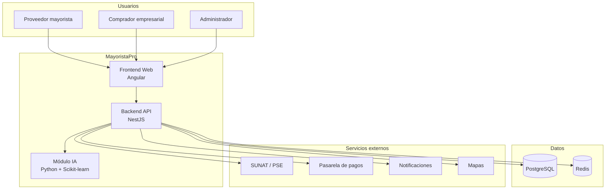
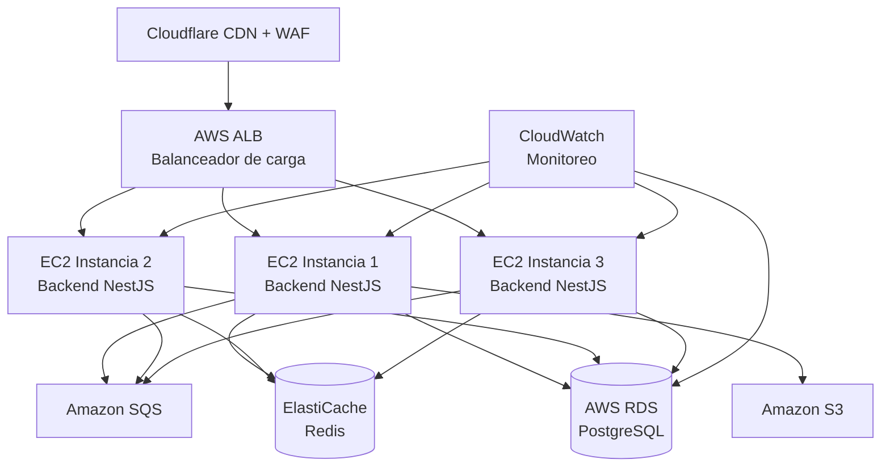

# Arquitectura inicial

Vista general de la arquitectura de MayoristaPro B2B, un marketplace que conecta proveedores mayoristas con compradores empresariales de Ayacucho.

---

## Estilo arquitectónico

MayoristaPro se diseña bajo un estilo de **Monolito Modular con Clean Architecture**, organizado en capas con responsabilidades claramente definidas.

| Capa | Responsabilidad |
|---|---|
| Presentación | Aplicación web responsive (Angular) que interactúa con los usuarios. |
| Aplicación | Casos de uso y coordinación de operaciones comerciales. |
| Dominio | Reglas de negocio (cotizaciones, pedidos, stock, pagos). |
| Infraestructura | Persistencia, caché, colas y servicios externos. |

---

## Vista general del sistema

---

## Módulos del sistema

El backend se organiza en 11 módulos de negocio, cada uno con sus propias capas internas (Dominio, Aplicación, Infraestructura, Presentación):

| Módulo | Responsabilidad principal |
|---|---|
| Usuarios | Registro, autenticación y gestión de cuentas. |
| Proveedores | Verificación y perfil comercial de proveedores. |
| Productos | Publicación, búsqueda y catálogo de productos con precios por volumen. |
| Cotizaciones | Solicitud, respuesta y comparación de cotizaciones entre proveedores. |
| Pedidos | Confirmación, seguimiento y gestión de estados del pedido. |
| Pagos | Integración con pasarela y registro de transacciones. |
| Entregas | Registro de despacho y confirmación de recepción. |
| Incidencias | Registro y seguimiento de reclamos y disputas. |
| Reportes | Dashboards e indicadores para proveedores y administración. |
| IA | Recomendación de proveedores según precio, disponibilidad e historial. |
| Administración | Gestión general de la plataforma y supervisión. |

---

## Decisiones arquitectónicas clave

| Decisión | Justificación |
|---|---|
| Monolito Modular | Consistencia transaccional, equipo pequeño, sin complejidad operativa de microservicios. |
| Clean Architecture | Aislar las reglas de negocio de los detalles tecnológicos (framework, BD, servicios externos). |
| PostgreSQL + Redis | ACID para pedidos/pagos; caché para búsquedas y sesiones en picos de concurrencia. |
| Amazon SQS | Desacoplar tareas secundarias (notificaciones, facturación) del flujo principal. |
| API-First | Frontend Angular y futuras apps móviles consumen los mismos servicios REST. |

---

## Infraestructura de despliegue

