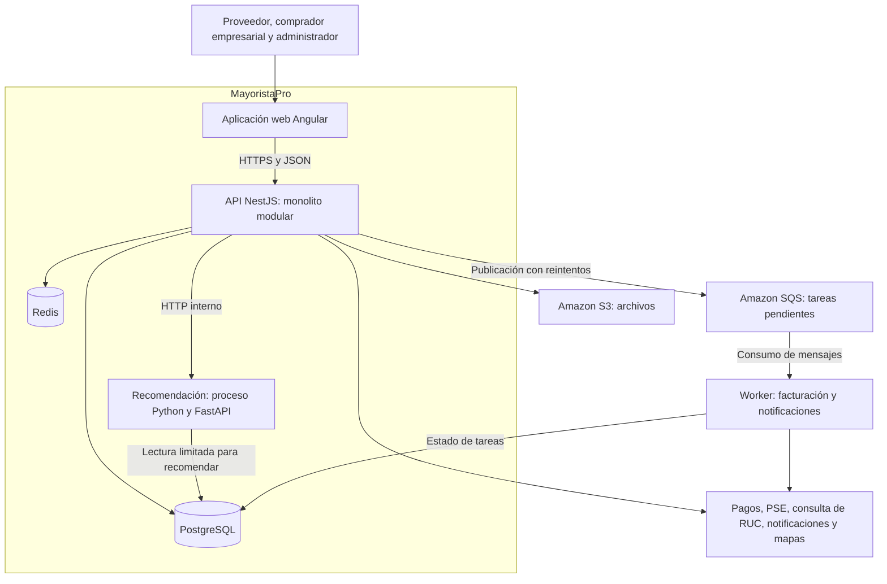

# Arquitectura inicial

MayoristaPro es un marketplace B2B que conecta proveedores mayoristas con negocios compradores de Ayacucho. Esta vista presenta el diseño propuesto; el despliegue y su capacidad se validarán durante la implementación.

## Vista general

Las flechas representan comunicación en ejecución, no dependencias entre clases. La publicación de tareas parte de un registro persistente para poder recuperarlas si falla el envío a la cola.

## Responsabilidad de cada parte

| Parte | Responsabilidad |
|---|---|
| Angular | Interfaz de proveedores, compradores y administradores; consume la API. |
| NestJS | Autoriza operaciones, ejecuta casos de uso y coordina los módulos comerciales. |
| PostgreSQL | Conserva empresas, productos, cotizaciones, pedidos, pagos y auditoría. Es la fuente de verdad del stock. |
| Redis | Caché y estado temporal compartido; no decide si existe stock para confirmar un pedido. |
| Proceso Python | Ordena proveedores mediante reglas explicables; su falla no bloquea la búsqueda. |
| SQS y worker | Procesan tareas posteriores con reintentos y control de duplicados. |
| S3 | Almacena imágenes y documentos con permisos según su uso. |

## Organización del backend

El estilo es **monolito modular**: los módulos comerciales se despliegan juntos. Dentro de cada módulo se aplica **Clean Architecture**: Presentación, Aplicación, Dominio e Infraestructura. El proceso Python es un componente auxiliar separado.

Los módulos y sus responsabilidades se detallan en [Componentes arquitectónicos](componentes-arquitectonicos.md). Las dependencias internas se explican en [Enfoque arquitectónico](enfoque-arquitectonico.md).

## Despliegue propuesto

| Recurso | Uso previsto | Condición |
|---|---|---|
| Cloudflare | DNS, distribución y protección perimetral. | Funciones sujetas al plan disponible. |
| Hosting web | Publicación de los archivos de Angular. | Ubicación y configuración por definir en el despliegue AWS. |
| EC2 y ALB | Ejecutar NestJS y distribuir solicitudes entre instancias cuando se evalúe el escalamiento. | Cantidad y tamaño según pruebas y presupuesto. |
| RDS PostgreSQL | Persistencia transaccional. | Respaldos y restauración deben probarse. |
| Redis | Caché compartida entre instancias. | Hosting administrado o propio según recursos disponibles. |
| S3, SQS y CloudWatch | Archivos, cola y monitoreo. | Verificar acceso y límites de la cuenta educativa. |

**Objetivo de evaluación:** hasta 2,000 usuarios concurrentes según los escenarios de calidad. Este diseño no demuestra esa capacidad ni presupone que tres instancias serán suficientes.
