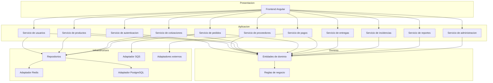
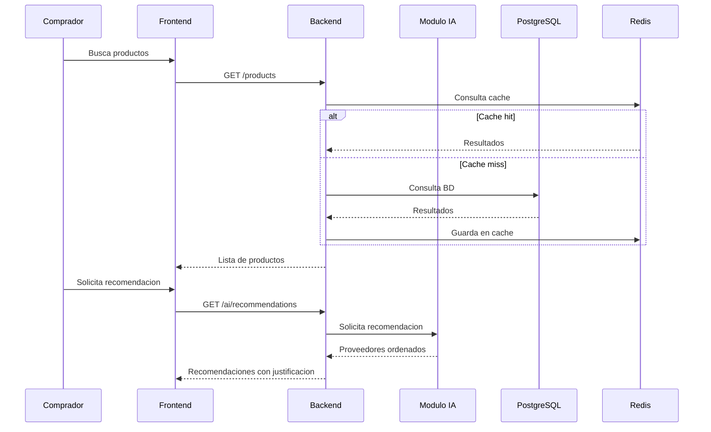
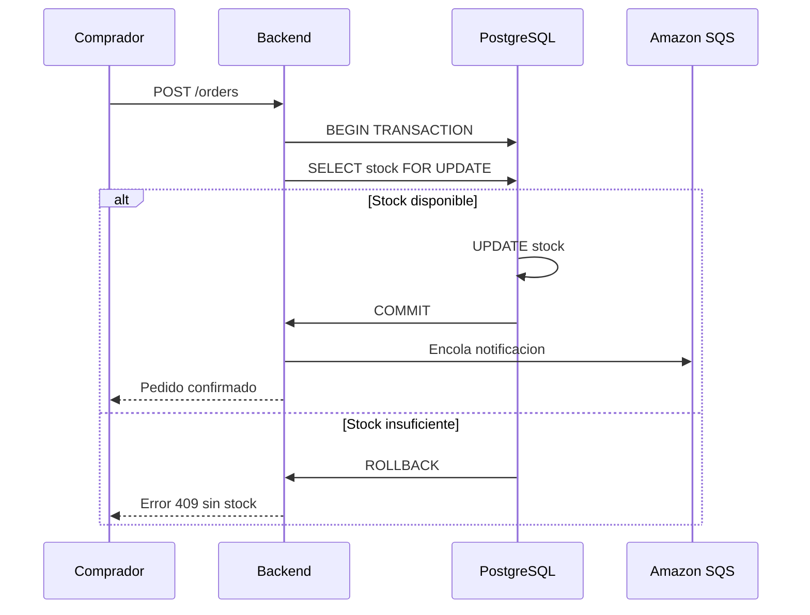

# Componentes arquitectónicos

Descripción de los componentes que conforman la arquitectura de MayoristaPro B2B, organizados por capa según Clean Architecture.

---

## Vista general de componentes

---

## Componentes por capa

### Capa de presentación

| Componente | Tecnología | Responsabilidad |
|---|---|---|
| Frontend Web | Angular + TypeScript | Interfaz de usuario para proveedores, compradores y administradores. |

---

### Capa de aplicación

| Componente | Responsabilidad |
|---|---|
| Servicio de autenticación | Registro, login, generación y validación de tokens JWT. |
| Servicio de usuarios | Gestión de cuentas, roles y permisos. |
| Servicio de proveedores | Verificación de proveedores y gestión de perfil comercial. |
| Servicio de productos | Publicación, actualización y carga masiva de productos. |
| Servicio de cotizaciones | Solicitud, respuesta y comparación de cotizaciones. |
| Servicio de pedidos | Confirmación, seguimiento y gestión de estados. |
| Servicio de pagos | Integración con pasarela y registro de transacciones. |
| Servicio de entregas | Registro de despacho y confirmación de recepción. |
| Servicio de incidencias | Registro y seguimiento de reclamos. |
| Servicio de reportes | Generación de dashboards e indicadores. |
| Servicio de administración | Gestión general de la plataforma. |

---

### Capa de dominio

| Componente | Responsabilidad |
|---|---|
| Entidades de dominio | Modelos de negocio: Usuario, Proveedor, Producto, Cotización, Pedido, Pago, Evaluación. |
| Reglas de negocio | Validaciones: stock disponible, precios por volumen, estados de pedido, control de concurrencia. |

---

### Capa de infraestructura

| Componente | Tecnología | Responsabilidad |
|---|---|---|
| Adaptador PostgreSQL | PostgreSQL | Persistencia transaccional con ACID. |
| Adaptador Redis | Redis | Caché y sesiones. |
| Adaptador SQS | Amazon SQS | Procesamiento asíncrono de tareas. |
| Adaptador PSE | NubeFacT / Alanube | Emisión de comprobantes electrónicos. |
| Adaptador de pagos | Niubiz / Mercado Pago | Procesamiento de pagos. |
| Adaptador de IA | Scikit-learn / API externa | Recomendación de proveedores. |
| Adaptador de notificaciones | Turbo Cloud / Awaitra | Envío de emails y WhatsApp. |
| Adaptador de mapas | OpenStreetMap + MapLibre | Geolocalización de proveedores. |
| Adaptador S3 | Amazon S3 | Almacenamiento de archivos. |

---

## Componentes del módulo de IA

| Componente | Responsabilidad |
|---|---|
| Analizador de necesidades | Procesa la solicitud del comprador (producto, cantidad, ubicación). |
| Evaluador de proveedores | Puntúa proveedores según precio, stock, ubicación e historial. |
| Generador de recomendaciones | Devuelve lista ordenada con justificación. |
| Fallback | Si el servicio de IA no está disponible, el comprador puede seguir buscando y comparando manualmente. |

---

## Interacciones entre componentes

---

## Flujo de confirmación de pedido (concurrencia)

---

## Resumen de componentes

| Capa | Cantidad | Componentes clave |
|---|---|---|
| Presentación | 1 | Frontend Angular |
| Aplicación | 11 | Servicios de negocio |
| Dominio | 2 | Entidades y reglas |
| Infraestructura | 9 | Adaptadores de persistencia, caché, colas y servicios externos |

---

## Principios aplicados

- **Separación de responsabilidades:** cada componente tiene una función clara.
- **Inversión de dependencias:** el dominio no depende de la infraestructura.
- **Desacoplamiento:** los adaptadores externos se pueden sustituir sin afectar el dominio.
- **Modularidad:** los servicios de aplicación están organizados por módulo de negocio.