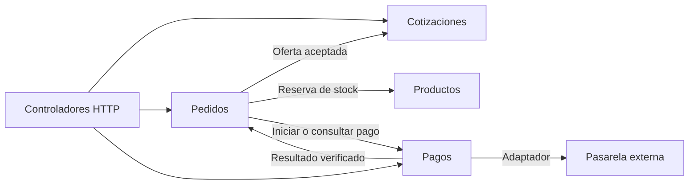
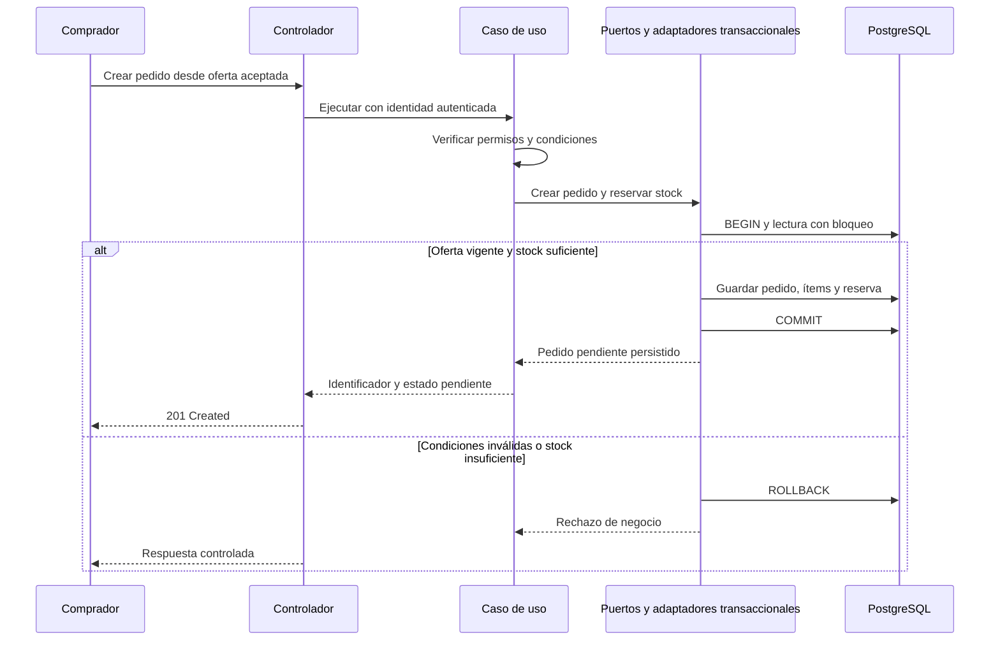

# Componentes arquitectónicos

Esta vista identifica responsabilidades del backend. Los módulos son divisiones lógicas del monolito; no representan un microservicio por funcionalidad.

## Módulos del sistema

| Módulo | Responsabilidad | Ejemplo de operación |
|---|---|---|
| Usuarios | Cuentas, pertenencia a empresas y permisos. | Iniciar sesión y comprobar acceso a un pedido. |
| Proveedores | Perfil, verificación y reputación comercial. | Aprobar un proveedor y consultar sus evaluaciones. |
| Productos | Catálogo, precios por volumen, mínimos de compra y stock. | Publicar una oferta o reservar existencias. |
| Cotizaciones | Solicitudes, respuestas por proveedor y aceptación. | Comparar precios por ítem y condiciones. |
| Pedidos | Pedido de un comprador y un proveedor, condiciones aceptadas y estados. | Crear un pedido pendiente de pago. |
| Pagos | Intentos, referencias y estados de la pasarela externa. | Procesar una confirmación sin duplicar sus efectos. |
| Entregas | Despacho y confirmación de recepción. | Registrar guía y fecha estimada. |
| Incidencias | Reclamos vinculados a operaciones. | Registrar un problema con una entrega. |
| Reportes | Consultas e indicadores autorizados. | Mostrar ventas por período. |
| IA | Coordinar recomendaciones y su alternativa ante fallas. | Consultar el proceso Python mediante un puerto. |
| Administración | Coordinar funciones de supervisión. | Revisar usuarios e incidencias mediante las APIs de sus módulos. |

Facturación y notificaciones son capacidades de integración consumidas mediante puertos y adaptadores. Su ejecución asíncrona se encarga a workers; no agrega once servicios independientes al despliegue.

## Componentes dentro de cada módulo

| Capa | Contenido | Ejemplo en Pedidos |
|---|---|---|
| Presentación | Controladores HTTP, validación de entrada y traducción de respuestas. | Controlador que recibe la solicitud de creación. |
| Aplicación | Casos de uso, autorización de la operación y coordinación de puertos. | Crear pedido y coordinar la reserva. |
| Dominio | Entidades, reglas y contratos del negocio. | Pedido, ítems, estados y repositorio. |
| Infraestructura | Persistencia y adaptadores de proveedores. | Repositorio PostgreSQL y coordinación de la transacción. |

Angular es un cliente separado. Los controladores HTTP de NestJS también pertenecen a la presentación del backend.

## Colaboración principal

Las flechas muestran colaboración en ejecución. Pedidos y Pagos intercambian resultados mediante contratos; el diagrama no autoriza imports circulares ni acceso directo a clases internas de otros módulos.

## Creación de pedido y reserva de stock

La transacción comparte la misma conexión entre las operaciones participantes. La autorización no sustituye la comprobación de precio, oferta y stock dentro de la operación crítica.

## Coordinación posterior

- El pago se realiza fuera de la transacción de PostgreSQL, vinculado al pedido y a un intento persistido e idempotente.
- La confirmación verificada del pago actualiza el estado del pedido. Un timeout deja el resultado pendiente de consulta; no equivale automáticamente a pago rechazado.
- Las reservas requieren vencimiento y liberación controlada. Antes de liberar por un pago incierto, se debe reconciliar su estado.
- Las tareas de notificación y facturación se registran de forma durable antes de publicarlas en SQS. El worker reconoce duplicados para evitar efectos repetidos.
