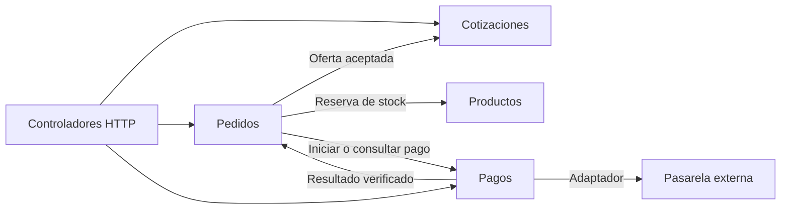
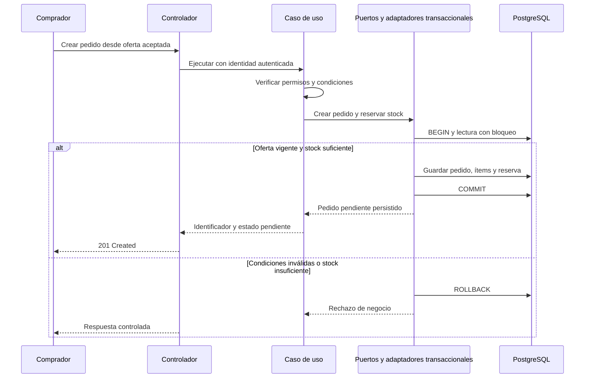

# Componentes arquitectónicos

Esta vista identifica responsabilidades del backend. Los módulos son divisiones lógicas del monolito; no representan un microservicio por funcionalidad.

## Módulos del sistema

| Módulo | Responsabilidad | Ejemplo de operación |
|---|---|---|
| Usuarios | Cuentas, pertenencia a empresas y permisos. | Iniciar sesión y comprobar acceso a un pedido. |
| Proveedores | Perfil, verificación y reputación comercial. | Aprobar un proveedor y consultar sus evaluaciones. |
| Productos | Catálogo, precios por volumen, mínimos de compra y stock. | Publicar una oferta o reservar existencias. |
| Cotizaciones | Solicitudes, respuestas por proveedor y aceptación. | Comparar precios por ítem y condiciones. |
| Pedidos | Pedido de un comprador y un proveedor, condiciones aceptadas y estados. | Crear un pedido pendiente de pago. |
| Pagos | Intentos, referencias y estados de la pasarela externa. | Procesar una confirmación sin duplicar sus efectos. |
| Entregas | Despacho y confirmación de recepción. | Registrar guía y fecha estimada. |
| Incidencias | Reclamos vinculados a operaciones. | Registrar un problema con una entrega. |
| Reportes | Consultas e indicadores autorizados. | Mostrar ventas por período. |
| IA | Coordinar recomendaciones y su alternativa ante fallas. | Consultar el proceso Python mediante un puerto. |
| Administración | Coordinar funciones de supervisión. | Revisar usuarios e incidencias mediante las APIs de sus módulos. |

Facturación y notificaciones son capacidades de integración consumidas mediante puertos y adaptadores. Su ejecución asíncrona se encarga a workers; no agrega once servicios independientes al despliegue.

## Primera versión: MVP

El **Producto Mínimo Viable (MVP)** es una primera versión funcional que permite completar y evaluar el flujo principal de compra mayorista. La tabla anterior representa el alcance general del proyecto; no implica implementar todas las capacidades de cada módulo en la primera entrega de software.

**Estado:** propuesta de priorización pendiente de validación con la docente. No modifica los identificadores ni elimina los requisitos documentados. MVP y Sprint 02 no son equivalentes: su implementación puede distribuirse en varios sprints.

| Módulo o capacidad | Alcance propuesto para el MVP | Ampliación posterior |
|---|---|---|
| Usuarios | Registro, autenticación, empresa y permisos básicos. | Administración avanzada de cuentas. |
| Proveedores y Administración | Perfil comercial, revisión y aprobación básica del proveedor. | Supervisión integral y gestión avanzada de reputación. |
| Productos | Publicación manual, consulta, precios por volumen, mínimos y stock. | Carga masiva y búsqueda avanzada. |
| Cotizaciones | Solicitud, respuesta por proveedor, comparación y aceptación de una oferta. | Opciones adicionales de negociación. |
| Pedidos | Creación desde oferta aceptada, reserva transaccional y consulta de estados. | Flujos comerciales adicionales. |
| Pagos | Una pasarela en sandbox, intento persistido y confirmación verificada, con protección frente a duplicados. | Operación en producción y más medios de pago. |
| Entregas | Registro básico de despacho y confirmación de recepción. | Integraciones logísticas y seguimiento avanzado. |
| IA | Recomendación acotada y explicable con alternativa ante falla. El método debe validarse frente a la exigencia académica. | Modelo entrenado o API externa según datos y evaluación. |
| Reportes e Incidencias | Se mantienen como alcance documentado, fuera del núcleo inicial propuesto. | Dashboards, reportes y seguimiento completo de reclamos. |
| Facturación y notificaciones | Integraciones previstas, con etapa de entrega por acordar según la rúbrica. | Automatización mediante PSE y canales externos. |

### Condiciones académicas y criterio de aceptación

- El MVP contempla despliegue real en **AWS** y evaluación progresiva con **k6 hasta 2,000 usuarios concurrentes**. Son objetivos por comprobar, no capacidad demostrada.
- La puntuación por reglas es un punto de partida; si el requisito de IA exige un modelo entrenado u otra técnica, deberá incorporarse al alcance acordado antes de darlo por cumplido.
- No se posponen requisitos obligatorios de la rúbrica sin acordarlo con la docente. La prioridad del MVP no elimina el alcance general documentado.
- Recorrido a demostrar: una empresa compradora se registra, consulta productos de un proveedor verificado, solicita y acepta una cotización, crea un pedido sin sobreventa, completa un pago sandbox y consulta su despacho y recepción.
- La demostración incluye accesos autorizados, rechazo por stock insuficiente y recuperación ante fallas de pago o recomendación. Los escenarios de calidad detallan las pruebas previstas.

La primera funcionalidad del Sprint 02 será la base de ese recorrido: identidad empresarial, catálogo y pedido con reserva. Las siguientes entregas completarán el MVP acordado.

## Componentes dentro de cada módulo

| Capa | Contenido | Ejemplo en Pedidos |
|---|---|---|
| Presentación | Controladores HTTP, validación de entrada y traducción de respuestas. | Controlador que recibe la solicitud de creación. |
| Aplicación | Casos de uso, autorización de la operación y coordinación de puertos. | Crear pedido y coordinar la reserva. |
| Dominio | Entidades, reglas y contratos del negocio. | Pedido, ítems, estados y repositorio. |
| Infraestructura | Persistencia y adaptadores de proveedores. | Repositorio PostgreSQL y coordinación de la transacción. |

Angular es un cliente separado. Los controladores HTTP de NestJS también pertenecen a la presentación del backend.

## Colaboración principal

Las flechas muestran colaboración en ejecución. Pedidos y Pagos intercambian resultados mediante contratos; el diagrama no autoriza imports circulares ni acceso directo a clases internas de otros módulos.

## Creación de pedido y reserva de stock

La transacción comparte la misma conexión entre las operaciones participantes. La autorización no sustituye la comprobación de precio, oferta y stock dentro de la operación crítica.

## Coordinación posterior

- El pago se realiza fuera de la transacción de PostgreSQL, vinculado al pedido y a un intento persistido e idempotente.
- La confirmación verificada del pago actualiza el estado del pedido. Un timeout deja el resultado pendiente de consulta; no equivale automáticamente a pago rechazado.
- Las reservas requieren vencimiento y liberación controlada. Antes de liberar por un pago incierto, se debe reconciliar su estado.
- Las tareas de notificación y facturación se registran de forma durable antes de publicarlas en SQS. El worker reconoce duplicados para evitar efectos repetidos.
