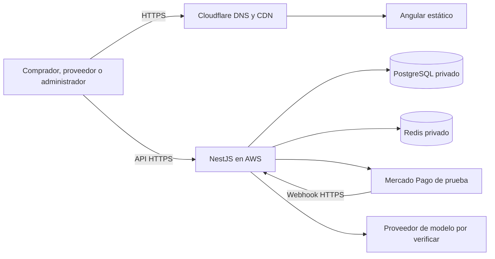

# Despliegue académico y escalabilidad

El entorno público inicial debe permitir la revisión mediante HTTPS hasta la entrega prevista alrededor del 20 de diciembre de 2026. La configuración del dominio y de la API se define por entorno. El C4 completo incluye capacidades de evolución.

| Área | Diseño inicial y evidencia prevista |
|---|---|
| DNS, HTTPS y CDN | Enlace público inicial del proveedor. Cuando haya dominio propio o delegado, configurar DNS, HTTPS y CDN, verificar resolución y registrar evidencias. El alcance del dominio se confirma en D5. |
| Frontend | Compilación Angular estática, archivos versionados y CDN para activos públicos. Medir carga y caché de activos. |
| Backend | Una instancia para la demo. Para comparar escalamiento, probar una y dos réplicas con balanceador, misma versión y base compartida. Evitar depender de estado en memoria entre peticiones. |
| PostgreSQL | Red privada, migraciones, índices y límites de conexiones. Registrar consultas, conexiones, bloqueos y latencia para la comparación. Evaluar aumentos de capacidad con resultados. |
| Caché | Redis para catálogo público con claves por filtros, orden y paginación, TTL y revisión confirmada en PostgreSQL. Publicación, importación, visibilidad y cambios de stock invalidan las claves vigentes. Las escrituras transaccionales consultan PostgreSQL. [SDD y medición](../sprint-2-redis-catalogo.md). |
| Entrega | GitHub Actions para compilar y probar cada cambio. Entorno de despliegue con secretos y verificación de salud. Evidencia de una ejecución, versión y enlace público. |
| Recuperación | Respaldo y restauración probada en entorno aislado. Evaluar RTO/RPO según EQ-02. |

## Recursos y gastos

| Recurso | Verificación previa |
|---|---|
| Lightsail o EC2, balanceador, base administrada y discos | Región, disponibilidad en el plan, productos elegibles, saldo, caducidad y estimación antes de aprovisionar. |
| Redis, S3, CloudWatch y transferencia | Cuotas y cobertura. Elegir servicios según la necesidad del entorno y el presupuesto. |
| Bedrock u otro proveedor | Modelo y región habilitados, cobertura del consumo y costo. Mantener la integración detrás de un puerto. |
| Dominio | El registro de Route 53 se paga aparte del crédito promocional. D5 define si se requiere compra. |

El saldo promocional informado es US$ 100 y el presupuesto personal es aproximadamente S/ 65. El objetivo es reservar saldo para pruebas de carga y mantener el enlace hasta la revisión. Registrar consumos, vigencia, responsables y retirada de recursos temporales. El perfil k6 debe usar datos sintéticos y medir las integraciones externas por separado. [Créditos AWS](https://docs.aws.amazon.com/us_en/awsaccountbilling/latest/aboutv2/useconsolidatedbilling-credits.html) · [Registro de dominios](https://aws.amazon.com/route53/pricing/)

[Plan de medición](../01-analisis-de-sistema/09-plan-de-medicion-calidad.md) · [Decisiones pendientes](../05-preparacion-sprint-2.md)
