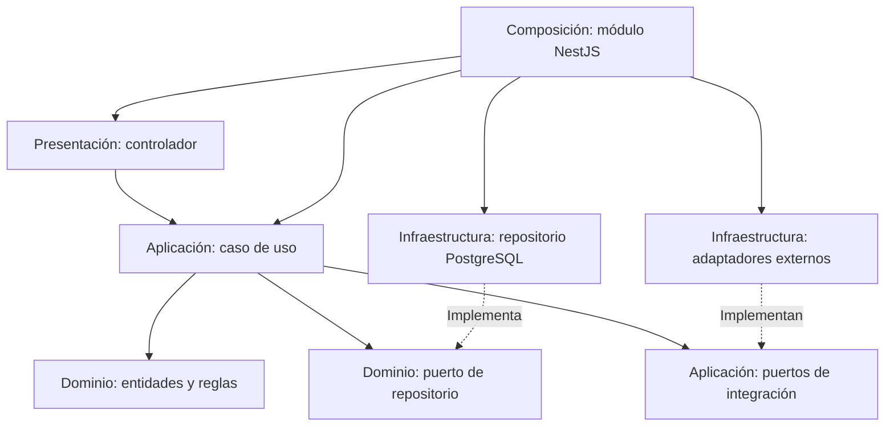

# Enfoque arquitectónico

Se propone **Clean Architecture dentro de cada módulo** para separar las reglas de MayoristaPro de NestJS, PostgreSQL y los proveedores externos (ADR-002).

## Capas y responsabilidades

| Capa | Qué contiene | Ejemplo |
|---|---|---|
| Presentación | Controladores, validación HTTP y mapeo de errores. | Recibir una solicitud de pedido y responder con su estado. |
| Aplicación | Casos de uso y puertos de coordinación e integración. | Autorizar al comprador y coordinar pedido, stock y pago. |
| Dominio | Entidades, objetos de valor, reglas e interfaces de repositorio. | Cantidades positivas, mínimos de compra y transiciones de estado válidas. |
| Infraestructura | Implementaciones de persistencia, transacciones y servicios externos. | SQL de reserva de stock y llamada a la pasarela. |

Los puertos se definen en la capa interna que los necesita: repositorios del modelo en Dominio y contratos de coordinación o servicios externos en Aplicación. El dominio no importa decoradores, ORM ni SDK externos.

## Dependencias del código



Las flechas representan dependencias del código. En ejecución, el caso de uso llama al objeto conectado al puerto; eso no exige importar su implementación concreta. La raíz de composición conecta las piezas mediante inyección de dependencias.

## Organización propuesta

```text
src/
└── modules/
    └── pedidos/
        ├── dominio/          Entidades, reglas y repositorio
        ├── aplicacion/       Casos de uso y puertos de coordinación
        ├── infraestructura/ Persistencia y adaptadores
        ├── presentacion/    Controladores HTTP
        ├── pedidos.module.ts
        └── index.ts         API pública del módulo
```

Los demás módulos siguen el mismo criterio. Angular mantiene sus funcionalidades y acceso HTTP separados de las reglas del backend; la validación del navegador no reemplaza la validación del servidor.

## Ejemplo aplicado

| Paso | Responsable | Motivo |
|---|---|---|
| Recibir productos y cantidades. | Controlador | Traducir HTTP a una entrada del caso de uso. |
| Comprobar identidad y participación en la compra. | Aplicación | Evitar operaciones de empresas no autorizadas. |
| Validar cantidades, mínimos y estados. | Dominio | Concentrar las reglas comerciales. |
| Obtener precios confiables y reservar stock junto al pedido. | Aplicación mediante puertos; Infraestructura ejecuta la transacción. | Evitar confiar en precios enviados por el cliente y prevenir sobreventa. |
| Iniciar el pago externo del pedido persistido. | Aplicación mediante el puerto de Pagos. | Mantener trazabilidad sin retener una transacción SQL durante la llamada externa. |

## Qué se comprobará al implementar

- Dominio y casos de uso no importan implementaciones de infraestructura.
- Las reglas comerciales se prueban sin NestJS, PostgreSQL ni una pasarela real.
- La reserva y el pedido se prueban con PostgreSQL real para verificar atomicidad y concurrencia.
- Reemplazar un adaptador que respeta el contrato no obliga a cambiar las reglas del negocio.

Clean Architecture facilita separar responsabilidades y probarlas; no garantiza por sí sola rendimiento ni elimina el trabajo necesario para cambiar de base de datos o proveedor.
