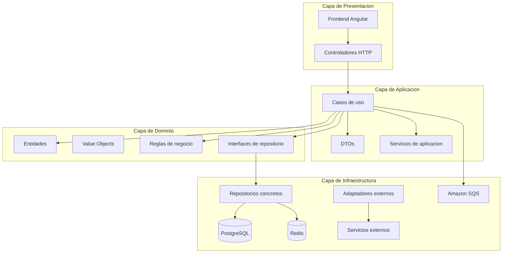
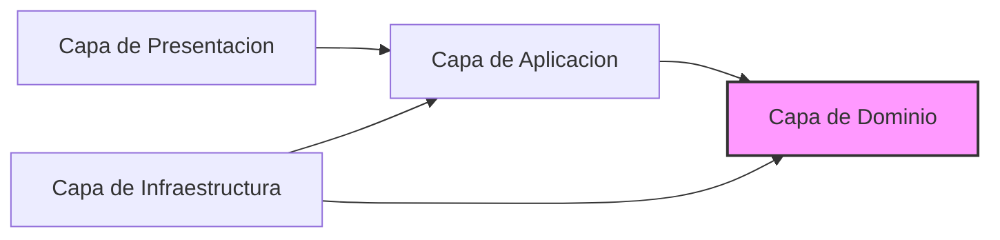
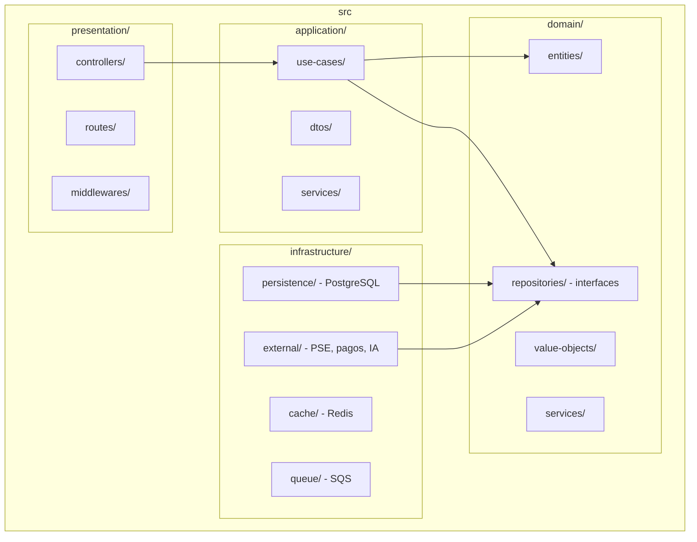
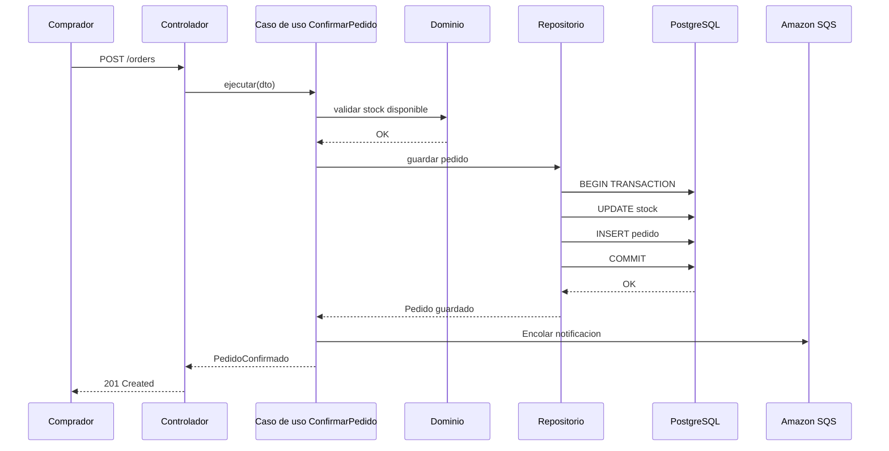

# Enfoque arquitectónico

MayoristaPro B2B se diseña bajo el enfoque de **Clean Architecture**, propuesto por Robert C. Martin, que organiza el sistema en capas concéntricas con dependencias dirigidas hacia el dominio.

---

## Principios de Clean Architecture

| Principio | Aplicación en MayoristaPro |
|---|---|
| Independencia de frameworks | El dominio no depende de NestJS, Angular ni PostgreSQL. |
| Testabilidad | Las reglas de negocio se testean sin BD ni UI. |
| Independencia de la UI | El frontend puede cambiar sin afectar el dominio. |
| Independencia de la BD | PostgreSQL puede reemplazarse sin tocar el dominio. |
| Independencia de agentes externos | Los adaptadores de PSE, pasarela y IA son sustituibles. |

---

## Capas de Clean Architecture

---

## Regla de dependencias

Las dependencias siempre apuntan **hacia el dominio**. Las capas externas conocen a las internas, pero las internas no conocen a las externas.

| Capa | Conoce a | No conoce a |
|---|---|---|
| Presentación | Aplicación | Infraestructura, Dominio directo |
| Aplicación | Dominio | Infraestructura, Presentación |
| Dominio | Nada | Aplicación, Infraestructura, Presentación |
| Infraestructura | Dominio, Aplicación | Presentación |

---

## Estructura de carpetas propuesta

---

## Ejemplo: caso de uso de confirmación de pedido

---

## Beneficios aplicados a MayoristaPro

| Beneficio | Impacto en MayoristaPro |
|---|---|
| Testabilidad | Se testean reglas de cotización y pedido sin BD. |
| Mantenibilidad | Cambios en pasarela de pago no afectan el dominio. |
| Independencia tecnológica | Cambiar de PostgreSQL a otro motor no requiere reescribir casos de uso. |
| Escalabilidad | Los adaptadores se pueden reemplazar por versiones distribuidas en el futuro. |
| Evolución | La IA puede evolucionar de motor de reglas a modelo ML sin tocar el dominio. |

---

## Relación con otros estilos

| Estilo | Relación con Clean Architecture |
|---|---|
| Hexagonal | Compatible. Clean Architecture puede implementarse con puertos y adaptadores. |
| Onion Architecture | Prácticamente equivalente. Misma idea de capas concéntricas. |
| DDD | Complementario. Clean Architecture organiza la estructura; DDD define el modelo. |
| Monolito Modular | Clean Architecture organiza cada módulo internamente. |