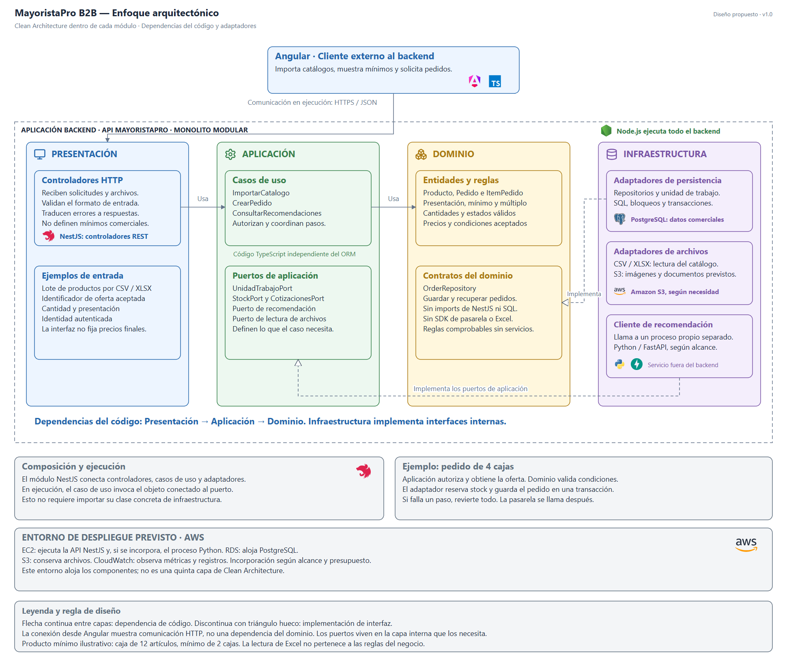
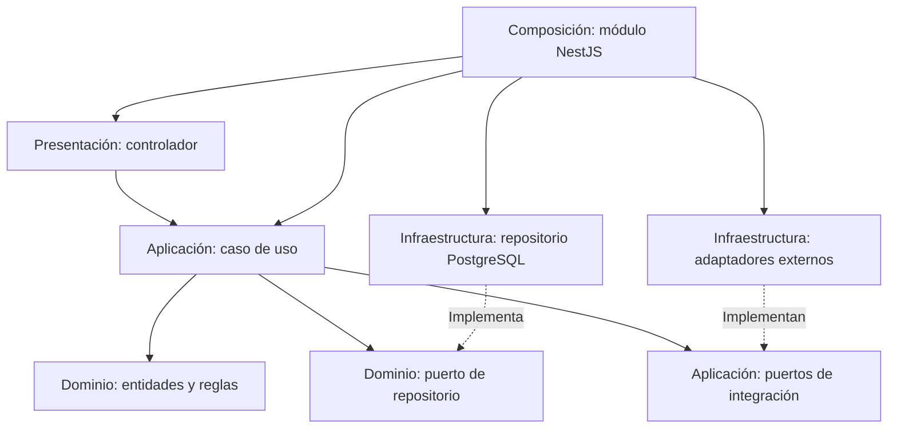

# Enfoque arquitectónico

Se propone **Clean Architecture dentro de cada módulo** para separar las reglas de MayoristaPro de NestJS, PostgreSQL y los proveedores externos (ADR-002).

## Diagrama del enfoque aplicado



**Fuente editable:** [enfoque-arquitectonico.svg](../../img/fuentes-svg/enfoque-arquitectonico.svg).

Los iconos identifican las responsabilidades de cada capa. Los logos ubican Angular y TypeScript en el cliente, NestJS en controladores y composición, Node.js como entorno de ejecución y PostgreSQL en persistencia. AWS, Python y FastAPI representan tecnologías previstas según alcance; el dominio conserva sus reglas sin depender de esas herramientas. Recursos gráficos: [Lucide](https://github.com/lucide-icons/lucide) y [Devicon](https://github.com/devicons/devicon), con licencias conservadas junto a los recursos.

La caja **Aplicación backend** contiene las cuatro capas y se ejecuta en Node.js. No debe confundirse con la **capa Aplicación**, que solo agrupa casos de uso y sus puertos. PostgreSQL aparece junto a persistencia; S3 junto al adaptador de archivos; Python/FastAPI junto al cliente que consulta ese proceso separado. La franja AWS describe dónde se alojan los componentes y qué servicio cumple cada función.

**Lectura:** el cliente Angular está fuera del backend. Presentación usa Aplicación y esta usa Dominio. Infraestructura implementa los contratos internos, no al revés. La composición de NestJS conecta las implementaciones. Los ejemplos de importación, mínimos y pedidos muestran responsabilidades; no representan una cadena obligatoria de cuatro llamadas de izquierda a derecha.

## Capas y responsabilidades

| Capa | Qué contiene | Ejemplo |
|---|---|---|
| Presentación | Controladores, validación HTTP y mapeo de errores. | Recibir una solicitud de pedido y responder con su estado. |
| Aplicación | Casos de uso y puertos de coordinación e integración. | Autorizar al comprador y coordinar pedido, stock y pago. |
| Dominio | Entidades, objetos de valor, reglas e interfaces de repositorio. | Cantidades positivas, mínimos de compra y transiciones de estado válidas. |
| Infraestructura | Implementaciones de persistencia, transacciones y servicios externos. | SQL de reserva de stock y llamada a la pasarela. |

Los puertos se definen en la capa interna que los necesita: repositorios del modelo en Dominio y contratos de coordinación o servicios externos en Aplicación. El dominio no importa decoradores, ORM ni SDK externos.

## Dependencias del código



Las flechas representan dependencias del código. En ejecución, el caso de uso llama al objeto conectado al puerto; eso no exige importar su implementación concreta. La raíz de composición conecta las piezas mediante inyección de dependencias.

## Organización propuesta

```text
src/
└── modules/
    └── pedidos/
        ├── dominio/          Entidades, reglas y repositorio
        ├── aplicacion/       Casos de uso y puertos de coordinación
        ├── infraestructura/ Persistencia y adaptadores
        ├── presentacion/    Controladores HTTP
        ├── pedidos.module.ts
        └── index.ts         API pública del módulo
```

Los demás módulos siguen el mismo criterio. Angular mantiene sus funcionalidades y acceso HTTP separados de las reglas del backend; la validación del navegador no reemplaza la validación del servidor.

## Ejemplo aplicado

| Paso | Responsable | Motivo |
|---|---|---|
| Recibir productos y cantidades. | Controlador | Traducir HTTP a una entrada del caso de uso. |
| Comprobar identidad y participación en la compra. | Aplicación | Evitar operaciones de empresas no autorizadas. |
| Validar cantidades, mínimos y estados. | Dominio | Concentrar las reglas comerciales. |
| Obtener precios confiables y reservar stock junto al pedido. | Aplicación mediante puertos; Infraestructura ejecuta la transacción. | Evitar confiar en precios enviados por el cliente y prevenir sobreventa. |
| Iniciar el pago externo del pedido persistido. | Aplicación mediante el puerto de Pagos. | Mantener trazabilidad sin retener una transacción SQL durante la llamada externa. |

## Qué se comprobará al implementar

Los casos mayoristas concretan la separación de capas:

| Caso | Presentación | Aplicación | Dominio | Infraestructura |
|---|---|---|---|---|
| Importar catálogo | Carga de archivo y vista previa. | Autoriza al proveedor y coordina validación y confirmación. | SKU propio, presentación, mínimos y múltiplos coherentes. | Lee CSV/Excel como datos y persiste el lote. |
| Crear pedido | Recibe oferta aceptada e informa errores. | Coordina Cotizaciones, Productos y unidad de trabajo. | Cantidad mayorista y condiciones del pedido. | Bloquea y persiste en una conexión PostgreSQL. |
| Mostrar recomendados | Tarjetas con precio, mínimo y motivo del orden. | Filtra elegibilidad y consulta el puerto de recomendación. | Condiciones comerciales de una oferta apta. | Obtiene datos autorizados y, si se incorpora, consulta Python. |

Excel es un formato de entrada: las reglas comerciales no dependen de él. Las mismas validaciones se aplican a importación, edición y compra. Detalle: [operación mayorista](../03-diseno-de-software/reglas-comerciales-mayoristas.md).

- Dominio y casos de uso no importan implementaciones de infraestructura.
- Las reglas comerciales se prueban sin NestJS, PostgreSQL ni una pasarela real.
- La reserva y el pedido se prueban con PostgreSQL real para verificar atomicidad y concurrencia.
- Reemplazar un adaptador que respeta el contrato no obliga a cambiar las reglas del negocio.

Clean Architecture facilita separar responsabilidades y probarlas; no garantiza por sí sola rendimiento ni elimina el trabajo necesario para cambiar de base de datos o proveedor.
