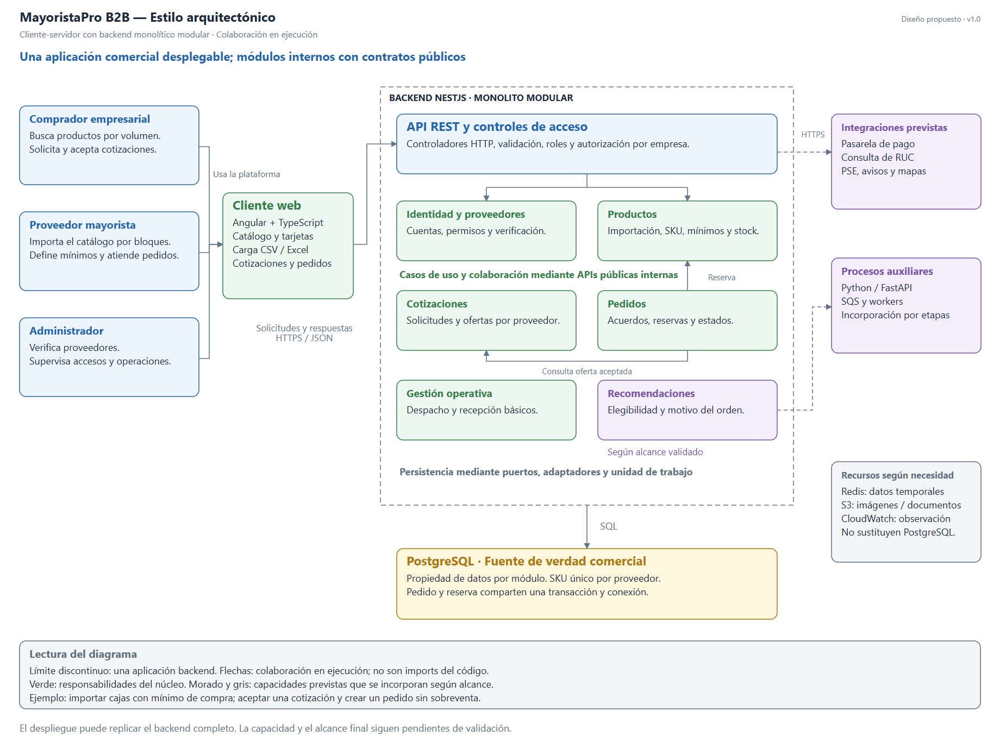
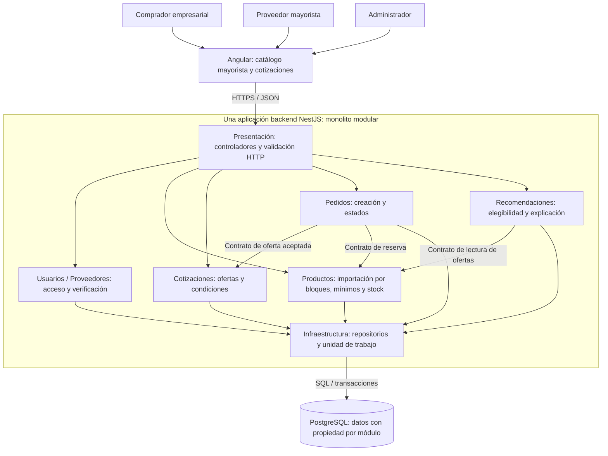
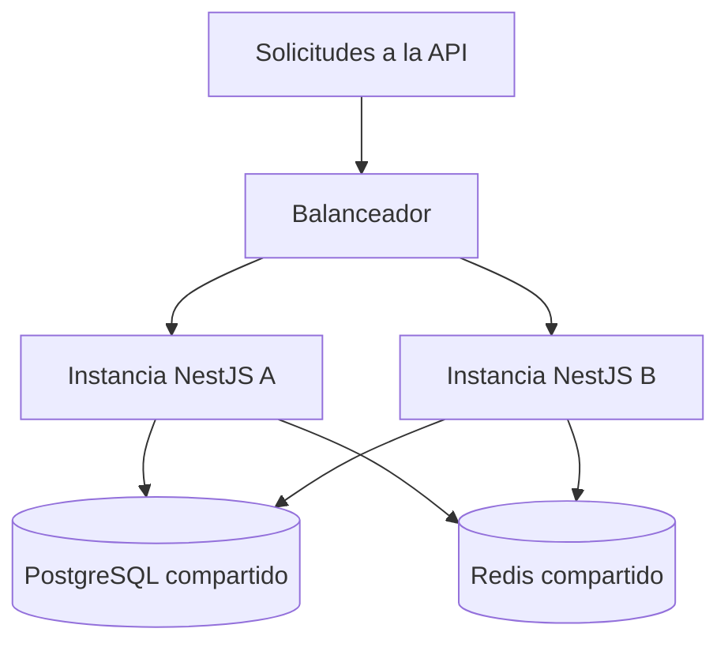

# Estilo arquitectónico

El backend comercial de MayoristaPro se propone como un **monolito modular**: una aplicación NestJS organizada en módulos con responsabilidades y APIs públicas definidas (ADR-001).

## Estructura del estilo aplicado

**Fuente editable:** [estilo-arquitectonico.svg](../../img/fuentes-svg/estilo-arquitectonico.svg).

**Lectura:** de izquierda a derecha, los usuarios operan en Angular, que consume una única API comercial. El límite discontinuo agrupa los módulos del backend. PostgreSQL sostiene la consistencia de pedido y reserva; los recursos y servicios previstos se distinguen del núcleo. Las flechas muestran colaboración durante la ejecución.

Angular funciona como cliente y consume la API mediante HTTPS/JSON. Dentro del backend, cada módulo comercial conserva sus reglas y expone contratos públicos. Los módulos se construyen y despliegan como una aplicación, aunque el backend pueda replicarse en varias instancias. Una base PostgreSQL compartida mantiene propiedad de datos por módulo.

Las flechas muestran colaboración en ejecución, no autorización para que el dominio importe infraestructura. Cada módulo aplica las capas de [Clean Architecture](enfoque-arquitectonico.md): Presentación, Aplicación, Dominio e Infraestructura. En código, los adaptadores implementan puertos internos y NestJS conecta esas implementaciones. Pagos, Python y tareas asíncronas pertenecen a la visión ampliada y se incorporarán según el alcance acordado.

## Cómo responde a la operación B2B

| Necesidad comercial | Colaboración dentro del monolito | Razón arquitectónica |
|---|---|---|
| El mayorista incorpora su catálogo por bloques. | Productos valida una plantilla, muestra errores y confirma el lote autorizado. | Un caso de uso coordina validación, unicidad y persistencia sin crear un servicio independiente. |
| El comprador solicita cantidades mayoristas. | Productos define presentación, mínimo y múltiplo; Cotizaciones conserva la oferta; Pedidos revalida al reservar. | Los contratos permiten compartir reglas sin duplicarlas en cada controlador. |
| Dos compradores intentan reservar las mismas existencias. | Pedidos y Productos participan en una unidad de trabajo con la misma conexión PostgreSQL. | Una transacción local guarda pedido y reserva o revierte todo. |
| El comprador consulta proveedores recomendados. | Recomendaciones obtiene ofertas elegibles y devuelve motivos del orden. | La interfaz no necesita conocer cómo se calcula la puntuación ni acceder directamente a tablas privadas. |

El detalle comercial está en [operación mayorista](../03-diseno-de-software/reglas-comerciales-mayoristas.md).

## Ejemplo completo: cotizar y comprar cajas de cuadernos

1. El proveedor importa un catálogo. Una fila declara una caja de 12 cuadernos, mínimo de 2 cajas, múltiplo de 1 y stock de 20 cajas. Productos valida y registra el lote.
2. El comprador consulta 4 cajas. El catálogo muestra presentación, precio y mínimo. Si existe recomendación, considera únicamente proveedores capaces de atender esa cantidad.
3. Cotizaciones guarda la solicitud y la respuesta del proveedor. El comprador acepta una oferta vigente; todavía no se descuenta stock.
4. Pedidos autoriza al comprador y solicita a Cotizaciones las condiciones aceptadas mediante su contrato público.
5. La unidad de trabajo inicia la transacción. Productos revalida mínimo, múltiplo y disponibilidad, y bloquea las existencias. Los adaptadores guardan pedido, ítems y reserva y reducen stock de 20 a 16 cajas en la misma conexión.
6. Si alguna operación falla, se ejecuta ROLLBACK. Si termina correctamente, COMMIT y respuesta con el pedido pendiente. Cualquier pago externo ocurre después y necesita confirmación verificable y reconciliación.

El ejemplo explica el beneficio de este estilo: separar responsabilidades comerciales manteniendo una transacción local para el proceso crítico. Los números ilustran el diseño, no una prueba ejecutada.

## Alternativas consideradas

| Alternativa | Evaluación para MayoristaPro |
|---|---|
| Monolito sin límites de módulos | Ofrece un despliegue simple, pero facilita mezclar reglas, consultas y permisos entre funcionalidades. Se elige modularidad explícita para reducir ese riesgo. |
| Monolito modular elegido | Reduce la coordinación operativa inicial y permite transacciones locales. Exige disciplina en imports, contratos y propiedad de datos. |
| Microservicios por módulo | Permiten despliegue independiente, pero agregan comunicación remota y coordinación de datos. Su costo de operación requiere una necesidad comprobada antes de adoptarlos. |

La elección no demuestra por sí sola rendimiento ni garantiza llegar a 2,000 usuarios. Se comprobará con el [plan de medición](../01-analisis-de-sistema/09-plan-de-medicion-calidad.md).

## Características

| Aspecto | Aplicación en MayoristaPro |
|---|---|
| Despliegue | Los módulos comerciales se entregan juntos como backend. |
| Organización | Usuarios, Proveedores, Productos, Cotizaciones, Pedidos, Pagos y módulos de apoyo. |
| Comunicación interna | Llamadas a contratos públicos en memoria; sin acceder a detalles privados de otros módulos. |
| Persistencia | PostgreSQL compartido con propiedad de tablas definida por módulo. |
| Estructura interna | Clean Architecture en cada módulo. |
| Escalamiento | Varias instancias del mismo backend detrás de un balanceador, si las pruebas lo justifican. |
| Componentes auxiliares | Proceso Python de recomendación y workers asíncronos; su ejecución separada no divide el negocio completo en microservicios. |

## Justificación

| Necesidad | Decisión y beneficio | Driver |
|---|---|---|
| Equipo y plazo académico limitados. | Una aplicación comercial reduce la coordinación de despliegues. | DA09, DA12 |
| Stock y pedidos consistentes. | Permite una transacción local coordinada entre módulos. | DA03, DA11 |
| Evolucionar funcionalidades. | Límites explícitos ayudan a localizar cambios y pruebas. | DA09 |
| Evaluar alta concurrencia. | Se puede replicar el backend y medir los cuellos de botella. | DA01, DA02 |

Se descarta una separación general en microservicios en esta etapa por el trabajo adicional de comunicación, consistencia y operación. Los microservicios no requieren obligatoriamente Kubernetes ni equipos separados; su elección debe responder a una necesidad concreta.

## Reglas de modularidad

| Regla | Ejemplo |
|---|---|
| Usar la API pública del módulo. | Pedidos solicita una reserva a Productos mediante su contrato. |
| No consultar tablas ajenas directamente desde otro módulo. | Reportes usa contratos de consulta o proyecciones acordadas. |
| Coordinar transacciones desde Aplicación. | Pedido y reserva utilizan la misma transacción mediante puertos. |
| Evitar dependencias circulares. | Los resultados de pago se reciben por contratos o eventos definidos. |
| Mantener el núcleo compartido pequeño. | Identificadores y errores comunes; no entidades que acoplen todo el negocio. |

Un comprador y un proveedor pueden compartir acceso autorizado a un pedido. La modularidad y el aislamiento por empresa son controles diferentes: uno organiza el código y el otro protege la información.

## Escalamiento propuesto

Las instancias no mantienen sesiones necesarias únicamente en memoria local. Replicar el backend también exige controlar conexiones a la base de datos, consultas y contención sobre stock. El dibujo ilustra la estrategia; no fija la cantidad final de instancias.

## Límites y evolución

| Límite | Tratamiento |
|---|---|
| Se despliegan juntos los módulos comerciales. | Pruebas de regresión y entregas controladas. |
| El escalamiento del backend es conjunto. | Medir antes de separar un módulo por carga. |
| Puede aparecer acoplamiento entre módulos. | Revisar APIs públicas, imports y propiedad de tablas. |
| El pago pertenece a un sistema externo. | Idempotencia, consulta de estados y recuperación; no queda cubierto por la transacción local. |

Se evaluará extraer un módulo si existen necesidades medidas de escalamiento o despliegue independiente. Esa extracción requiere trabajo de contratos, datos y operación; no se considera automática.
