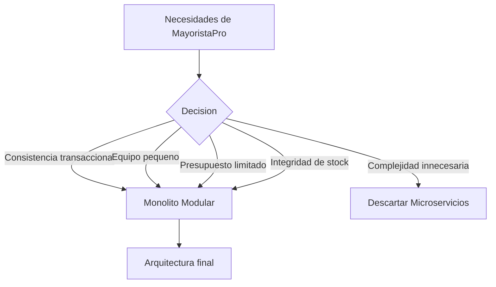
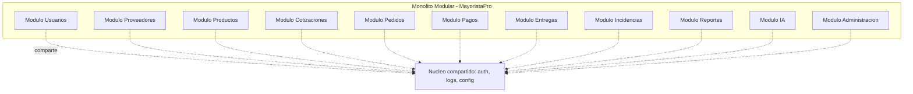
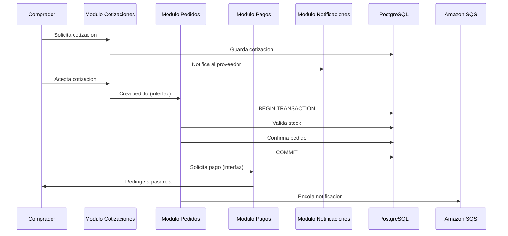
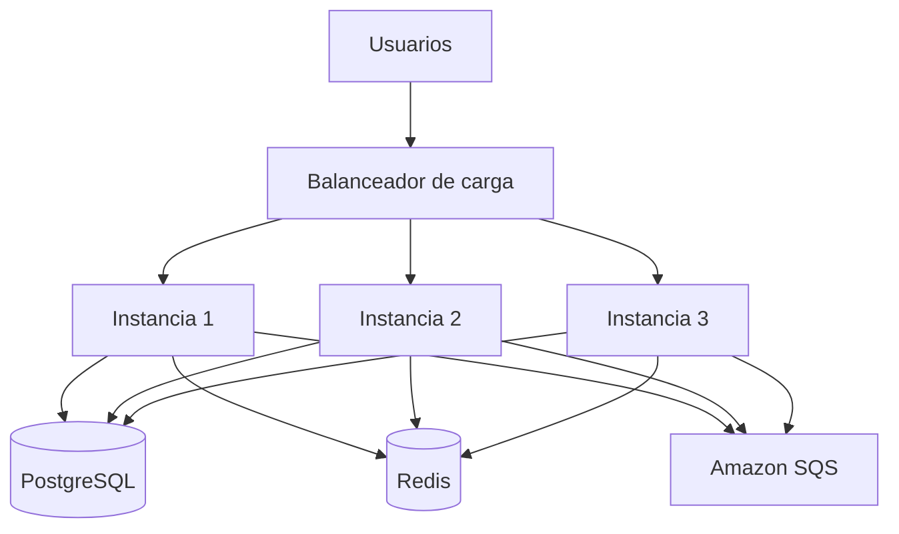

# Estilo arquitectónico

MayoristaPro B2B se diseña bajo el estilo de **Monolito Modular**, una variante del monolito tradicional en la que el sistema se organiza internamente en módulos independientes y desacoplados, desplegados como una sola aplicación.

---

## Definición del estilo

| Aspecto | Descripción |
|---|---|
| Tipo | Monolito con modularidad interna |
| Despliegue | Una sola aplicación desplegable |
| Organización | Módulos independientes con responsabilidades claras |
| Comunicación | En memoria entre módulos, API REST hacia el exterior |
| Persistencia | Base de datos compartida (PostgreSQL) con esquemas bien definidos |
| Escalabilidad | Horizontal: múltiples instancias detrás de un balanceador |

---

## Comparación con otros estilos

| Criterio | Monolito tradicional | Monolito Modular | Microservicios |
|---|---|---|---|
| Despliegue | Único | Único | Múltiple |
| Modularidad | Baja | Alta | Muy alta |
| Complejidad operativa | Baja | Baja | Alta |
| Consistencia transaccional | Fácil (ACID) | Fácil (ACID) | Difícil (sagas) |
| Escalabilidad | Vertical | Horizontal | Horizontal |
| Costo operativo | Bajo | Bajo | Alto |
| Equipo requerido | Pequeño | Pequeño/Mediano | Grande |
| Adecuado para MayoristaPro | No | **Sí** | No |

---

## Justificación de la elección

### Razones principales

| Razón | Explicación |
|---|---|
| Consistencia transaccional | Los pedidos, pagos y stock requieren transacciones ACID. En microservicios se necesitarían sagas y compensaciones. |
| Equipo pequeño | Un solo desarrollador o equipo reducido. Microservicios requieren equipos por servicio. |
| Complejidad operativa | Microservicios requieren orquestación (Kubernetes), service mesh y tracing distribuido. |
| Presupuesto limitado | Microservicios implican mayor costo cloud (múltiples instancias, más monitoreo). |
| Consistencia del dominio | Las reglas de negocio de cotización y pedido están acopladas. Dividirlas en microservicios sería artificial. |
| Evolución posible | Los módulos pueden extraerse a microservicios en el futuro si el volumen lo justifica. |

---

## Módulos del monolito

---

## Reglas de modularidad

| Regla | Descripción |
|---|---|
| Aislamiento de dominio | Cada módulo define su propio modelo de dominio. No comparte entidades con otros módulos. |
| Comunicación por interfaces | Los módulos se comunican mediante interfaces bien definidas, no acceden directamente a las tablas del otro. |
| Transacciones compartidas | Las operaciones que involucran múltiples módulos se coordinan en un caso de uso de aplicación. |
| Dependencias unidireccionales | Un módulo no debe depender circularmente de otro. |
| Independencia de despliegue (futura) | Cada módulo está diseñado para poder extraerse a un servicio independiente sin reescribir lógica. |

---

## Ejemplo de comunicación entre módulos

---

## Escalabilidad del monolito modular

El monolito modular se despliega en múltiples instancias idénticas detrás de un balanceador. Las sesiones y la caché se almacenan en Redis para evitar dependencia de instancias específicas.

---

## Beneficios del estilo

| Beneficio | Impacto en MayoristaPro |
|---|---|
| Simplicidad operativa | Un solo pipeline de despliegue, un solo monitoreo. |
| Consistencia transaccional | Transacciones ACID sin necesidad de sagas. |
| Bajo costo | Menos recursos cloud que microservicios. |
| Velocidad de desarrollo | No hay que coordinar múltiples repositorios ni despliegues. |
| Evolución gradual | Los módulos pueden extraerse en el futuro sin reescribir. |
| Testabilidad | Los módulos se testean de forma aislada. |

---

## Desventajas y mitigaciones

| Desventaja | Mitigación |
|---|---|
| Escalabilidad menos granular | Escalabilidad horizontal del monolito completo. |
| Acoplamiento potencial | Reglas estrictas de modularidad y revisión de dependencias. |
| Despliegue de todo el sistema | Se acepta como trade-off por la simplicidad operativa. |
| Tamaño del repositorio | Organización clara en carpetas por módulo y capa. |

---

## Cuándo migrar a microservicios

La arquitectura está preparada para evolucionar. Se consideraría migrar a microservicios si:

- El equipo crece significativamente (varios equipos por dominio).
- El volumen de tráfico requiere escalado granular por módulo.
- Surgen necesidades de despliegue independiente por módulo.
- Aparecen límites claros entre dominios que justifiquen separación física.