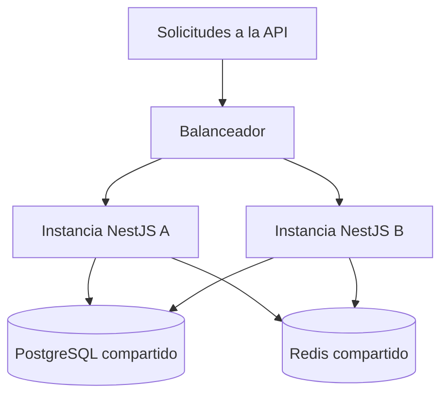

# Estilo arquitectónico

El backend comercial de MayoristaPro se propone como un **monolito modular**: una aplicación NestJS organizada en módulos con responsabilidades y APIs públicas definidas (ADR-001).

## Características

| Aspecto | Aplicación en MayoristaPro |
|---|---|
| Despliegue | Los módulos comerciales se entregan juntos como backend. |
| Organización | Usuarios, Proveedores, Productos, Cotizaciones, Pedidos, Pagos y módulos de apoyo. |
| Comunicación interna | Llamadas a contratos públicos en memoria; sin acceder a detalles privados de otros módulos. |
| Persistencia | PostgreSQL compartido con propiedad de tablas definida por módulo. |
| Estructura interna | Clean Architecture en cada módulo. |
| Escalamiento | Varias instancias del mismo backend detrás de un balanceador, si las pruebas lo justifican. |
| Componentes auxiliares | Proceso Python de recomendación y workers asíncronos; su ejecución separada no divide el negocio completo en microservicios. |

## Justificación

| Necesidad | Decisión y beneficio | Driver |
|---|---|---|
| Equipo y plazo académico limitados. | Una aplicación comercial reduce la coordinación de despliegues. | DA09, DA12 |
| Stock y pedidos consistentes. | Permite una transacción local coordinada entre módulos. | DA03, DA11 |
| Evolucionar funcionalidades. | Límites explícitos ayudan a localizar cambios y pruebas. | DA09 |
| Evaluar alta concurrencia. | Se puede replicar el backend y medir los cuellos de botella. | DA01, DA02 |

Se descarta una separación general en microservicios en esta etapa por el trabajo adicional de comunicación, consistencia y operación. Los microservicios no requieren obligatoriamente Kubernetes ni equipos separados; su elección debe responder a una necesidad concreta.

## Reglas de modularidad

| Regla | Ejemplo |
|---|---|
| Usar la API pública del módulo. | Pedidos solicita una reserva a Productos mediante su contrato. |
| No consultar tablas ajenas directamente desde otro módulo. | Reportes usa contratos de consulta o proyecciones acordadas. |
| Coordinar transacciones desde Aplicación. | Pedido y reserva utilizan la misma transacción mediante puertos. |
| Evitar dependencias circulares. | Los resultados de pago se reciben por contratos o eventos definidos. |
| Mantener el núcleo compartido pequeño. | Identificadores y errores comunes; no entidades que acoplen todo el negocio. |

Un comprador y un proveedor pueden compartir acceso autorizado a un pedido. La modularidad y el aislamiento por empresa son controles diferentes: uno organiza el código y el otro protege la información.

## Escalamiento propuesto

Las instancias no mantienen sesiones necesarias únicamente en memoria local. Replicar el backend también exige controlar conexiones a la base de datos, consultas y contención sobre stock. El dibujo ilustra la estrategia; no fija la cantidad final de instancias.

## Límites y evolución

| Límite | Tratamiento |
|---|---|
| Se despliegan juntos los módulos comerciales. | Pruebas de regresión y entregas controladas. |
| El escalamiento del backend es conjunto. | Medir antes de separar un módulo por carga. |
| Puede aparecer acoplamiento entre módulos. | Revisar APIs públicas, imports y propiedad de tablas. |
| El pago pertenece a un sistema externo. | Idempotencia, consulta de estados y recuperación; no queda cubierto por la transacción local. |

Se evaluará extraer un módulo si existen necesidades medidas de escalamiento o despliegue independiente. Esa extracción requiere trabajo de contratos, datos y operación; no se considera automática.
