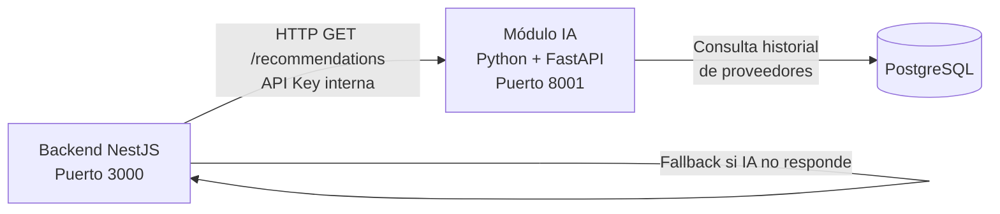
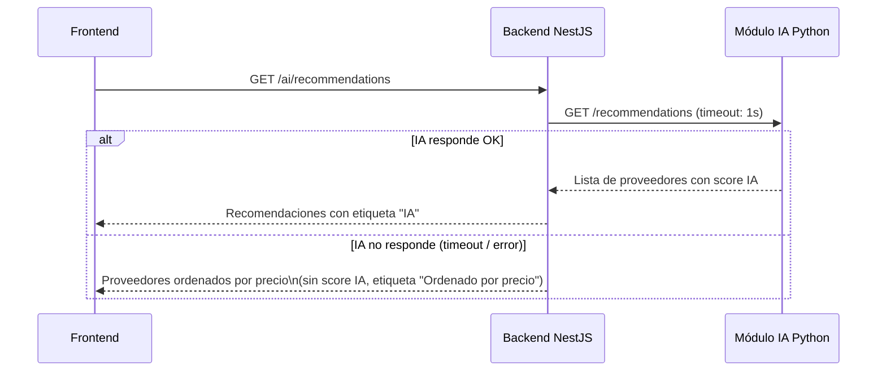

# Módulo de IA — Decisión de despliegue

> **Proyecto:** MayoristaPro B2B  
> **Versión:** 1.0  
> **Relacionado con:** ADR-007, ADR-001, Nivel 2 C4

---

## Contexto

En distintos documentos del proyecto aparecía ambigüedad sobre si el Módulo de IA es:

- **Opción A:** un módulo interno del backend NestJS (solo TypeScript).
- **Opción B:** un proceso Python independiente que se comunica con el backend por HTTP.

Este documento cierra esa ambigüedad y define la arquitectura oficial para v1 y v2.

---

## Decisión para v1

El Módulo de IA se implementa como un **proceso Python separado** (microservicio ligero), no como código TypeScript dentro del backend NestJS.

**Razón:** Scikit-learn es una biblioteca Python. Incrustarla dentro del proceso NestJS requeriría llamadas a shell o puentes Node-Python, lo que introduce complejidad y fragilidad. Es más limpio y simple ejecutarla como un servicio HTTP propio.

| Aspecto | Decisión |
|---|---|
| Tecnología | Python 3.11 + Scikit-learn + FastAPI |
| Despliegue | Proceso Python separado en la misma instancia EC2 (misma VPC) |
| Comunicación con backend | HTTP interno (`http://localhost:8001` o IP privada) |
| Protocolo | REST (JSON) |
| Puerto | 8001 (configurable por variable de entorno) |
| Autenticación | API Key interna (no expuesto a Internet) |

### ¿Por qué FastAPI y no Flask?

FastAPI genera documentación OpenAPI automáticamente, soporta async/await y tiene mejor rendimiento. La elección es pragmática para un servicio pequeño.

---

## Arquitectura de v1



### Flujo de recomendación

1. El comprador solicita recomendaciones desde el frontend.
2. El backend NestJS llama a `GET http://ia-service:8001/recommendations?producto=X&cantidad=Y&ubicacion=Z`.
3. El módulo IA consulta proveedores desde PostgreSQL y calcula puntuaciones con Scikit-learn.
4. Devuelve una lista ordenada con justificación en JSON.
5. Si el módulo IA no responde en 1 segundo, el backend activa el **fallback**: devuelve proveedores ordenados por precio sin puntuación IA.

---

## Estructura del módulo IA

```text
modules/
└── ia/
    ├── main.py                   Entrada FastAPI
    ├── routes/
    │   └── recommendations.py   Endpoint GET /recommendations
    ├── domain/
    │   ├── proveedor.py          Modelo de datos del proveedor
    │   └── recomendacion.py      Resultado de recomendación
    ├── application/
    │   └── recomendar.py         Lógica de puntuación con Scikit-learn
    ├── infrastructure/
    │   └── postgres_repo.py      Consulta proveedores desde PostgreSQL
    └── requirements.txt          fastapi, scikit-learn, psycopg2, uvicorn
```

---

## Fallback (ADR-007)



El usuario no ve un error. El sistema informa sutilmente que las recomendaciones inteligentes no están disponibles en ese momento.

---

## Evolución a v2

En v2, si el volumen de datos justifica un modelo ML más sofisticado, el Módulo IA puede:

1. Reemplazarse por una llamada a una API externa (OpenAI, DeepSeek, Cohere) sin tocar el backend NestJS, solo cambiando el adaptador.
2. Desplegarse en una instancia EC2 dedicada o en AWS Lambda (si el tiempo de inferencia lo permite).
3. Incorporar un modelo de recomendación entrenado con datos reales de la plataforma (collaborative filtering).

En todos los casos, la interfaz HTTP que expone permanece igual, por lo que el backend NestJS no necesita cambios.

---

## Impacto en otros documentos

| Documento | Ajuste aplicado |
|---|---|
| `01-actores.md` | Servicio de IA descrito como proceso Python interno (corregido). |
| `arquitectura-inicial.md` | Diagrama muestra Módulo IA como proceso separado dentro de MayoristaPro (corregido). |
| `Nivel2-Diagrama-de-Contenedores.md` | Módulo IA aparece como contenedor "Servicio interno (Python + FastAPI)" (consistente). |
| ADR-007 | Decisión original mantiene la intención; este documento agrega el detalle de implementación. |
