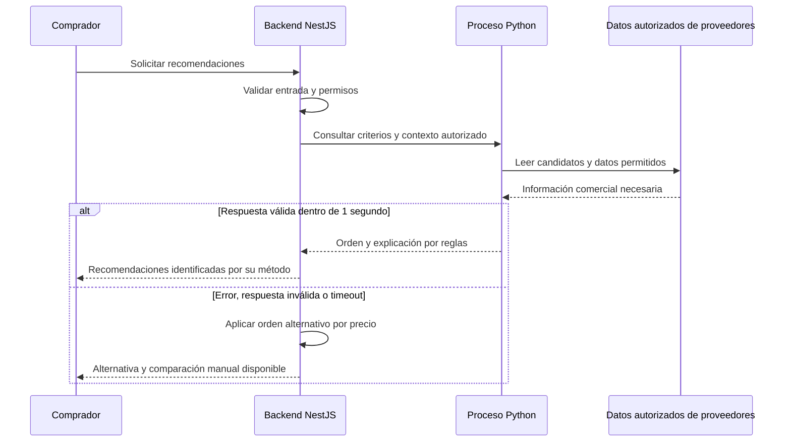

# Módulo de IA: recomendación de proveedores

**Decisión relacionada:** ADR-007. Se propone un proceso Python separado, consultado por NestJS mediante HTTP interno. El núcleo comercial conserva el estilo de monolito modular.

## Objetivo y alcance

Ayudar al comprador a comparar proveedores elegibles según precio, disponibilidad, ubicación e historial de cumplimiento. La recomendación no acepta ofertas, no reserva stock ni decide compras por el usuario.

| Aspecto | Propuesta para v1 |
|---|---|
| Implementación | Python y FastAPI; Scikit-learn queda disponible para un modelo cuando existan datos y evaluación. |
| Método inicial | Puntuación por reglas con criterios y pesos documentados. |
| Resultado | Proveedores ordenados con explicación de los criterios utilizados. |
| Datos | Lectura limitada de información comercial necesaria; sin credenciales con permisos de escritura en el núcleo transaccional. |
| Despliegue | Proceso separado en red privada; puede compartir EC2 inicialmente según recursos. |
| Acceso | Solo desde el backend autorizado; credenciales internas fuera del repositorio. |

## Flujo de recomendación

## Contrato y protección de datos

| Elemento | Contenido |
|---|---|
| Entrada | Producto, cantidad y ubicación necesarios para comparar; contexto autorizado por el backend. |
| Salida | Identificador del proveedor, puntuación, explicación y método aplicado. |
| Acceso a datos | Consultas o vistas de lectura acordadas con los módulos propietarios; excluir pedidos privados, datos personales y secretos ajenos. |
| Validez | La API verifica la respuesta. Precio y disponibilidad se vuelven a comprobar al crear el pedido. |
| Integración | Un puerto del backend desacopla el caso de uso del proceso Python y permite sustituir el adaptador. |

La lectura de datos por Python es una excepción explícita y limitada de integración: no habilita acceso libre a tablas de otros módulos. Las vistas o contratos concretos se definirán en la implementación.

## Fallback y evaluación

- Timeout propuesto de **1 segundo** para la recomendación y hasta **500 ms adicionales** para la alternativa, bajo las condiciones de EQ-07.
- La alternativa ordena proveedores elegibles por precio e informa que la recomendación no está disponible. La búsqueda y comparación manual permanecen accesibles.
- Si también falla la fuente de datos comercial, se devuelve un error controlado; el fallback no garantiza disponibilidad de toda la plataforma.
- Se probarán éxito, timeout, datos insuficientes y respuestas inválidas. Las puntuaciones deberán ser reproducibles y sus pesos justificables.

## Evolución del componente

| Etapa | Qué se propone | Qué falta demostrar |
|---|---|---|
| v1: reglas | Comparación explicable y comportamiento seguro ante fallas. | Utilidad de criterios y pesos con casos representativos. |
| Modelo entrenado | Evaluar Scikit-learn con datos reales o de prueba identificados como tales. | Datos, método de entrenamiento, métricas y comparación contra las reglas iniciales. |
| API externa | Evaluar un proveedor detrás del mismo puerto. | Beneficio, costo, privacidad y cumplimiento del contrato. |

Una puntuación por reglas no demuestra aprendizaje automático. La aceptación de esa primera versión frente al requisito académico de IA debe confirmarse con la docente; un modelo entrenado o API externa no se presenta como ya implementado.
