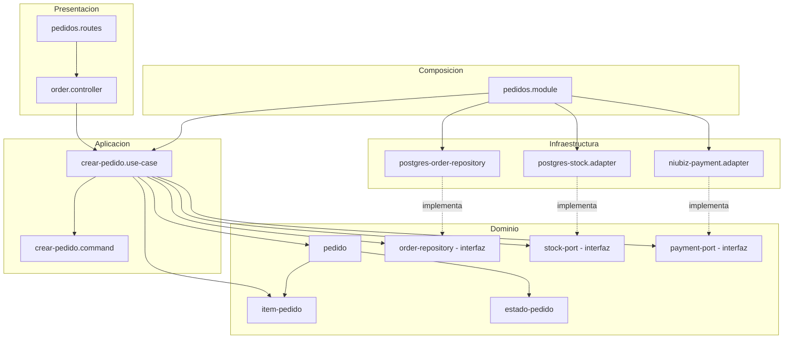
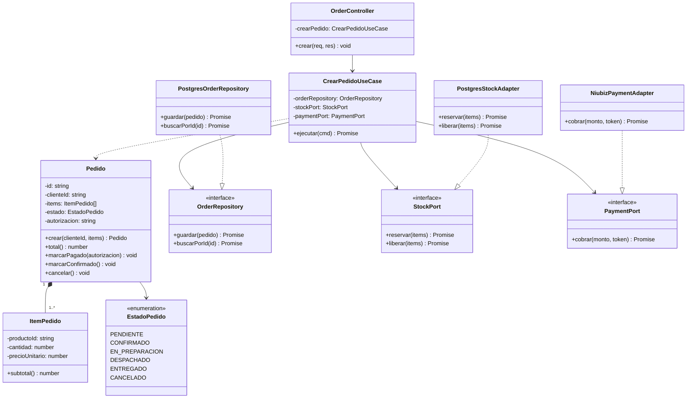
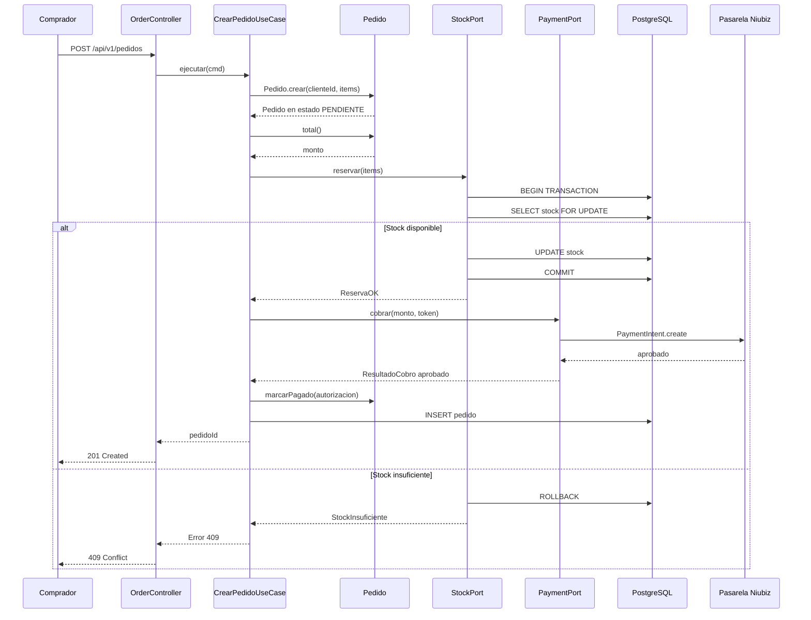

# Diseño interno de módulos

> **Proyecto:** MayoristaPro B2B · **Backend:** Node.js + TypeScript · **Módulo de referencia:** Pedidos
> **Enfoque arquitectónico:** Clean Architecture dentro de cada módulo del monolito modular
> **Nivel C4:** 4 – Código · **Versión:** 1.0

---

## 1. Propósito

Este documento describe **cómo se organiza el código dentro de un módulo** del backend. Tiene tres objetivos:

- que todos los módulos se construyan con la misma estructura;
- que las reglas de negocio queden aisladas de la tecnología;
- que cualquier integrante del equipo sepa dónde va cada archivo y de qué puede depender.

---

## 2. Estructura de carpetas

```text
src/
└── modules/
    └── pedidos/
        ├── dominio/
        │   ├── pedido.ts                    Entidad Pedido y sus reglas
        │   ├── item-pedido.ts               Objeto de valor ItemPedido
        │   ├── estado-pedido.ts             Enumeración EstadoPedido
        │   ├── order-repository.ts          Interfaz (puerto) de persistencia
        │   ├── stock-port.ts                Interfaz (puerto) de validación de stock
        │   ├── payment-port.ts              Interfaz (puerto) de cobro
        │   └── resultado-cobro.ts           DTO de respuesta del cobro
        ├── aplicacion/
        │   ├── crear-pedido.use-case.ts     Caso de uso CrearPedido
        │   └── crear-pedido.command.ts      Datos de entrada del caso de uso
        ├── infraestructura/
        │   ├── postgres-order-repository.ts Implementación con PostgreSQL
        │   ├── postgres-stock.adapter.ts    Implementación de validación de stock
        │   └── niubiz-payment.adapter.ts    Implementación con Niubiz
        ├── presentacion/
        │   ├── order.controller.ts          Traduce HTTP ⇄ caso de uso
        │   └── pedidos.routes.ts            Rutas /api/v1/pedidos
        ├── pedidos.module.ts                Raíz de composición del módulo
        └── index.ts                         API pública del módulo
```

| Archivo | Capa | Responsabilidad | Importa de |
|---|---|---|---|
| `pedido.ts` | Dominio | Crear pedidos válidos, calcular el total, cambiar de estado | Solo dominio |
| `item-pedido.ts` | Dominio | Representar un producto, su cantidad y su subtotal | Nada |
| `estado-pedido.ts` | Dominio | Definir los estados posibles del pedido | Nada |
| `order-repository.ts` | Dominio | Declarar **qué** operaciones de persistencia necesita el módulo | `pedido.ts` |
| `stock-port.ts` | Dominio | Declarar **qué** necesita el módulo para validar y reservar stock | `item-pedido.ts` |
| `payment-port.ts` | Dominio | Declarar **qué** necesita el módulo para cobrar | `resultado-cobro.ts` |
| `resultado-cobro.ts` | Dominio | Estructura del resultado de un cobro | Nada |
| `crear-pedido.use-case.ts` | Aplicación | Coordinar los pasos de la compra | Dominio |
| `crear-pedido.command.ts` | Aplicación | Datos de entrada validados del caso de uso | Nada |
| `postgres-order-repository.ts` | Infraestructura | Guardar y leer pedidos en PostgreSQL | Dominio + driver de BD |
| `postgres-stock.adapter.ts` | Infraestructura | Reservar stock con transacción ACID | Dominio + driver de BD |
| `niubiz-payment.adapter.ts` | Infraestructura | Traducir `cobrar()` a la API de Niubiz | Dominio + SDK de Niubiz |
| `order.controller.ts` | Presentación | Leer la petición HTTP, invocar el caso de uso y responder | Aplicación |
| `pedidos.routes.ts` | Presentación | Registrar las rutas en Express | Presentación |
| `pedidos.module.ts` | Composición | Crear las instancias concretas e inyectarlas | Todas las capas |
| `index.ts` | Composición | Exponer solo lo que otros módulos pueden usar | `pedidos.module.ts` |

---

## 3. Capas del módulo y regla de dependencia



**Regla de dependencia:** el código solo puede importar hacia el centro (dominio). El dominio no conoce Express, PostgreSQL ni Niubiz.

| Capa | Contiene | Responsabilidad | Puede depender de | **No** puede depender de |
|---|---|---|---|---|
| **Dominio** | Entidades, objetos de valor, enumeraciones, interfaces (puertos) | Reglas de negocio que serían ciertas con cualquier tecnología | Nada externo | Aplicación, infraestructura, presentación, Express, ORM, SDK |
| **Aplicación** | Casos de uso, comandos | Orquestar el flujo: qué paso va primero y qué hacer si falla | Dominio | Infraestructura, presentación, Express, ORM |
| **Infraestructura** | Repositorios concretos, adaptadores de servicios externos | Implementar las interfaces del dominio con una tecnología | Dominio, librerías externas | Aplicación, presentación |
| **Presentación** | Controladores, rutas | Traducir HTTP a llamadas del caso de uso y viceversa | Aplicación | Infraestructura, base de datos |
| **Composición** | `pedidos.module.ts` | Elegir implementaciones concretas y conectarlas | Todas | — |

> **Cómo comprobarlo en el código:** basta revisar los `import` de `dominio/`. Si aparece `express`, `pg`, `niubiz` o cualquier archivo de `infraestructura/`, la regla se rompió.

---

## 4. Diagrama de clases



### 4.1 Notación UML utilizada

| Símbolo | Significado | Ejemplo en el diagrama |
|---|---|---|
| Línea continua con flecha abierta | Asociación: la clase guarda una referencia a la otra | `CrearPedidoUseCase` → `OrderRepository` |
| Línea discontinua con flecha abierta | Dependencia: la usa o la crea, pero no la guarda | `CrearPedidoUseCase` ..> `Pedido` |
| Línea discontinua con triángulo hueco | Realización: implementa una interfaz | `PostgresOrderRepository` ..|> `OrderRepository` |
| Rombo relleno | Composición: la parte no existe sin el todo | `Pedido` ◆ `ItemPedido` (1..*) |
| Nombre en cursiva + «interface» | Interfaz (contrato sin implementación) | `OrderRepository`, `StockPort`, `PaymentPort` |
| `-` / `+` | Privado / público | `- estado`, `+ total()` |

---

## 5. Flujo de ejecución: crear pedido con control de stock



| Paso | Origen → destino | Acción | Capa |
|---|---|---|---|
| 1 | Cliente web → `OrderController` | `POST /api/v1/pedidos` con `clienteId`, `items` y `tokenPago` | Presentación |
| 2 | `OrderController` → `CrearPedidoUseCase` | `ejecutar(cmd)` | Presentación → Aplicación |
| 3 | `CrearPedidoUseCase` → `Pedido` | `crear(clienteId, items)`; se validan RN-01 a RN-03; estado PENDIENTE | Aplicación → Dominio |
| 4 | `CrearPedidoUseCase` → `Pedido` | `total()` (RN-04) | Aplicación → Dominio |
| 5 | `CrearPedidoUseCase` → `StockPort` | `reservar(items)` — inicia transacción ACID | Aplicación → Dominio (interfaz) |
| 6 | `PostgresStockAdapter` → PostgreSQL | `SELECT stock FOR UPDATE` + `UPDATE stock` + `COMMIT` | Infraestructura → BD |
| 7 | `CrearPedidoUseCase` → `PaymentPort` | `cobrar(monto, tokenPago)` | Aplicación → Dominio (interfaz) |
| 8 | `NiubizPaymentAdapter` → pasarela | Solicitud de cobro por HTTPS | Infraestructura → externo |
| 9 | `CrearPedidoUseCase` → `Pedido` | Si fue aprobado: `marcarPagado(autorizacion)` (RN-05) | Aplicación → Dominio |
| 10 | `CrearPedidoUseCase` → `OrderRepository` | `guardar(pedido)` | Aplicación → Dominio (interfaz) |
| 11 | `PostgresOrderRepository` → PostgreSQL | `INSERT` del pedido y sus ítems | Infraestructura → BD |
| 12 | `OrderController` → Cliente web | `201 Created` con `pedidoId` | Presentación |
| 13–14 | Alternativa | Si el stock es insuficiente: no se cobra, se responde `409` | Aplicación → Presentación |

---

## 6. Código de referencia

### 6.1 Dominio · entidad e interfaces

```ts
// dominio/pedido.ts
import { ItemPedido } from './item-pedido';
import { EstadoPedido } from './estado-pedido';
import { ReglaNegocioError } from '../../../shared/errores';

export class Pedido {
  private constructor(
    readonly id: string,
    readonly clienteId: string,
    private readonly items: ItemPedido[],
    private estado: EstadoPedido,
    private autorizacion?: string,
  ) {}

  static crear(clienteId: string, items: ItemPedido[]): Pedido {
    if (!clienteId) throw new ReglaNegocioError('RN-01: el pedido debe tener un cliente');
    if (items.length === 0) throw new ReglaNegocioError('RN-02: el pedido debe tener ítems');
    return new Pedido(crypto.randomUUID(), clienteId, items, EstadoPedido.PENDIENTE);
  }

  total(): number {                                            // RN-04
    return this.items.reduce((suma, item) => suma + item.subtotal(), 0);
  }

  marcarPagado(autorizacion: string): void {                   // RN-05
    if (this.estado !== EstadoPedido.PENDIENTE) {
      throw new ReglaNegocioError('RN-05: solo un pedido pendiente puede pagarse');
    }
    this.estado = EstadoPedido.CONFIRMADO;
    this.autorizacion = autorizacion;
  }

  cancelar(): void {                                           // RN-06
    if (this.estado === EstadoPedido.DESPACHADO || this.estado === EstadoPedido.ENTREGADO) {
      throw new ReglaNegocioError('RN-06: el pedido ya fue despachado');
    }
    this.estado = EstadoPedido.CANCELADO;
  }
}
```

```ts
// dominio/order-repository.ts
import { Pedido } from './pedido';

export interface OrderRepository {
  guardar(pedido: Pedido): Promise<void>;
  buscarPorId(id: string): Promise<Pedido | null>;
}
```

```ts
// dominio/stock-port.ts
import { ItemPedido } from './item-pedido';

export interface StockPort {
  reservar(items: ItemPedido[]): Promise<void>;
  liberar(items: ItemPedido[]): Promise<void>;
}
```

```ts
// dominio/payment-port.ts
import { ResultadoCobro } from './resultado-cobro';

export interface PaymentPort {
  cobrar(monto: number, token: string): Promise<ResultadoCobro>;
}
```

### 6.2 Aplicación · caso de uso

```ts
// aplicacion/crear-pedido.use-case.ts
import { Pedido } from '../dominio/pedido';
import { ItemPedido } from '../dominio/item-pedido';
import { OrderRepository } from '../dominio/order-repository';
import { StockPort } from '../dominio/stock-port';
import { PaymentPort } from '../dominio/payment-port';
import { CrearPedidoCommand } from './crear-pedido.command';
import { PagoRechazadoError, StockInsuficienteError } from '../../../shared/errores';

export class CrearPedidoUseCase {
  constructor(
    private readonly orderRepository: OrderRepository,   // interfaz, no PostgreSQL
    private readonly stockPort: StockPort,               // interfaz, no adapter
    private readonly paymentPort: PaymentPort,           // interfaz, no Niubiz
  ) {}

  async ejecutar(cmd: CrearPedidoCommand): Promise<string> {
    const items = cmd.items.map((i) => new ItemPedido(i.productoId, i.cantidad, i.precioUnitario));
    const pedido = Pedido.crear(cmd.clienteId, items);

    // 1. Reservar stock con transacción ACID (evita sobreventa)
    try {
      await this.stockPort.reservar(items);
    } catch (e) {
      throw new StockInsuficienteError('No hay stock suficiente para el pedido');
    }

    // 2. Cobrar mediante pasarela externa
    const cobro = await this.paymentPort.cobrar(pedido.total(), cmd.tokenPago);
    if (!cobro.aprobado) {
      await this.stockPort.liberar(items);   // rollback de stock
      throw new PagoRechazadoError(cobro.motivoRechazo);
    }

    // 3. Confirmar pedido y persistir
    pedido.marcarPagado(cobro.autorizacion);
    await this.orderRepository.guardar(pedido);
    return pedido.id;
  }
}
```

> El precio unitario de cada ítem debe obtenerse del módulo **Productos** a través de su API pública, no del frontend. Se omite aquí para mantener el ejemplo corto.

### 6.3 Infraestructura · adaptadores

```ts
// infraestructura/postgres-stock.adapter.ts
import { Pool } from 'pg';
import { StockPort } from '../dominio/stock-port';
import { ItemPedido } from '../dominio/item-pedido';

export class PostgresStockAdapter implements StockPort {
  constructor(private readonly db: Pool) {}

  async reservar(items: ItemPedido[]): Promise<void> {
    const client = await this.db.connect();
    try {
      await client.query('BEGIN');
      for (const item of items) {
        const { rows } = await client.query(
          'SELECT stock FROM productos WHERE id = $1 FOR UPDATE',
          [item.productoId],
        );
        if (!rows[0] || rows[0].stock < item.cantidad) {
          throw new Error('Stock insuficiente');
        }
        await client.query(
          'UPDATE productos SET stock = stock - $1 WHERE id = $2',
          [item.cantidad, item.productoId],
        );
      }
      await client.query('COMMIT');
    } catch (e) {
      await client.query('ROLLBACK');
      throw e;
    } finally {
      client.release();
    }
  }

  async liberar(items: ItemPedido[]): Promise<void> {
    for (const item of items) {
      await this.db.query(
        'UPDATE productos SET stock = stock + $1 WHERE id = $2',
        [item.cantidad, item.productoId],
      );
    }
  }
}
```

```ts
// infraestructura/niubiz-payment.adapter.ts
import { PaymentPort } from '../dominio/payment-port';
import { ResultadoCobro } from '../dominio/resultado-cobro';

export class NiubizPaymentAdapter implements PaymentPort {
  constructor(private readonly apiKey: string, private readonly merchantId: string) {}

  async cobrar(monto: number, token: string): Promise<ResultadoCobro> {
    // Traduce el lenguaje del proveedor al lenguaje del dominio.
    // La llamada exacta depende de la versión de la API de Niubiz.
    const res = await fetch('https://api.niubiz.com.pe/v1/transactions', {
      method: 'POST',
      headers: {
        'Authorization': this.apiKey,
        'Content-Type': 'application/json',
      },
      body: JSON.stringify({
        merchantId: this.merchantId,
        amount: monto,
        currency: 'PEN',
        token,
      }),
    });
    const data = await res.json();
    return {
      aprobado: data.status === 'approved',
      autorizacion: data.transactionId,
      motivoRechazo: data.status === 'approved' ? undefined : data.message,
    };
  }
}
```

### 6.4 Presentación · controlador

```ts
// presentacion/order.controller.ts
import { Request, Response } from 'express';
import { CrearPedidoUseCase } from '../aplicacion/crear-pedido.use-case';

export class OrderController {
  constructor(private readonly crearPedido: CrearPedidoUseCase) {}

  crear = async (req: Request, res: Response): Promise<void> => {
    const pedidoId = await this.crearPedido.ejecutar({
      clienteId: req.user.id,            // lo agrega el middleware JWT; no viene del body
      items: req.body.items,
      tokenPago: req.body.tokenPago,
    });
    res.status(201).json({ pedidoId });
  };
}
```

### 6.5 Raíz de composición

```ts
// pedidos.module.ts
import { Pool } from 'pg';
import { PostgresOrderRepository } from './infraestructura/postgres-order-repository';
import { PostgresStockAdapter } from './infraestructura/postgres-stock.adapter';
import { NiubizPaymentAdapter } from './infraestructura/niubiz-payment.adapter';
import { CrearPedidoUseCase } from './aplicacion/crear-pedido.use-case';
import { OrderController } from './presentacion/order.controller';

export function crearModuloPedidos(db: Pool, niubizApiKey: string, niubizMerchantId: string) {
  const orderRepository = new PostgresOrderRepository(db);
  const stockPort = new PostgresStockAdapter(db);
  const paymentPort = new NiubizPaymentAdapter(niubizApiKey, niubizMerchantId);

  const crearPedido = new CrearPedidoUseCase(orderRepository, stockPort, paymentPort);
  return { controller: new OrderController(crearPedido) };
}
```

---

## 7. Reglas de negocio del módulo

| ID | Regla | Dónde se valida |
|---|---|---|
| RN-01 | El pedido debe tener un cliente asociado | `Pedido.crear()` |
| RN-02 | El pedido debe tener al menos un ítem | `Pedido.crear()` |
| RN-03 | Cada ítem debe tener cantidad mayor a 0 | `ItemPedido` constructor |
| RN-04 | El total del pedido se calcula sumando los subtotales | `Pedido.total()` |
| RN-05 | Solo un pedido pendiente puede marcarse como pagado | `Pedido.marcarPagado()` |
| RN-06 | No se puede cancelar un pedido despachado o entregado | `Pedido.cancelar()` |
| RN-07 | El stock debe reservarse antes de cobrar | `CrearPedidoUseCase.ejecutar()` |
| RN-08 | Si el pago falla, el stock reservado debe liberarse | `CrearPedidoUseCase.ejecutar()` |

---

## 8. Beneficios del diseño

| Beneficio | Cómo se logra |
|---|---|
| Independencia tecnológica | El dominio no conoce PostgreSQL ni Niubiz; ambos son adaptadores. |
| Testabilidad | `CrearPedidoUseCase` se testea con mocks de `StockPort` y `PaymentPort`. |
| Intercambiabilidad | Cambiar Niubiz por Mercado Pago es cambiar una línea en `pedidos.module.ts`. |
| Consistencia | La reserva de stock se hace en una transacción ACID aislada. |
| Resiliencia | Si el pago falla, el stock se libera y no se persiste el pedido. |
| Trazabilidad | Los errores se manejan con excepciones de dominio específicas. |