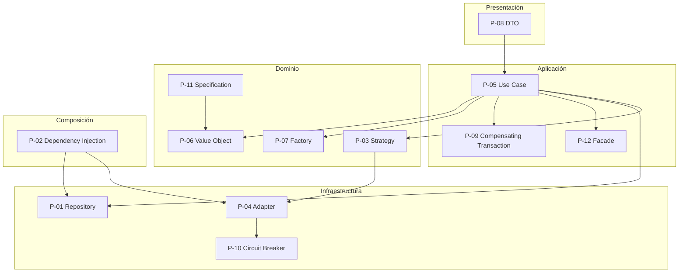

# Patrones de diseño

> **Proyecto:** MayoristaPro B2B · **Backend:** Node.js + TypeScript
> **Enfoque arquitectónico:** Clean Architecture dentro de cada módulo del monolito modular
> **Nivel C4:** 4 – Código · **Versión:** 1.0

---

## 1. Propósito

Este documento describe los **patrones de diseño** aplicados en MayoristaPro B2B. Los patrones se clasifican según la capa donde se aplican y el problema que resuelven. Cada patrón incluye:

- el problema que resuelve;
- cómo se aplica en MayoristaPro;
- un ejemplo de código de referencia;
- los beneficios y trade-offs.

---

## 2. Resumen de patrones aplicados

| ID | Patrón | Capa | Problema que resuelve |
|---|---|---|---|
| P-01 | Repository | Dominio / Infraestructura | Aislar el dominio de la persistencia |
| P-02 | Dependency Injection | Composición | Invertir dependencias y facilitar testing |
| P-03 | Strategy | Dominio / Infraestructura | Intercambiar algoritmos (pagos, IA) sin afectar el dominio |
| P-04 | Adapter | Infraestructura | Traducir APIs externas al lenguaje del dominio |
| P-05 | Use Case | Aplicación | Encapsular la lógica de una operación del negocio |
| P-06 | Value Object | Dominio | Representar conceptos inmutables con validación propia |
| P-07 | Factory | Dominio | Encapsular la creación de entidades con reglas de negocio |
| P-08 | DTO | Aplicación / Presentación | Transportar datos sin exponer entidades del dominio |
| P-09 | Compensating Transaction (Saga) | Aplicación | Revertir operaciones ante fallos en flujos distribuidos |
| P-10 | Circuit Breaker | Infraestructura | Evitar cascadas de fallos en servicios externos |
| P-11 | Specification | Dominio | Encapsular reglas de filtrado y validación complejas |
| P-12 | Facade | Aplicación | Simplificar el acceso a módulos internos |

---

## 3. Patrones por capa



---

## 4. Patrones de dominio

### P-06 · Value Object

**Problema:** representar conceptos del negocio que no tienen identidad propia pero tienen reglas de validación.

**Aplicación en MayoristaPro:**
- `ItemPedido`: producto + cantidad + precio unitario.
- `RUC`: valor validado contra SUNAT.
- `Monto`: valor monetario con moneda.
- `CantidadMinima`: cantidad mínima de compra.

```ts
// dominio/item-pedido.ts
import { ReglaNegocioError } from '../../../shared/errores';

export class ItemPedido {
  constructor(
    readonly productoId: string,
    readonly cantidad: number,
    readonly precioUnitario: number,
  ) {
    if (cantidad <= 0) throw new ReglaNegocioError('RN-03: la cantidad debe ser mayor a 0');
    if (precioUnitario < 0) throw new ReglaNegocioError('RN-09: el precio no puede ser negativo');
  }

  subtotal(): number {
    return this.cantidad * this.precioUnitario;
  }
}
```

**Beneficios:**
- Validación encapsulada en el propio objeto.
- Inmutabilidad garantizada.
- Imposible crear instancias inválidas.

---

### P-07 · Factory

**Problema:** centralizar la creación de entidades complejas que tienen reglas de negocio.

**Aplicación en MayoristaPro:**
- `Pedido.crear()`: valida cliente, ítems y genera ID único.
- `Cotizacion.solicitar()`: valida comprador, proveedor y productos.
- `Producto.publicar()`: valida proveedor y campos obligatorios.

```ts
// dominio/pedido.ts
export class Pedido {
  private constructor(
    readonly id: string,
    readonly clienteId: string,
    private readonly items: ItemPedido[],
    private estado: EstadoPedido,
    private autorizacion?: string,
  ) {}

  static crear(clienteId: string, items: ItemPedido[]): Pedido {
    if (!clienteId) throw new ReglaNegocioError('RN-01: el pedido debe tener un cliente');
    if (items.length === 0) throw new ReglaNegocioError('RN-02: el pedido debe tener ítems');
    return new Pedido(crypto.randomUUID(), clienteId, items, EstadoPedido.PENDIENTE);
  }
}
```

**Beneficios:**
- Constructor privado evita creación inválida.
- Reglas de negocio centralizadas.
- Fácil de testear.

---

### P-03 · Strategy

**Problema:** permitir intercambiar algoritmos sin modificar el código cliente.

**Aplicación en MayoristaPro:**
- **Pagos:** Niubiz, Mercado Pago, BBVA.
- **IA:** motor de reglas (Scikit-learn) vs API externa (GPT).
- **Notificaciones:** email vs WhatsApp vs SMS.
- **Facturación:** NubeFacT vs Alanube.

```ts
// dominio/payment-port.ts
export interface PaymentPort {
  cobrar(monto: number, token: string): Promise<ResultadoCobro>;
}

// infraestructura/niubiz-payment.adapter.ts
export class NiubizPaymentAdapter implements PaymentPort {
  async cobrar(monto: number, token: string): Promise<ResultadoCobro> { /* ... */ }
}

// infraestructura/mercadopago-payment.adapter.ts
export class MercadoPagoPaymentAdapter implements PaymentPort {
  async cobrar(monto: number, token: string): Promise<ResultadoCobro> { /* ... */ }
}
```

**Beneficios:**
- Intercambiar proveedor sin tocar el dominio.
- Testear con un `FakePaymentAdapter`.
- Añadir nuevos proveedores sin refactorizar.

---

### P-11 · Specification

**Problema:** encapsular reglas de filtrado o validación complejas que combinan múltiples criterios.

**Aplicación en MayoristaPro:**
- Filtros de búsqueda de productos (precio, categoría, ubicación, reputación).
- Criterios de recomendación de IA.
- Reglas de aprobación de proveedores.

```ts
// dominio/specifications/producto-disponible.spec.ts
export class ProductoDisponibleSpec {
  esSatisfechoPor(producto: Producto): boolean {
    return producto.estado === EstadoProducto.DISPONIBLE && producto.stock > 0;
  }
}

// Combinación con AND / OR
const spec = new ProductoDisponibleSpec()
  .and(new ProductoEnCategoriaSpec('utiles-escolares'))
  .and(new ProductoConPrecioMenorSpec(100));
```

**Beneficios:**
- Reglas de filtrado reutilizables.
- Combinables con AND/OR.
- Testeables de forma aislada.

---

## 5. Patrones de aplicación

### P-05 · Use Case

**Problema:** encapsular cada operación del negocio en una clase con una única responsabilidad.

**Aplicación en MayoristaPro:**
- `CrearPedidoUseCase`
- `SolicitarCotizacionUseCase`
- `ResponderCotizacionUseCase`
- `ConfirmarPagoUseCase`
- `RecomendarProveedoresUseCase`

```ts
// aplicacion/crear-pedido.use-case.ts
export class CrearPedidoUseCase {
  constructor(
    private readonly orderRepository: OrderRepository,
    private readonly stockPort: StockPort,
    private readonly paymentPort: PaymentPort,
  ) {}

  async ejecutar(cmd: CrearPedidoCommand): Promise<string> {
    const items = cmd.items.map((i) => new ItemPedido(i.productoId, i.cantidad, i.precioUnitario));
    const pedido = Pedido.crear(cmd.clienteId, items);

    await this.stockPort.reservar(items);
    const cobro = await this.paymentPort.cobrar(pedido.total(), cmd.tokenPago);
    if (!cobro.aprobado) {
      await this.stockPort.liberar(items);
      throw new PagoRechazadoError(cobro.motivoRechazo);
    }

    pedido.marcarPagado(cobro.autorizacion);
    await this.orderRepository.guardar(pedido);
    return pedido.id;
  }
}
```

**Beneficios:**
- Una clase por operación del negocio.
- Fácil de testear con mocks.
- Orquesta sin conocer la infraestructura.

---

### P-08 · DTO (Data Transfer Object)

**Problema:** transportar datos entre capas sin exponer entidades del dominio ni acoplar la presentación.

**Aplicación en MayoristaPro:**
- `CrearPedidoCommand`: entrada del caso de uso.
- `PedidoResponse`: salida hacia el cliente HTTP.
- `CotizacionRequest`: entrada para solicitar cotización.

```ts
// aplicacion/crear-pedido.command.ts
export interface CrearPedidoCommand {
  clienteId: string;
  items: { productoId: string; cantidad: number; precioUnitario: number }[];
  tokenPago: string;
}

// presentacion/dto/pedido-response.ts
export interface PedidoResponse {
  id: string;
  estado: string;
  total: number;
  fechaCreacion: string;
}
```

**Beneficios:**
- El dominio no se expone directamente al exterior.
- Los cambios en el dominio no rompen la API.
- Validación de entrada separada de la lógica de negocio.

---

### P-09 · Compensating Transaction (Saga)

**Problema:** revertir operaciones ya realizadas cuando una operación posterior falla en un flujo distribuido.

**Aplicación en MayoristaPro:**
- **Flujo de pedido:** reservar stock → cobrar → guardar pedido. Si el cobro falla, se libera el stock.
- **Flujo de facturación:** confirmar pedido → emitir factura. Si la factura falla, se marca el pedido para reintento.
- **Flujo de cancelación:** cancelar pedido → reembolsar → liberar stock.

```ts
// aplicacion/crear-pedido.use-case.ts
async ejecutar(cmd: CrearPedidoCommand): Promise<string> {
  const items = cmd.items.map((i) => new ItemPedido(i.productoId, i.cantidad, i.precioUnitario));
  const pedido = Pedido.crear(cmd.clienteId, items);

  // Paso 1: reservar stock
  await this.stockPort.reservar(items);

  try {
    // Paso 2: cobrar
    const cobro = await this.paymentPort.cobrar(pedido.total(), cmd.tokenPago);
    if (!cobro.aprobado) throw new PagoRechazadoError(cobro.motivoRechazo);

    // Paso 3: persistir
    pedido.marcarPagado(cobro.autorizacion);
    await this.orderRepository.guardar(pedido);
    return pedido.id;
  } catch (e) {
    // Compensación: liberar stock si algo falla después de reservarlo
    await this.stockPort.liberar(items);
    throw e;
  }
}
```

**Beneficios:**
- Garantiza consistencia sin transacciones distribuidas.
- Manejo explícito de fallos.
- Trazabilidad de la compensación.

---

### P-12 · Facade

**Problema:** simplificar el acceso a un subsistema complejo.

**Aplicación en MayoristaPro:**
- `PedidosFacade`: expone una API simple del módulo Pedidos a otros módulos.
- `CatalogoFacade`: expone consultas de productos sin revelar la complejidad interna.
- `ProveedoresFacade`: expone verificación y datos comerciales.

```ts
// pedidos/index.ts — API pública del módulo
export class PedidosFacade {
  constructor(private readonly crearPedido: CrearPedidoUseCase) {}

  async crear(cmd: CrearPedidoCommand): Promise<string> {
    return this.crearPedido.ejecutar(cmd);
  }
}

// Otros módulos solo importan la fachada
import { PedidosFacade } from '../pedidos';
```

**Beneficios:**
- Los módulos no acceden a clases internas.
- La API pública es estable aunque el interior cambie.
- Facilita el refactor interno.

---

## 6. Patrones de infraestructura

### P-01 · Repository

**Problema:** aislar el dominio de la tecnología de persistencia.

**Aplicación en MayoristaPro:**
- `OrderRepository`: persistencia de pedidos.
- `ProductRepository`: persistencia de productos.
- `CotizacionRepository`: persistencia de cotizaciones.
- `ProveedorRepository`: persistencia de proveedores.

```ts
// dominio/order-repository.ts — interfaz en el dominio
export interface OrderRepository {
  guardar(pedido: Pedido): Promise<void>;
  buscarPorId(id: string): Promise<Pedido | null>;
  buscarPorComprador(clienteId: string): Promise<Pedido[]>;
}

// infraestructura/postgres-order-repository.ts — implementación
export class PostgresOrderRepository implements OrderRepository {
  constructor(private readonly db: Pool) {}

  async guardar(pedido: Pedido): Promise<void> {
    await this.db.query('INSERT INTO pedidos (...) VALUES (...)', [/* ... */]);
  }

  async buscarPorId(id: string): Promise<Pedido | null> {
    const { rows } = await this.db.query('SELECT * FROM pedidos WHERE id = $1', [id]);
    return rows[0] ? this.mapear(rows[0]) : null;
  }
}
```

**Beneficios:**
- El dominio no conoce PostgreSQL.
- Intercambiable por MongoDB o memoria.
- Testeable con un repositorio en memoria.

---

### P-04 · Adapter

**Problema:** traducir interfaces externas al lenguaje del dominio.

**Aplicación en MayoristaPro:**
- `NiubizPaymentAdapter`: pasarela de pagos.
- `NubeFacTPSEAdapter`: facturación electrónica.
- `OpenAIAIAdapter`: recomendaciones con GPT.
- `TurboCloudNotificationAdapter`: notificaciones.
- `OpenStreetMapAdapter`: geolocalización.

```ts
// infraestructura/niubiz-payment.adapter.ts
export class NiubizPaymentAdapter implements PaymentPort {
  async cobrar(monto: number, token: string): Promise<ResultadoCobro> {
    const res = await fetch('https://api.niubiz.com.pe/v1/transactions', { /* ... */ });
    const data = await res.json();
    return {
      aprobado: data.status === 'approved',
      autorizacion: data.transactionId,
      motivoRechazo: data.status === 'approved' ? undefined : data.message,
    };
  }
}
```

**Beneficios:**
- Aísla el dominio de los detalles de cada proveedor.
- Cambiar de proveedor es cambiar el adaptador.
- Testeable con mocks.

---

### P-10 · Circuit Breaker

**Problema:** evitar cascadas de fallos cuando un servicio externo está caído.

**Aplicación en MayoristaPro:**
- **IA:** si el servicio de IA no responde, el sistema sigue permitiendo búsqueda y comparación manual (fallback).
- **PSE:** si la facturación falla, se encola el reintento en SQS.
- **Notificaciones:** si el servicio falla, se reintenta con backoff exponencial.

```ts
// infraestructura/circuit-breaker.ts
export class CircuitBreaker {
  private fallos = 0;
  private estado: 'CERRADO' | 'ABIERTO' | 'SEMI_ABIERTO' = 'CERRADO';

  async ejecutar<T>(operacion: () => Promise<T>, fallback: () => Promise<T>): Promise<T> {
    if (this.estado === 'ABIERTO') return fallback();
    try {
      const resultado = await operacion();
      this.fallos = 0;
      return resultado;
    } catch (e) {
      this.fallos++;
      if (this.fallos >= 5) this.estado = 'ABIERTO';
      return fallback();
    }
  }
}
```

**Beneficios:**
- Evita saturar servicios caídos.
- Proporciona fallback automático.
- Mejora la resiliencia general.

---

## 7. Patrones de composición

### P-02 · Dependency Injection

**Problema:** invertir dependencias y facilitar testing sin acoplar a implementaciones concretas.

**Aplicación en MayoristaPro:**
- Inyección por constructor en casos de uso.
- Composición manual en `*.module.ts`.
- Sin framework de DI (nativo, simple).

```ts
// pedidos.module.ts
export function crearModuloPedidos(db: Pool, niubizApiKey: string) {
  const orderRepository = new PostgresOrderRepository(db);
  const stockPort = new PostgresStockAdapter(db);
  const paymentPort = new NiubizPaymentAdapter(niubizApiKey);

  const crearPedido = new CrearPedidoUseCase(orderRepository, stockPort, paymentPort);
  return { controller: new OrderController(crearPedido) };
}
```

**Beneficios:**
- Las dependencias se declaran explícitamente.
- Fácil sustituir por mocks en tests.
- Sin acoplamiento a frameworks de DI.

---

## 8. Patrones descartados

| Patrón | Por qué no se aplicó |
|---|---|
| Singleton global | El estado compartido dificulta el testing y la concurrencia. |
| Service Locator | Oculta dependencias y complica el rastreo de fallos. |
| Active Record | Mezcla persistencia con dominio, violando Clean Architecture. |
| Anemic Domain Model | Se prefiere un dominio rico con reglas encapsuladas. |
| CQRS completo | Se considera overkill para el tamaño del proyecto. |
| Event Sourcing | Excesivo para el alcance actual; se evalúa en v2. |

---

## 9. Mapa de patrones por módulo

| Módulo | Patrones principales |
|---|---|
| Usuarios | Use Case, Repository, DTO, Factory |
| Proveedores | Use Case, Repository, Specification, Adapter (SUNAT) |
| Productos | Use Case, Repository, Specification, Value Object |
| Cotizaciones | Use Case, Repository, State, DTO |
| IA | Strategy, Adapter, Circuit Breaker |
| Pedidos | Use Case, Repository, Saga, Value Object |
| Pagos | Strategy, Adapter, Circuit Breaker |
| Entregas | Use Case, Repository, DTO |
| Incidencias | Use Case, Repository, State |
| Reportes | Use Case, Repository, Facade |

---

## 10. Beneficios globales

| Beneficio | Cómo se logra |
|---|---|
| Desacoplamiento | Patrones Repository y Adapter aíslan la infraestructura. |
| Testabilidad | Use Case + DI permiten testear sin BD ni frameworks. |
| Flexibilidad | Strategy permite intercambiar proveedores sin tocar el dominio. |
| Consistencia | Saga garantiza consistencia sin transacciones distribuidas. |
| Resiliencia | Circuit Breaker evita cascadas de fallos. |
| Mantenibilidad | Cada patrón encapsula una responsabilidad clara. |