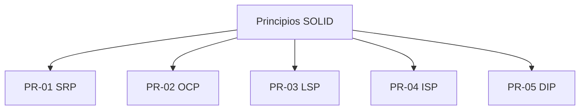

# Principios de diseño

> **Proyecto:** MayoristaPro B2B · **Backend:** Node.js + TypeScript
> **Enfoque arquitectónico:** Clean Architecture dentro de cada módulo del monolito modular
> **Nivel C4:** 4 – Código · **Versión:** 1.0

---

## 1. Propósito

Este documento describe los **principios de diseño** aplicados en MayoristaPro B2B. Los principios guían la toma de decisiones durante el desarrollo y aseguran que el código sea mantenible, testeable y evolutivo. Cada principio incluye:

- definición;
- aplicación en MayoristaPro;
- ejemplo de código;
- beneficio concreto.

---

## 2. Resumen de principios aplicados

| ID | Principio | Origen | Aplicación |
|---|---|---|---|
| PR-01 | Responsabilidad Única (SRP) | SOLID | Cada clase tiene una razón para cambiar |
| PR-02 | Abierto/Cerrado (OCP) | SOLID | Extender sin modificar |
| PR-03 | Sustitución de Liskov (LSP) | SOLID | Implementaciones intercambiables |
| PR-04 | Segregación de Interfaces (ISP) | SOLID | Interfaces pequeñas y específicas |
| PR-05 | Inversión de Dependencias (DIP) | SOLID | Depender de abstracciones, no de concreciones |
| PR-06 | No te repitas (DRY) | Pragmático | Evitar duplicación de lógica |
| PR-07 | Mantenlo simple (KISS) | Pragmático | Soluciones simples primero |
| PR-08 | No lo necesitas aún (YAGNI) | Pragmático | No agregar funcionalidad no requerida |
| PR-09 | Fallar rápido | Pragmático | Validar temprano, error claro |
| PR-10 | Ley de Demeter | Pragmático | No hablar con extraños |
| PR-11 | Separación de responsabilidades | General | Cada capa con su rol |
| PR-12 | Alta cohesión, bajo acoplamiento | General | Módulos enfocados e independientes |

---

## 3. Principios SOLID



---

### PR-01 · Responsabilidad Única (SRP)

**Definición:** una clase debe tener una única razón para cambiar.

**Aplicación en MayoristaPro:**
- `Pedido`: solo gestiona las reglas de negocio del pedido.
- `PostgresOrderRepository`: solo persiste pedidos en PostgreSQL.
- `OrderController`: solo traduce HTTP a casos de uso.
- `CrearPedidoUseCase`: solo orquesta el flujo de creación de pedido.

**Contraejemplo (evitado):**

```ts
// ❌ Clase que hace todo
class PedidoService {
  async crear(datos: any) {
    // valida reglas
    // cobra con Niubiz
    // persiste en PostgreSQL
    // envía email
    // genera factura
  }
}
```

**Ejemplo aplicado:**

```ts
// ✅ Cada clase tiene una responsabilidad
class Pedido { /* reglas de negocio */ }
class PostgresOrderRepository { /* persistencia */ }
class NiubizPaymentAdapter { /* cobro */ }
class CrearPedidoUseCase { /* orquestación */ }
class OrderController { /* traducción HTTP */ }
```

**Beneficio:** cambios en la persistencia no afectan las reglas de negocio; cambios en las reglas no afectan la presentación.

---

### PR-02 · Abierto/Cerrado (OCP)

**Definición:** las clases deben estar abiertas a extensión pero cerradas a modificación.

**Aplicación en MayoristaPro:**
- Se puede añadir un nuevo proveedor de pagos (PayPal) sin modificar `CrearPedidoUseCase`.
- Se puede añadir un nuevo PSE (Alanube) sin modificar el dominio.
- Se puede añadir un nuevo canal de notificación (SMS) sin modificar el flujo de pedido.

**Ejemplo aplicado:**

```ts
// El caso de uso no cambia al añadir nuevos adaptadores
export class CrearPedidoUseCase {
  constructor(
    private readonly orderRepository: OrderRepository,
    private readonly stockPort: StockPort,
    private readonly paymentPort: PaymentPort,   // ← cualquier implementación
  ) {}

  async ejecutar(cmd: CrearPedidoCommand): Promise<string> {
    // ...
    const cobro = await this.paymentPort.cobrar(pedido.total(), cmd.tokenPago);
    // ...
  }
}

// Añadir un nuevo proveedor solo requiere implementar la interfaz
export class PayPalPaymentAdapter implements PaymentPort { /* ... */ }
```

**Beneficio:** añadir proveedores no rompe el código existente; se cumple el principio de extensión.

---

### PR-03 · Sustitución de Liskov (LSP)

**Definición:** las implementaciones de una interfaz deben poder sustituirse sin alterar el comportamiento esperado.

**Aplicación en MayoristaPro:**
- `NiubizPaymentAdapter` y `MercadoPagoPaymentAdapter` son intercambiables.
- `PostgresOrderRepository` y `InMemoryOrderRepository` (tests) son intercambiables.
- `ScikitLearnAIAdapter` y `OpenAIAIAdapter` son intercambiables.

**Ejemplo aplicado:**

```ts
// Todos los adaptadores cumplen el mismo contrato
export interface PaymentPort {
  cobrar(monto: number, token: string): Promise<ResultadoCobro>;
}

export class NiubizPaymentAdapter implements PaymentPort { /* ... */ }
export class MercadoPagoPaymentAdapter implements PaymentPort { /* ... */ }
export class FakePaymentAdapter implements PaymentPort { /* para tests */ }

// El caso de uso funciona con cualquiera
const useCase = new CrearPedidoUseCase(repo, stock, new NiubizPaymentAdapter(apiKey));
```

**Beneficio:** los tests usan `FakePaymentAdapter` y en producción se usa el adapter real; sin cambios en el caso de uso.

---

### PR-04 · Segregación de Interfaces (ISP)

**Definición:** los clientes no deben depender de interfaces que no usan. Preferir interfaces pequeñas y específicas.

**Aplicación en MayoristaPro:**

```ts
// ❌ Interfaz gigante
interface Repositorio {
  guardarPedido(p: Pedido): Promise<void>;
  buscarPedido(id: string): Promise<Pedido>;
  guardarProducto(p: Producto): Promise<void>;
  buscarProducto(id: string): Promise<Producto>;
  // ...
}

// ✅ Interfaces específicas por agregado
interface OrderRepository {
  guardar(pedido: Pedido): Promise<void>;
  buscarPorId(id: string): Promise<Pedido | null>;
}

interface ProductRepository {
  guardar(producto: Producto): Promise<void>;
  buscarPorId(id: string): Promise<Producto | null>;
}

interface CotizacionRepository {
  guardar(cotizacion: Cotizacion): Promise<void>;
  buscarPorId(id: string): Promise<Cotizacion | null>;
}
```

**Beneficio:** cada módulo depende solo de la interfaz que necesita; cambios en una no afectan a las demás.

---

### PR-05 · Inversión de Dependencias (DIP)

**Definición:** depender de abstracciones, no de concreciones. El código de alto nivel no debe depender del código de bajo nivel.

**Aplicación en MayoristaPro:**
- El caso de uso depende de `OrderRepository` (interfaz), no de `PostgresOrderRepository`.
- El caso de uso depende de `PaymentPort` (interfaz), no de `NiubizPaymentAdapter`.
- El dominio no conoce NestJS, PostgreSQL, Redis ni ningún framework.

**Ejemplo aplicado:**

```ts
// ✅ El caso de uso depende de interfaces (abstracciones)
export class CrearPedidoUseCase {
  constructor(
    private readonly orderRepository: OrderRepository,   // interfaz en dominio/
    private readonly stockPort: StockPort,               // interfaz en dominio/
    private readonly paymentPort: PaymentPort,           // interfaz en dominio/
  ) {}
}

// ✅ La composición decide las implementaciones concretas
// pedidos.module.ts
export function crearModuloPedidos(db: Pool, apiKey: string) {
  const orderRepository = new PostgresOrderRepository(db);
  const stockPort = new PostgresStockAdapter(db);
  const paymentPort = new NiubizPaymentAdapter(apiKey);
  return new CrearPedidoUseCase(orderRepository, stockPort, paymentPort);
}
```

**Beneficio:** el dominio es independiente de la tecnología; cambiar PostgreSQL por MongoDB solo afecta la composición.

---

## 4. Principios pragmáticos

---

### PR-06 · No te repitas (DRY)

**Definición:** evitar duplicación de lógica. Cada pieza de conocimiento debe tener una única representación autoritativa en el sistema.

**Aplicación en MayoristaPro:**
- Validación de RUC centralizada en el Value Object `RUC`.
- Cálculo de total centralizado en `Pedido.total()`.
- Validación de stock centralizada en `StockPort`.
- Manejo de errores centralizado en `shared/errores.ts`.

**Ejemplo aplicado:**

```ts
// ✅ Validación de RUC en un solo lugar
export class RUC {
  constructor(readonly valor: string) {
    if (!/^\d{11}$/.test(valor)) {
      throw new ReglaNegocioError('El RUC debe tener 11 dígitos');
    }
  }
}

// Se reutiliza en todos los módulos que validan RUC
const rucProveedor = new RUC('20123456789');
const rucComprador = new RUC('20987654321');
```

**Beneficio:** cambios en la validación de RUC se hacen en un solo archivo.

---

### PR-07 · Mantenlo simple (KISS)

**Definición:** las soluciones deben ser lo más simples posible, sin sacrificar la corrección. La complejidad innecesaria es un riesgo.

**Aplicación en MayoristaPro:**
- Se descartan microservicios en favor de un monolito modular.
- Se descarta CQRS completo; se usa un solo modelo por caso de uso.
- Se descarta Event Sourcing; se usan eventos ligeros con SQS.
- Se descarta Kubernetes; se usa AWS ECS o instancias simples.

**Ejemplo aplicado:**

```ts
// ❌ Sobre-ingeniería
class PedidoFactoryBuilderStrategyProvider { /* ... */ }

// ✅ Simple y suficiente
class Pedido {
  static crear(clienteId: string, items: ItemPedido[]): Pedido { /* ... */ }
}
```

**Beneficio:** menor tiempo de desarrollo, menor curva de aprendizaje, menos errores.

---

### PR-08 · No lo necesitas aún (YAGNI)

**Definición:** no añadir funcionalidad que no se necesita actualmente, aunque parezca que podría ser útil en el futuro.

**Aplicación en MayoristaPro:**

| Tentación | Decisión | Justificación |
|---|---|---|
| Añadir microservicios desde el inicio | No | Monolito modular es suficiente; migrar si es necesario. |
| Añadir Kafka | No | Amazon SQS cubre los casos de uso. |
| Añadir Elasticsearch en v1 | No | PostgreSQL con `tsvector` es suficiente en v1. |
| Añadir MongoDB en v1 | No | PostgreSQL cubre todo en v1; MongoDB en v2 si se justifica. |
| Añadir multi-región | No | Una sola región (Lima) en v1. |
| Añadir apps móviles nativas | No | Web responsive en v1. |

**Ejemplo aplicado:**

```ts
// ❌ Añadir campos "por si acaso"
interface Pedido {
  id: string;
  clienteId: string;
  items: ItemPedido[];
  // campos sin uso actual
  descuentoFuturo?: number;
  cuponAplicado?: string;
  trackingExternoId?: string;
}

// ✅ Solo lo necesario
interface Pedido {
  id: string;
  clienteId: string;
  items: ItemPedido[];
  estado: EstadoPedido;
}
```

**Beneficio:** menos código, menos bugs, menos tiempo de mantenimiento.

---

### PR-09 · Fallar rápido

**Definición:** detectar y reportar errores lo antes posible, con mensajes claros y específicos.

**Aplicación en MayoristaPro:**
- Validación en constructores de Value Objects.
- Validación en `Pedido.crear()`.
- Validación de comandos antes de ejecutar casos de uso.
- Errores específicos por tipo (`StockInsuficienteError`, `PagoRechazadoError`).

**Ejemplo aplicado:**

```ts
// ✅ Falla al construir un Value Object inválido
export class ItemPedido {
  constructor(
    readonly productoId: string,
    readonly cantidad: number,
    readonly precioUnitario: number,
  ) {
    if (cantidad <= 0) throw new ReglaNegocioError('RN-03: la cantidad debe ser mayor a 0');
    if (precioUnitario < 0) throw new ReglaNegocioError('RN-09: el precio no puede ser negativo');
  }
}
```

**Beneficio:** los errores se detectan en el origen, no se propagan silenciosamente.

---

### PR-10 · Ley de Demeter

**Definición:** un objeto no debe conocer la estructura interna de otros objetos. Solo debe hablar con sus colaboradores directos.

**Aplicación en MayoristaPro:**
- Los casos de uso no acceden a `pedido.items[0].producto.proveedor.direccion`.
- El dominio expone métodos que encapsulan el acceso.

**Ejemplo aplicado:**

```ts
// ❌ Violación de la Ley de Demeter
const direccionProveedor = pedido.items[0].producto.proveedor.direccion;

// ✅ El dominio expone lo necesario
class Pedido {
  proveedoresInvolucrados(): Proveedor[] { /* ... */ }
}

const proveedores = pedido.proveedoresInvolucrados();
```

**Beneficio:** menos acoplamiento; cambios en la estructura interna no rompen otros objetos.

---

## 5. Principios generales

---

### PR-11 · Separación de responsabilidades

**Definición:** cada componente del sistema debe tener una responsabilidad claramente definida.

**Aplicación en MayoristaPro:**

| Capa | Responsabilidad |
|---|---|
| Presentación | Traducir HTTP ⇄ casos de uso |
| Aplicación | Orquestar el flujo de negocio |
| Dominio | Reglas de negocio puras |
| Infraestructura | Persistencia y servicios externos |
| Composición | Elegir implementaciones concretas |

**Beneficio:** cada capa puede evolucionar sin afectar a las demás.

---

### PR-12 · Alta cohesión, bajo acoplamiento

**Definición:** los elementos de un módulo deben estar fuertemente relacionados entre sí (cohesión), y los módulos entre sí deben estar débilmente acoplados.

**Aplicación en MayoristaPro:**
- Cada módulo (Pedidos, Cotizaciones, Productos) tiene su propio dominio.
- La comunicación entre módulos se hace mediante interfaces (fachadas).
- No se accede directamente a las tablas de otros módulos.

**Ejemplo aplicado:**

```ts
// ✅ El módulo Pedidos no accede directamente a la tabla de Productos
// En su lugar, consume la fachada pública del módulo Productos
import { ProductosFacade } from '../productos';

const producto = await productosFacade.obtenerPrecio(productoId);
```

**Beneficio:** los cambios internos de un módulo no afectan a los demás.

---

## 6. Aplicación de principios por capa

| Capa | Principios dominantes |
|---|---|
| Dominio | SRP, DIP, Fail Fast, Ley de Demeter |
| Aplicación | SRP, DIP, YAGNI, Fail Fast |
| Infraestructura | LSP, OCP, DIP, DRY |
| Presentación | SRP, ISP, DRY |
| Composición | DIP, SRP |

---

## 7. Beneficios globales

| Beneficio | Cómo se logra |
|---|---|
| Mantenibilidad | Código simple, con responsabilidades claras y sin duplicación. |
| Testabilidad | Dominio aislado + DIP + interfaces pequeñas. |
| Extensibilidad | OCP + Strategy + Adapter permiten añadir funcionalidad sin modificar. |
| Consistencia | DRY + Fail Fast garantizan reglas en un solo lugar. |
| Bajo acoplamiento | DIP + Ley de Demeter + Fachadas entre módulos. |
| Evolución | YAGNI + KISS evitan sobre-ingeniería; el sistema crece cuando lo necesita. |

---

## 8. Anti-patrones evitados

| Anti-patrón | Por qué se evita |
|---|---|
| God Object | Viola SRP; cada clase tiene una responsabilidad. |
| Anemic Domain Model | El dominio contiene reglas, no solo datos. |
| Service Locator | Oculta dependencias; se usa DI por constructor. |
| Singleton global | Estado compartido difícil de testear. |
| Copy-Paste Programming | Viola DRY; se centralizan reglas. |
| Over-engineering | Viola KISS y YAGNI; se prioriza lo necesario. |
| Spaghetti Code | Se separa por capas y módulos. |
| Big Ball of Mud | La arquitectura previene el acoplamiento desordenado. |