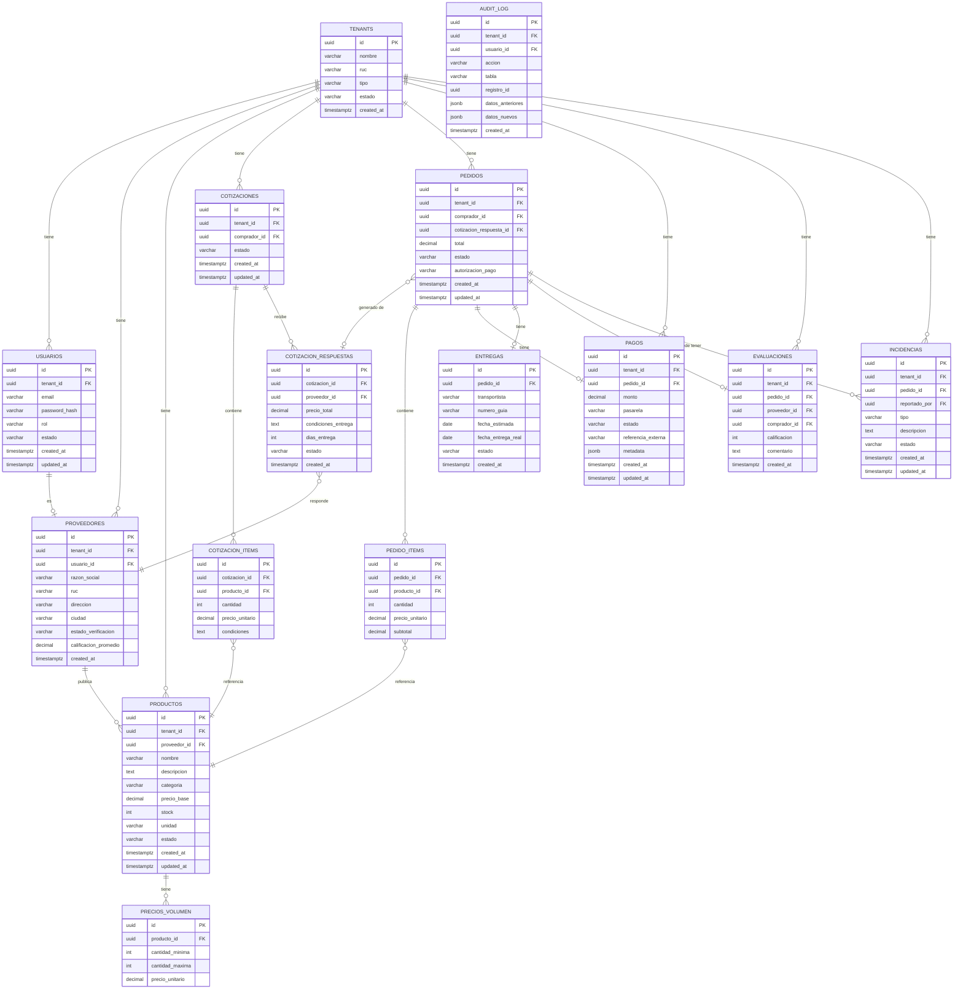

# Esquema de base de datos

> **Proyecto:** MayoristaPro B2B  
> **Motor:** PostgreSQL 15+  
> **Versión:** 1.0  
> **Relacionado con:** ADR-005, ADR-012, RF-01 a RF-40

---

## 1. Propósito

Este documento define el esquema relacional de PostgreSQL para MayoristaPro B2B. Incluye el diagrama entidad-relación, descripción de cada tabla, sus columnas, tipos de datos, constraints e índices relevantes.

---

## 2. Diagrama entidad-relación (ERD)



---

## 3. Descripción de tablas

### `tenants`

Tabla raíz del modelo multi-tenant. Cada empresa (proveedor o comprador) es un tenant.

| Columna | Tipo | Constraint | Descripción |
|---|---|---|---|
| `id` | `uuid` | PK | Identificador único del tenant. |
| `nombre` | `varchar(200)` | NOT NULL | Razón social o nombre comercial. |
| `ruc` | `varchar(11)` | UNIQUE, NOT NULL | RUC validado ante SUNAT. |
| `tipo` | `varchar(20)` | NOT NULL | `proveedor` o `comprador`. |
| `estado` | `varchar(20)` | NOT NULL, DEFAULT `'activo'` | `activo`, `suspendido`, `pendiente_verificacion`. |
| `created_at` | `timestamptz` | NOT NULL, DEFAULT `now()` | Fecha de registro. |

---

### `usuarios`

Cuentas de acceso a la plataforma. Cada usuario pertenece a un tenant.

| Columna | Tipo | Constraint | Descripción |
|---|---|---|---|
| `id` | `uuid` | PK | Identificador único. |
| `tenant_id` | `uuid` | FK → tenants(id), NOT NULL | Tenant al que pertenece. |
| `email` | `varchar(255)` | UNIQUE, NOT NULL | Correo de acceso. |
| `password_hash` | `varchar(255)` | NOT NULL | Hash bcrypt de la contraseña. |
| `rol` | `varchar(30)` | NOT NULL | `proveedor`, `comprador` o `administrador`. |
| `estado` | `varchar(20)` | NOT NULL, DEFAULT `'activo'` | `activo`, `inactivo`, `bloqueado`. |
| `created_at` | `timestamptz` | NOT NULL, DEFAULT `now()` | Fecha de registro. |
| `updated_at` | `timestamptz` | NOT NULL, DEFAULT `now()` | Última modificación. |

**Índices:** `idx_usuarios_tenant_id`, `idx_usuarios_email`.

---

### `proveedores`

Perfil comercial del proveedor. Extensión de `usuarios` para el rol proveedor.

| Columna | Tipo | Constraint | Descripción |
|---|---|---|---|
| `id` | `uuid` | PK | Identificador único. |
| `tenant_id` | `uuid` | FK → tenants(id), NOT NULL | Tenant del proveedor. |
| `usuario_id` | `uuid` | FK → usuarios(id), UNIQUE | Usuario asociado. |
| `razon_social` | `varchar(200)` | NOT NULL | Razón social registrada en SUNAT. |
| `ruc` | `varchar(11)` | NOT NULL | RUC de la empresa. |
| `direccion` | `varchar(300)` | | Dirección comercial. |
| `ciudad` | `varchar(100)` | | Ciudad donde opera. |
| `estado_verificacion` | `varchar(30)` | NOT NULL, DEFAULT `'pendiente'` | `pendiente`, `verificado`, `rechazado`. |
| `calificacion_promedio` | `decimal(3,2)` | DEFAULT `0.00` | Promedio de evaluaciones (0.00 – 5.00). |
| `created_at` | `timestamptz` | NOT NULL, DEFAULT `now()` | Fecha de registro. |

**Índices:** `idx_proveedores_tenant_id`, `idx_proveedores_ciudad`.

---

### `productos`

Catálogo de productos publicados por proveedores.

| Columna | Tipo | Constraint | Descripción |
|---|---|---|---|
| `id` | `uuid` | PK | Identificador único. |
| `tenant_id` | `uuid` | FK → tenants(id), NOT NULL | Tenant del proveedor dueño. |
| `proveedor_id` | `uuid` | FK → proveedores(id), NOT NULL | Proveedor que lo publica. |
| `nombre` | `varchar(200)` | NOT NULL | Nombre del producto. |
| `descripcion` | `text` | | Descripción detallada. |
| `categoria` | `varchar(100)` | NOT NULL | Categoría de producto. |
| `precio_base` | `decimal(12,2)` | NOT NULL, CHECK > 0 | Precio base sin descuentos por volumen. |
| `stock` | `int` | NOT NULL, DEFAULT `0`, CHECK >= 0 | Unidades disponibles. |
| `unidad` | `varchar(30)` | NOT NULL, DEFAULT `'unidad'` | Unidad de medida (unidad, caja, docena, kg). |
| `estado` | `varchar(20)` | NOT NULL, DEFAULT `'activo'` | `activo`, `pausado`, `eliminado`. |
| `created_at` | `timestamptz` | NOT NULL, DEFAULT `now()` | Fecha de publicación. |
| `updated_at` | `timestamptz` | NOT NULL, DEFAULT `now()` | Última modificación. |

**Índices:** `idx_productos_tenant_id`, `idx_productos_proveedor_id`, `idx_productos_categoria`, `idx_productos_nombre` (tsvector para búsqueda de texto completo).

> **Nota de concurrencia:** el campo `stock` usa `SELECT ... FOR UPDATE` en transacciones de pedido para evitar sobreventa (ADR-005, RN-07).

---

### `precios_volumen`

Precios diferenciados por rango de cantidad comprada (RF-08).

| Columna | Tipo | Constraint | Descripción |
|---|---|---|---|
| `id` | `uuid` | PK | Identificador único. |
| `producto_id` | `uuid` | FK → productos(id), NOT NULL | Producto al que aplica. |
| `cantidad_minima` | `int` | NOT NULL, CHECK > 0 | Cantidad mínima para aplicar el precio. |
| `cantidad_maxima` | `int` | CHECK > cantidad_minima | Cantidad máxima (NULL = sin límite). |
| `precio_unitario` | `decimal(12,2)` | NOT NULL, CHECK > 0 | Precio por unidad en este rango. |

---

### `cotizaciones`

Solicitud de cotización de un comprador a uno o varios proveedores.

| Columna | Tipo | Constraint | Descripción |
|---|---|---|---|
| `id` | `uuid` | PK | Identificador único. |
| `tenant_id` | `uuid` | FK → tenants(id), NOT NULL | Tenant del comprador. |
| `comprador_id` | `uuid` | FK → usuarios(id), NOT NULL | Comprador que solicita. |
| `estado` | `varchar(20)` | NOT NULL, DEFAULT `'abierta'` | `abierta`, `respondida`, `aceptada`, `vencida`. |
| `created_at` | `timestamptz` | NOT NULL, DEFAULT `now()` | Fecha de solicitud. |
| `updated_at` | `timestamptz` | NOT NULL, DEFAULT `now()` | Última modificación. |

---

### `cotizacion_items`

Ítems (productos y cantidades) incluidos en una solicitud de cotización.

| Columna | Tipo | Constraint | Descripción |
|---|---|---|---|
| `id` | `uuid` | PK | Identificador único. |
| `cotizacion_id` | `uuid` | FK → cotizaciones(id), NOT NULL | Cotización a la que pertenece. |
| `producto_id` | `uuid` | FK → productos(id), NOT NULL | Producto solicitado. |
| `cantidad` | `int` | NOT NULL, CHECK > 0 | Cantidad solicitada. |
| `precio_unitario` | `decimal(12,2)` | | Precio acordado (lo rellena el proveedor en la respuesta). |
| `condiciones` | `text` | | Condiciones adicionales del ítem. |

---

### `cotizacion_respuestas`

Respuesta de un proveedor a una solicitud de cotización.

| Columna | Tipo | Constraint | Descripción |
|---|---|---|---|
| `id` | `uuid` | PK | Identificador único. |
| `cotizacion_id` | `uuid` | FK → cotizaciones(id), NOT NULL | Cotización respondida. |
| `proveedor_id` | `uuid` | FK → proveedores(id), NOT NULL | Proveedor que responde. |
| `precio_total` | `decimal(12,2)` | NOT NULL, CHECK > 0 | Precio total de la oferta. |
| `condiciones_entrega` | `text` | | Condiciones de entrega y pago. |
| `dias_entrega` | `int` | CHECK > 0 | Días estimados para entrega. |
| `estado` | `varchar(20)` | NOT NULL, DEFAULT `'enviada'` | `enviada`, `aceptada`, `rechazada`. |
| `created_at` | `timestamptz` | NOT NULL, DEFAULT `now()` | Fecha de respuesta. |

---

### `pedidos`

Pedido confirmado a partir de una cotización aceptada.

| Columna | Tipo | Constraint | Descripción |
|---|---|---|---|
| `id` | `uuid` | PK | Identificador único. |
| `tenant_id` | `uuid` | FK → tenants(id), NOT NULL | Tenant del comprador. |
| `comprador_id` | `uuid` | FK → usuarios(id), NOT NULL | Comprador que confirma. |
| `cotizacion_respuesta_id` | `uuid` | FK → cotizacion_respuestas(id) | Respuesta de cotización origen. |
| `total` | `decimal(12,2)` | NOT NULL, CHECK > 0 | Monto total del pedido. |
| `estado` | `varchar(30)` | NOT NULL, DEFAULT `'pendiente'` | `pendiente`, `confirmado`, `en_preparacion`, `despachado`, `entregado`, `cancelado`. |
| `autorizacion_pago` | `varchar(100)` | | Código de autorización de la pasarela. |
| `created_at` | `timestamptz` | NOT NULL, DEFAULT `now()` | Fecha de creación. |
| `updated_at` | `timestamptz` | NOT NULL, DEFAULT `now()` | Última modificación. |

**Índices:** `idx_pedidos_tenant_id`, `idx_pedidos_comprador_id`, `idx_pedidos_estado`.

---

### `pedido_items`

Ítems confirmados del pedido.

| Columna | Tipo | Constraint | Descripción |
|---|---|---|---|
| `id` | `uuid` | PK | Identificador único. |
| `pedido_id` | `uuid` | FK → pedidos(id), NOT NULL | Pedido al que pertenece. |
| `producto_id` | `uuid` | FK → productos(id), NOT NULL | Producto comprado. |
| `cantidad` | `int` | NOT NULL, CHECK > 0 | Cantidad confirmada. |
| `precio_unitario` | `decimal(12,2)` | NOT NULL, CHECK > 0 | Precio en el momento de la compra (histórico). |
| `subtotal` | `decimal(12,2)` | NOT NULL, CHECK > 0 | cantidad × precio_unitario. |

---

### `pagos`

Registro de transacciones de pago asociadas a pedidos.

| Columna | Tipo | Constraint | Descripción |
|---|---|---|---|
| `id` | `uuid` | PK | Identificador único. |
| `tenant_id` | `uuid` | FK → tenants(id), NOT NULL | Tenant del comprador. |
| `pedido_id` | `uuid` | FK → pedidos(id), NOT NULL | Pedido pagado. |
| `monto` | `decimal(12,2)` | NOT NULL, CHECK > 0 | Monto de la transacción. |
| `pasarela` | `varchar(30)` | NOT NULL | `niubiz` o `mercado_pago`. |
| `estado` | `varchar(20)` | NOT NULL, DEFAULT `'pendiente'` | `pendiente`, `autorizado`, `pagado`, `rechazado`, `cancelado`, `reembolsado`. |
| `referencia_externa` | `varchar(100)` | | ID de la transacción en la pasarela. |
| `metadata` | `jsonb` | | Datos adicionales de la pasarela (sin datos de tarjeta). |
| `created_at` | `timestamptz` | NOT NULL, DEFAULT `now()` | Fecha de la transacción. |
| `updated_at` | `timestamptz` | NOT NULL, DEFAULT `now()` | Última modificación. |

> **Seguridad:** no se almacenan números de tarjeta ni CVV. Solo el token de autorización y la referencia externa (RF-23).

---

### `entregas`

Información de despacho y confirmación de recepción.

| Columna | Tipo | Constraint | Descripción |
|---|---|---|---|
| `id` | `uuid` | PK | Identificador único. |
| `pedido_id` | `uuid` | FK → pedidos(id), NOT NULL, UNIQUE | Pedido asociado. |
| `transportista` | `varchar(100)` | | Nombre de la empresa transportista. |
| `numero_guia` | `varchar(50)` | | Número de guía de remisión. |
| `fecha_estimada` | `date` | | Fecha estimada de entrega. |
| `fecha_entrega_real` | `date` | | Fecha real de entrega (lo registra el comprador). |
| `estado` | `varchar(20)` | NOT NULL, DEFAULT `'pendiente'` | `pendiente`, `en_transito`, `entregado`. |
| `created_at` | `timestamptz` | NOT NULL, DEFAULT `now()` | Fecha de registro del despacho. |

---

### `evaluaciones`

Calificaciones del comprador al proveedor tras recibir un pedido (RF-28).

| Columna | Tipo | Constraint | Descripción |
|---|---|---|---|
| `id` | `uuid` | PK | Identificador único. |
| `tenant_id` | `uuid` | FK → tenants(id), NOT NULL | Tenant del comprador. |
| `pedido_id` | `uuid` | FK → pedidos(id), NOT NULL, UNIQUE | Pedido evaluado. |
| `proveedor_id` | `uuid` | FK → proveedores(id), NOT NULL | Proveedor evaluado. |
| `comprador_id` | `uuid` | FK → usuarios(id), NOT NULL | Comprador que evalúa. |
| `calificacion` | `int` | NOT NULL, CHECK >= 1 AND <= 5 | Calificación del 1 al 5. |
| `comentario` | `text` | | Comentario opcional. |
| `created_at` | `timestamptz` | NOT NULL, DEFAULT `now()` | Fecha de evaluación. |

---

### `incidencias`

Reclamos y disputas relacionados con pedidos (RF-29, RF-30).

| Columna | Tipo | Constraint | Descripción |
|---|---|---|---|
| `id` | `uuid` | PK | Identificador único. |
| `tenant_id` | `uuid` | FK → tenants(id), NOT NULL | Tenant del comprador. |
| `pedido_id` | `uuid` | FK → pedidos(id), NOT NULL | Pedido relacionado. |
| `reportado_por` | `uuid` | FK → usuarios(id), NOT NULL | Usuario que reporta. |
| `tipo` | `varchar(50)` | NOT NULL | `producto_incorrecto`, `pago_fallido`, `entrega_tardía`, `otro`. |
| `descripcion` | `text` | NOT NULL | Descripción del problema. |
| `estado` | `varchar(20)` | NOT NULL, DEFAULT `'abierta'` | `abierta`, `en_revision`, `resuelta`, `cerrada`. |
| `created_at` | `timestamptz` | NOT NULL, DEFAULT `now()` | Fecha de registro. |
| `updated_at` | `timestamptz` | NOT NULL, DEFAULT `now()` | Última modificación. |

---

### `audit_log`

Registro de auditoría de operaciones relevantes (RF-36, AC08).

| Columna | Tipo | Constraint | Descripción |
|---|---|---|---|
| `id` | `uuid` | PK | Identificador único. |
| `tenant_id` | `uuid` | FK → tenants(id) | Tenant del usuario que actuó. |
| `usuario_id` | `uuid` | FK → usuarios(id) | Usuario que realizó la acción. |
| `accion` | `varchar(50)` | NOT NULL | `CREATE`, `UPDATE`, `DELETE`, `LOGIN`, `LOGOUT`. |
| `tabla` | `varchar(50)` | NOT NULL | Tabla o entidad afectada. |
| `registro_id` | `uuid` | | ID del registro afectado. |
| `datos_anteriores` | `jsonb` | | Estado previo del registro (para UPDATE/DELETE). |
| `datos_nuevos` | `jsonb` | | Nuevo estado del registro (para CREATE/UPDATE). |
| `created_at` | `timestamptz` | NOT NULL, DEFAULT `now()` | Fecha y hora de la operación. |

**Índices:** `idx_audit_log_tenant_id`, `idx_audit_log_usuario_id`, `idx_audit_log_tabla`, `idx_audit_log_created_at`.

---

## 4. Estrategia multi-tenant (ADR-012)

Todos los datos de negocio incluyen la columna `tenant_id`. El aislamiento es **lógico**, no físico (tablas compartidas, no schemas separados).

```sql
-- Ejemplo de consulta con filtro de tenant automático
SELECT * FROM productos
WHERE tenant_id = $1  -- tenant_id del usuario autenticado
  AND estado = 'activo';
```

El middleware de autenticación extrae el `tenant_id` del token JWT y lo inyecta en cada consulta a través del repositorio.

---

## 5. Índices y optimizaciones de rendimiento

```sql
-- Búsqueda de texto completo en productos
CREATE INDEX idx_productos_nombre_fts
  ON productos USING GIN (to_tsvector('spanish', nombre || ' ' || coalesce(descripcion, '')));

-- Búsqueda por categoría y tenant
CREATE INDEX idx_productos_tenant_categoria
  ON productos (tenant_id, categoria);

-- Pedidos por estado (para dashboards)
CREATE INDEX idx_pedidos_estado_created
  ON pedidos (estado, created_at DESC);

-- Audit log por rango de fechas
CREATE INDEX idx_audit_log_created_at
  ON audit_log (created_at DESC);
```

---

## 6. Relación con los módulos de negocio

| Tabla | Módulo | RF relacionados |
|---|---|---|
| `tenants`, `usuarios` | Usuarios | RF-01 a RF-04 |
| `proveedores` | Proveedores | RF-05, RF-06 |
| `productos`, `precios_volumen` | Productos | RF-07 a RF-12 |
| `cotizaciones`, `cotizacion_items`, `cotizacion_respuestas` | Cotizaciones | RF-13 a RF-15 |
| `pedidos`, `pedido_items` | Pedidos | RF-18 a RF-21 |
| `pagos` | Pagos | RF-22 a RF-24 |
| `entregas` | Entregas | RF-26, RF-27 |
| `evaluaciones` | Reputación | RF-28 |
| `incidencias` | Incidencias | RF-29, RF-30 |
| `audit_log` | Seguridad | RF-35, RF-36 |
