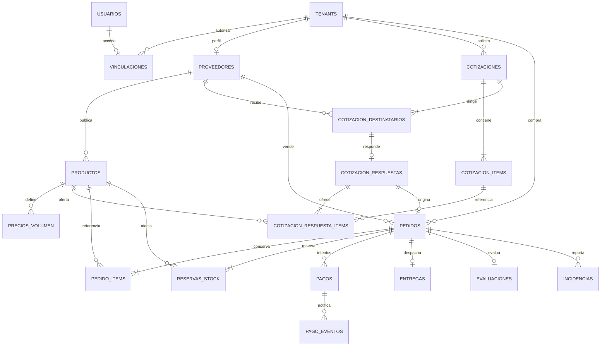

# Esquema de base de datos

Modelo lógico propuesto para PostgreSQL. No es una migración ejecutada. Mantiene las tablas del diseño inicial y agrega el detalle necesario para reservas, respuestas por proveedor y recuperación de pagos.

## Relaciones del flujo comercial

Se muestra el núcleo comercial. Auditoría, eventos de salida y archivos se describen debajo para no sobrecargar el diagrama.

## Tablas y campos principales

Todas las tablas usan id UUID y fechas de creación; las modificables agregan fecha de actualización. Las migraciones precisarán longitudes, nulabilidad e índices.

| Tabla | Campos y relaciones relevantes | Regla principal |
|---|---|---|
| tenants | nombre, ruc único, estado | Cada empresa es un tenant y puede comprar y vender simultáneamente. T2 usa `companies`. |
| usuarios | email único, password_hash, administración de plataforma | Cuenta independiente de la empresa. T2 usa `accounts`; el registro público nunca concede administración. |
| vinculaciones | tenant_id, usuario_id, permisos combinables, activo | T2 usa `memberships`, con permisos `manage`, `buy`, `publish`. El alta aprobada crea al responsable; la invitación incorpora cuentas nuevas. |
| proveedores | tenant_id único, estado_verificacion, dirección, ciudad | Perfil de empresa, no extensión exclusiva de un usuario; varios usuarios autorizados pueden operarlo. |
| productos | tenant_id, proveedor_id, sku, nombre, descripción, categoría, precio_base, moneda, precio_incluye_igv, cantidad_minima_compra, multiplo_compra, unidades_por_presentacion, stock, unidad, estado | Stock disponible no negativo; producto y proveedor pertenecen a la misma empresa. |
| importaciones_catalogo | proveedor_id, responsable_id, estado, idempotency_key, vence_at, resumen | Lote propio, vista previa vigente y confirmación única. |
| importacion_filas | importacion_id, numero_fila, sku, datos_validados, errores | Filas preparadas; un lote con errores no publica cambios parciales. |
| precios_volumen | producto_id, cantidad_minima, cantidad_maxima opcional, precio_unitario | Cantidades positivas; máximo mayor o igual al mínimo; rangos sin solapamientos. |
| cotizaciones | tenant_id del comprador, comprador_id del usuario, estado | Solicitud privada con destinatarios explícitos. |
| cotizacion_items | cotizacion_id, descripción solicitada, unidad, cantidad, producto_referencia_id opcional | No almacena el precio que ofrecen todos los proveedores. |
| cotizacion_destinatarios | cotizacion_id, proveedor_id | Par único; identifica quién puede recibir y responder. |
| cotizacion_respuestas | destinatario_id único, estado, moneda, precio_total, vigente_hasta, condiciones_entrega, dias_entrega | Oferta completa de un proveedor; solo una respuesta aceptada por solicitud en v1. |
| cotizacion_respuesta_items | respuesta_id, solicitud_item_id, producto_id, cantidad, presentación, equivalencia, mínimo y múltiplo de la oferta, precio_unitario, subtotal | Conserva las condiciones ofrecidas y exige que ítem, solicitud, destinatario y proveedor correspondan. |
| pedidos | tenant_id del comprador, comprador_id, proveedor_id obligatorio, cotizacion_respuesta_id obligatorio y único en v1, total, moneda, estado, idempotency_key, request_hash | Un comprador y un proveedor. Conserva condiciones de entrega e importes aceptados. |
| pedido_items | pedido_id, producto_id, descripción, unidad, unidades_por_presentacion, minimo y multiplo históricos, cantidad, precio_unitario, subtotal | Conserva cantidades y precios aceptados; todos los productos corresponden al proveedor del pedido. |
| reservas_stock | pedido_id, producto_id, cantidad, estado, vence_at | Par pedido/producto único. Activa, consumida o liberada. |
| pagos | pedido_id, monto, moneda, pasarela, estado, idempotency_key, referencia_externa, autorización opcional | Una fila por intento; el pedido puede tener varios intentos, pero no cobros duplicados. |
| pago_eventos | pago_id, pasarela, evento_externo_id, estado_procesamiento | Identificador externo único por pasarela para no repetir eventos. |
| entregas | pedido_id único, transportista, numero_guia, fecha_estimada, fecha_entrega_real, estado | Una entrega agregada por pedido en v1. |
| evaluaciones | pedido_id único, tenant_id, comprador_id, proveedor_id, calificación, comentario | Solo comprador de pedido recibido; calificación de 1 a 5. |
| incidencias | pedido_id, tenant_id, reportado_por, tipo, descripción, estado | Participantes autorizados y administración. |
| audit_log | tenant_id y usuario_id cuando correspondan, acción, entidad, registro_id, fecha, cambios permitidos | Sin contraseñas, credenciales, datos de tarjeta ni tokens. |
| outbox_eventos | tipo, agregado_id, payload permitido, estado, intentos, proximo_intento_at | Cambio comercial y evento pendiente se guardan en la misma transacción. |
| archivos | propietario_tenant_id, entidad e identificador asociado, objeto_s3, tipo, visibilidad | Imágenes públicas o documentos privados según permiso; sin URL pública permanente para documentos privados. |
| comprobantes | pedido_id, referencia_pse, estado, xml_archivo_id, cdr_archivo_id | Conserva resultado de facturación y documentos disponibles. |

## Integridad y concurrencia

T4: la migración `004_trade.sql` conserva en oferta y pedido el desglose de productos, IGV incluido, envío final, total PEN y plazo. Aceptación única por solicitud, pedido único por oferta/solicitud y reserva por pedido/producto; creación y deducción de stock en una sola transacción. Tablas físicas: `quotation_requests`, `quotation_items`, `quotation_recipients`, `quotation_offers`, `quotation_offer_items`, `trade_orders`, `trade_order_items`, `stock_reservations` y `order_keys`. La [SDD T4](../sprint-2-cotizaciones-pedidos.md) detalla FK compuestas, concurrencia, cálculo exacto y pruebas. Reservas activas sin vencimiento automático en T4; D3/T5 deben cerrar ese plazo antes del pago.

La operación mayorista amplía el diseño de `productos` con `sku` (único por proveedor), `multiplo_compra` y `unidades_por_presentacion`. Se conserva `unidad` como presentación de venta (caja, paquete u otra); `stock`, cantidades, mínimos y rangos de precio se expresan en esa presentación. El mínimo será positivo y compatible con el múltiplo. Los ítems de oferta y pedido conservarán una copia de presentación, equivalencia y condiciones aceptadas para no reinterpretar cantidades históricas.

Para la carga masiva se proponen `importaciones_catalogo` (proveedor, responsable, estado, clave de idempotencia, vencimiento y resumen) e `importacion_filas` (lote, número de fila, SKU, datos validados y errores). El backend revalida una vista previa vigente al confirmar. Un lote aplicado no puede duplicar efectos. La retención de archivos y datos de preparación se fijará al implementar.

La carga inicial declara existencias; las importaciones posteriores de metadatos no sobrescriben stock. Los ajustes de inventario tendrán responsable y motivo y se coordinarán con las reservas. Detalle: [reglas mayoristas](reglas-comerciales-mayoristas.md).

- Dinero en numeric con precisión definida y moneda PEN en v1; no usar flotantes para cálculos monetarios.
- FK y restricciones de unicidad protegen relaciones; checks validan cantidades, stock y estados. La pertenencia entre entidades se refuerza con claves compuestas o validaciones transaccionales en la implementación.
- Crear pedido, ítems y reservas y descontar stock disponible en **una transacción y conexión**. Bloquear productos en orden estable para reducir interbloqueos; aplicar reintentos limitados ante conflictos recuperables.
- Consumir la reserva después del pago no vuelve a descontar stock. Liberarla lo reintegra una sola vez mediante transición condicionada.
- La clave de creación es única por empresa compradora y operación; el hash detecta contenido distinto. Solo se permite un intento de pago en curso por pedido, con referencias estables y reconciliación antes de otro intento.
- La aceptación bloquea la solicitud y verifica pertenencia, vigencia y ausencia de otra oferta aceptada en la misma transacción. La restricción lógica es una aceptación por solicitud. La base mantiene un pedido por oferta en v1.

## Acceso entre empresas

| Datos | Acceso autorizado |
|---|---|
| Catálogo publicado | Compradores consultan productos de proveedores de otras empresas. |
| Solicitud de cotización | Comprador propietario y proveedores destinatarios; cada proveedor ve su propia respuesta, no las ofertas privadas de competidores. |
| Pedido y entrega | Empresa compradora y proveedora participantes, con permisos distintos. |
| Pagos y documentos privados | Solo la información necesaria para el participante autorizado y administración con permiso. |
| Auditoría | Acceso administrativo restringido y acciones registradas. |

No se aplica un filtro universal tenant_id del usuario a toda consulta. Las tablas hijas heredan autorización del recurso padre; los permisos se verifican también en accesos por identificador.

## Índices y validación propuesta

Índices iniciales: productos por proveedor/categoría, pedidos por empresa compradora/proveedor y fecha, reservas por estado/vencimiento, pagos por pedido/referencia, outbox por estado/próximo intento. Las búsquedas de texto se evaluarán con PostgreSQL y datos representativos antes de agregar otro motor.

Se probarán restricciones, restauración, acceso entre empresas, reintentos y sobreventa. Para EQ-06 se cuentan unidades y pedidos mediante la relación pedidos → pedido_items; producto_id no es una columna de pedidos.

## Precisión aprobada para T2 (10/11/2026)

T2 comprueba formato (11 dígitos) y unicidad del RUC. La consulta externa SUNAT queda pendiente de confirmación para otra entrega; se informa «revisado manualmente». Cada empresa puede comprar y vender. Los permisos combinables pertenecen a la vinculación usuario/empresa; administración de plataforma separada. Alta aprobada e invitación autorizan acceso, nunca la coincidencia de RUC. La verificación del proveedor es independiente. Véase [D1](../05-preparacion-sprint-2.md).

El esquema anterior es el objetivo comercial. La migración física `002_identity.sql` agrega además solicitudes de alta, sesiones, invitaciones y auditoría. Cada empresa nueva referencia un perfil en `suppliers`; los productos siguen obteniendo su empresa por ese proveedor. Los proveedores sintéticos de T1 se conservan sin usuarios asociados. La pertenencia a una sola empresa por cuenta es el alcance de T2. Detalle: [identidad implementada](../sprint-2-identidad.md).

T3 agrega `products.category`, `products.revision` y `catalog_imports` mediante `003_catalog_imports.sql`. El lote guarda filas normalizadas, errores y revisión esperada, huella, responsable, estado, vencimiento y resultado. La revisión cambia mediante trigger ante modificaciones de metadatos; stock se conserva y se lee vigente durante confirmación. Filas y cabecera del lote se almacenan juntas en JSONB, con máximo 500 filas. La aplicación de productos, lote y auditoría usa una sola transacción. [Detalle y limitaciones de concurrencia](../sprint-2-carga-masiva.md).
