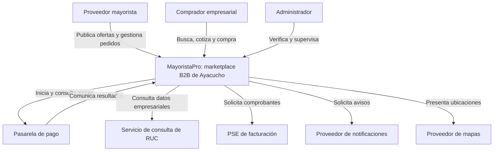

# Nivel 1: contexto del sistema

**Pregunta:** ¿quién usa MayoristaPro y con qué sistemas se relaciona? La plataforma se muestra como una sola caja; no se detallan frameworks ni bases de datos.

| Participante | Responsabilidad |
|---|---|
| Proveedor | Empresa mayorista que publica productos y responde cotizaciones. |
| Comprador | Bodega, librería, minimarket u otro negocio que se abastece. |
| Administrador | Verifica proveedores y supervisa incidencias y operación. |
| Servicios externos | Procesan pagos, consultas empresariales, facturación, avisos y mapas según el contrato disponible. |

## Límites del sistema

- El negocio es B2B; no incluye grupos de consumidores, custodia de fondos ni transporte propio.
- La recomendación Python es un componente propio de MayoristaPro: se detalla en el nivel 2, no como un proveedor externo de IA en v1.
- Consulta de RUC y facturación son responsabilidades distintas; no se presupone que el PSE provea ambas.
- Se diseñará para evaluar 2,000 usuarios concurrentes. No se afirma que esa capacidad ya esté demostrada.

**Siguiente vista:** [Nivel 2: contenedores](Nivel2-Diagrama-de-Contenedores.md).
