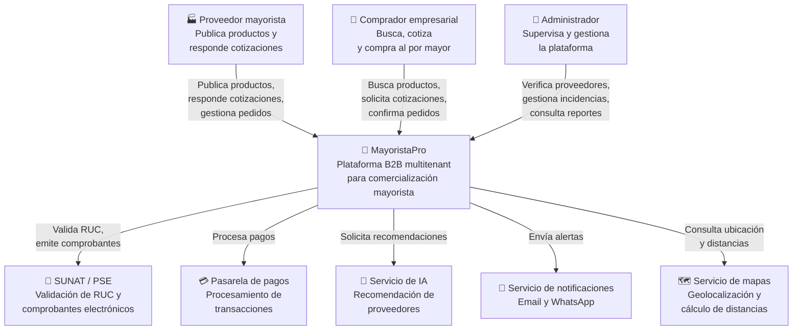
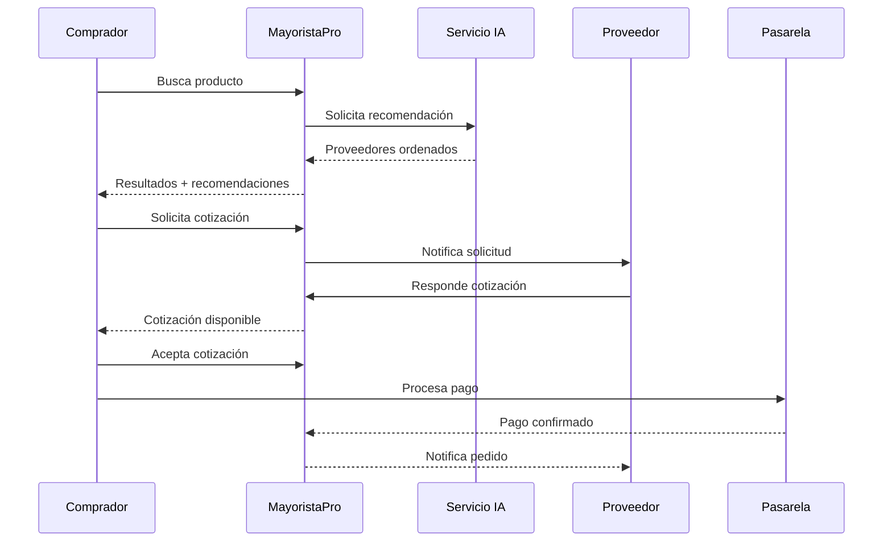
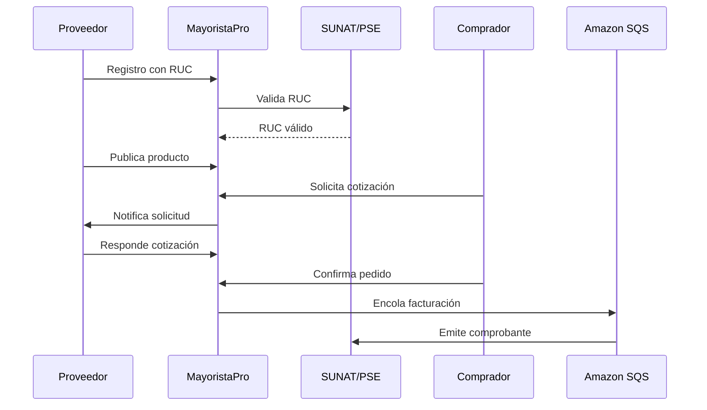

# Nivel 1 — Diagrama de Contexto del Sistema

> **Proyecto:** MayoristaPro B2B
> **Nivel C4:** 1 — Contexto
> **Versión:** 1.0

---

## 1. Propósito

Este diagrama muestra **MayoristaPro como una caja negra** y sus relaciones con los actores humanos y sistemas externos que interactúan con él. Está dirigido a audiencias no técnicas: stakeholders, docentes, usuarios finales.

---

## 2. Diagrama de contexto

---

## 3. Actores y sistemas externos

### Actores humanos

| Actor | Descripción | Interacción principal con MayoristaPro |
|---|---|---|
| Proveedor mayorista | Empresa que vende al por mayor (distribuidora, importador, fabricante) | Publica productos, responde cotizaciones, gestiona pedidos y despachos |
| Comprador empresarial | Negocio que compra al por mayor (bodega, librería, minimarket, restaurante) | Busca, solicita cotizaciones, compara, confirma pedidos y paga |
| Administrador | Responsable de la operación de la plataforma | Verifica proveedores, gestiona incidencias, supervisa reportes |

### Sistemas externos

| Sistema | Descripción | Tipo de integración |
|---|---|---|
| SUNAT / PSE | Validación de RUC y emisión de comprobantes electrónicos | API REST |
| Pasarela de pagos | Procesamiento de pagos (Niubiz, Mercado Pago) | API REST + webhooks |
| Servicio de IA | Recomendación de proveedores según criterios comerciales | API REST o módulo interno |
| Servicio de notificaciones | Envío de alertas por email y WhatsApp | API REST |
| Servicio de mapas | Geolocalización y cálculo de distancias | API REST |

---

## 4. Descripción del sistema

**MayoristaPro** es una plataforma B2B multitenant que conecta proveedores mayoristas (de Lima, Ayacucho u otras regiones) con compradores empresariales de Ayacucho. Su propósito es digitalizar la comercialización mayorista, permitiendo que los compradores encuentren proveedores, comparen precios, soliciten cotizaciones y confirmen pedidos en línea.

**Características clave:**
- Comercialización mayorista entre empresas.
- Precios diferenciados por volumen.
- Recomendación de proveedores con IA.
- Multi-tenancy con aislamiento de datos.
- Soporte para 2,000 usuarios concurrentes.

---

## 5. Flujos principales

### Flujo 1: Comprador busca y compra

### Flujo 2: Proveedor publica y vende

---

## 6. Fuera de alcance (Nivel 1)

| No se muestra en este nivel | Se detalla en |
|---|---|
| Componentes internos del sistema | Nivel 2 — Contenedores |
| Módulos de la aplicación | Nivel 3 — Componentes |
| Clases y estructuras de código | Nivel 4 — Código |
| Detalles de implementación | Documentos de diseño interno |

---

## 7. Notas y consideraciones

- **Multi-tenancy:** varios proveedores y compradores comparten la plataforma con aislamiento de datos.
- **Integración con SUNAT:** la validación de RUC y la emisión de comprobantes se delegan a un PSE autorizado.
- **Pagos:** MayoristaPro no almacena fondos ni datos de tarjetas.
- **IA:** en v1 es un módulo interno con motor de reglas; en v2 se prevé integración con API externa.
- **Escalabilidad:** el sistema está diseñado para 2,000 usuarios concurrentes en picos estacionales.

---

## 8. Leyenda de notación

| Elemento | Significado |
|---|---|
| Rectángulo con borde | Persona (actor humano) |
| Rectángulo con nombre y descripción | Sistema de software |
| Flecha con etiqueta | Relación y dirección de la interacción |
| Texto entre corchetes | Tecnología o tipo de integración |