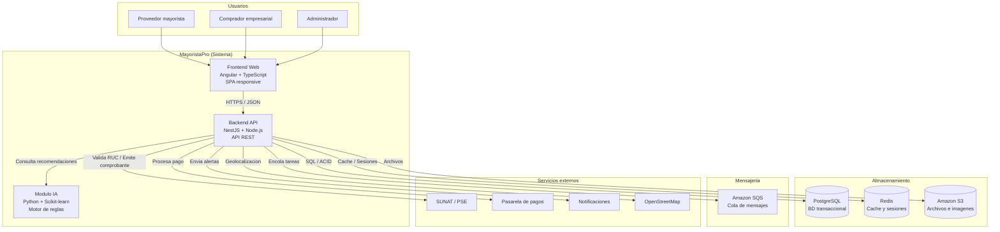
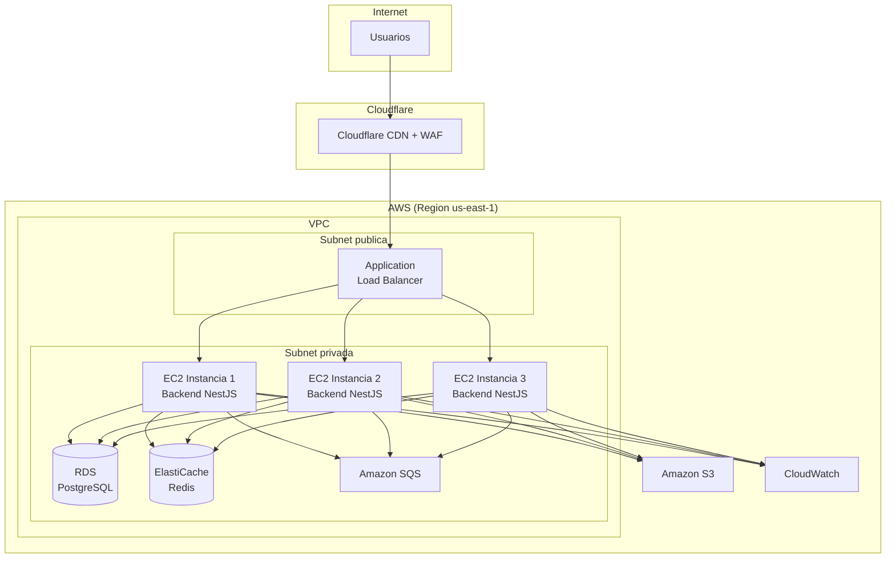

# Nivel 2 — Diagrama de Contenedores

> **Proyecto:** MayoristaPro B2B
> **Nivel C4:** 2 — Contenedores
> **Versión:** 1.0

---

## 1. Propósito

Este diagrama muestra **cómo se descompone MayoristaPro en contenedores** (aplicaciones, servicios, bases de datos) y cómo se comunican entre sí. Está dirigido a arquitectos de software y desarrolladores técnicos.

Un "contenedor" en C4 es una unidad desplegable o ejecutable que ejecuta código o almacena datos.

---

## 2. Diagrama de contenedores

---

## 3. Descripción de contenedores

### Contenedores propios

| Contenedor | Tecnología | Responsabilidad | Tipo |
|---|---|---|---|
| Frontend Web | Angular + TypeScript | Interfaz de usuario responsive para proveedores, compradores y administradores. | SPA |
| Backend API | NestJS + Node.js | Implementa la lógica de negocio, expone APIs REST y coordina las operaciones comerciales. | API REST |
| Módulo IA | Python + Scikit-learn | Genera recomendaciones de proveedores según precio, disponibilidad, ubicación e historial. | Servicio interno |
| PostgreSQL | PostgreSQL 15+ | Almacena datos transaccionales con garantías ACID: usuarios, productos, cotizaciones, pedidos, pagos. | Base de datos |
| Redis | Redis 7+ | Almacena caché de consultas frecuentes, sesiones de usuario y contadores. | Caché en memoria |
| Amazon S3 | AWS S3 | Almacena imágenes de productos, documentos comerciales y comprobantes electrónicos. | Almacenamiento de objetos |
| Amazon SQS | AWS SQS | Cola de mensajes para procesamiento asíncrono de notificaciones, facturación y emails. | Cola de mensajes |

### Servicios externos

| Sistema | Tecnología | Responsabilidad | Protocolo |
|---|---|---|---|
| SUNAT / PSE | NubeFacT / Alanube | Validación de RUC y emisión de comprobantes electrónicos. | API REST |
| Pasarela de pagos | Niubiz / Mercado Pago | Procesamiento de transacciones con tarjeta. | API REST + webhooks |
| Servicio de notificaciones | Turbo Cloud / Awaitra | Envío de alertas por email y WhatsApp. | API REST |
| Servicio de mapas | OpenStreetMap + MapLibre | Geolocalización de proveedores y cálculo de distancias. | API REST |

---

## 4. Comunicación entre contenedores

| Origen | Destino | Protocolo | Formato | Propósito |
|---|---|---|---|---|
| Frontend Web | Backend API | HTTPS | JSON | Operaciones del usuario |
| Backend API | Módulo IA | HTTP interno | JSON | Solicitar recomendaciones |
| Backend API | PostgreSQL | TCP | SQL | Persistencia transaccional |
| Backend API | Redis | TCP | Comandos Redis | Caché y sesiones |
| Backend API | Amazon S3 | HTTPS | Binario | Almacenar imágenes y documentos |
| Backend API | Amazon SQS | HTTPS | JSON | Encolar tareas asíncronas |
| Backend API | SUNAT / PSE | HTTPS | JSON/XML | Validación y facturación |
| Backend API | Pasarela de pagos | HTTPS | JSON | Procesar pagos |
| Backend API | Notificaciones | HTTPS | JSON | Enviar alertas |
| Backend API | Mapas | HTTPS | JSON | Geolocalización |
| Amazon SQS | Workers | HTTPS | JSON | Procesar tareas |

---

## 5. Justificación de decisiones por contenedor

### Backend API (NestJS)

- **Framework completo:** NestJS incluye inyección de dependencias, routing, validación y testing.
- **Modularidad:** se alinea con Clean Architecture y permite separar capas fácilmente.
- **TypeScript:** tipado fuerte en todo el backend.
- **Ecosistema:** integración con TypeORM, Passport, Swagger.

### PostgreSQL

- **ACID:** operaciones transaccionales críticas (pedidos, pagos, stock).
- **Integridad referencial:** constraints y claves foráneas.
- **Consultas complejas:** dashboards y reportes sin necesidad de un motor adicional.
- **JSONB:** flexibilidad para datos semi-estructurados cuando sea necesario.

### Redis

- **Latencia baja:** respuestas en microsegundos para consultas frecuentes.
- **Caché:** reduce la carga sobre PostgreSQL.
- **Sesiones:** permite escalabilidad horizontal sin estado compartido en memoria local.
- **Contadores:** control de concurrencia y rate limiting.

### Amazon SQS

- **Desacoplamiento:** notificaciones, emails y facturación no bloquean la respuesta al usuario.
- **Reintentos:** los mensajes fallidos se reintentan automáticamente.
- **Escalabilidad:** múltiples workers procesan mensajes en paralelo.

### Módulo IA

- **Scikit-learn (v1):** motor de reglas sin costos de API, explicable y de baja latencia.
- **Evolución (v2):** posibilidad de integrar API externa (OpenAI GPT-4o mini o DeepSeek) cuando haya datos suficientes.
- **Fallback:** si el módulo no responde, el frontend permite búsqueda y comparación manual.

### Amazon S3

- **Escalabilidad:** almacena cualquier volumen de imágenes y documentos.
- **Costo bajo:** pago por uso.
- **Integración nativa:** compatible con el resto del stack AWS.

---

## 6. Vista de despliegue

---

## 7. Contenedores descartados (y por qué)

| Contenedor | Por qué no se incluyó en v1 |
|---|---|
| MongoDB | PostgreSQL cubre los requisitos de v1. Se prevé en v2 para logs y catálogo extendido. |
| Elasticsearch | PostgreSQL con `tsvector` es suficiente para búsqueda en v1. |
| Kafka | Amazon SQS cubre los casos de uso sin la complejidad de Kafka. |
| Kubernetes | AWS ECS o instancias simples son suficientes para el volumen proyectado. |
| API Gateway dedicado | El ALB maneja el enrutamiento básico. Se evalúa en v2 si hay múltiples servicios. |
| MongoDB Atlas | No se justifica en v1. |

---

## 8. Atributos de calidad cubiertos

| Atributo | Cómo lo cubren los contenedores |
|---|---|
| Rendimiento | Redis (caché), ALB (distribución), SQS (async). |
| Disponibilidad | Múltiples instancias backend, RDS con backups, CloudWatch. |
| Escalabilidad | Auto-scaling de instancias, ALB, caché distribuida. |
| Seguridad | Cloudflare WAF, HTTPS, JWT, aislamiento en VPC. |
| Mantenibilidad | Separación clara de contenedores, API REST. |
| Concurrencia | Transacciones ACID en PostgreSQL. |

---

## 9. Notas y consideraciones

- **Multi-tenancy:** un solo backend sirve a múltiples proveedores y compradores; el aislamiento se hace a nivel de datos.
- **Alta concurrencia:** se maneja con múltiples instancias backend, caché distribuida y procesamiento asíncrono.
- **IA:** en v1 es un módulo interno; en v2 se puede desplegar como servicio independiente.
- **Monitoreo:** todas las instancias reportan métricas a Amazon CloudWatch.

---

## 10. Leyenda de notación

| Elemento | Significado |
|---|---|
| Rectángulo con borde redondeado | Contenedor (unidad desplegable) |
| Cilindro | Base de datos o almacenamiento |
| Rectángulo con línea discontinua | Servicio externo |
| Flecha con etiqueta | Relación y protocolo |
| Subgraph | Agrupación lógica (sistema, red, región) |