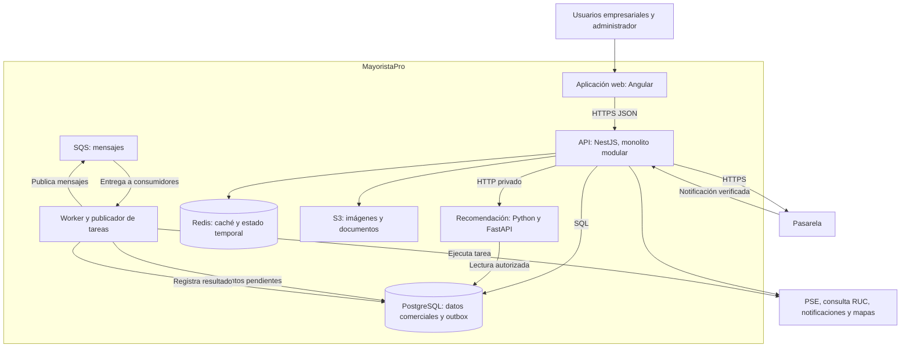

# Nivel 2: contenedores

**Pregunta:** ¿qué aplicaciones y almacenes forman MayoristaPro? En C4, contenedor significa una aplicación o almacén de datos; no equivale necesariamente a Docker.

El worker representa procesos auxiliares del mismo código base; publicador y consumidores pueden ejecutarse por separado. SQS entrega mensajes; el consumidor debe reconocer duplicados.

| Contenedor | Responsabilidad y acceso |
|---|---|
| Angular | Interfaz del navegador, sin secretos de proveedores. |
| API NestJS | Autoriza operaciones y ejecuta casos de uso. |
| Python/FastAPI | Puntuación de proveedores por reglas y explicación; lectura limitada. |
| PostgreSQL | Fuente de verdad de pedidos y stock; incluye intentos de pago y eventos pendientes. |
| Redis | Copias temporales y sesiones compartidas; no confirma stock. |
| S3 | Imágenes y documentos con visibilidad pública o privada según uso. |
| SQS y workers | Tareas posteriores, reintentos y resultados persistidos. |

## Despliegue y seguridad

API y workers se proponen en EC2, PostgreSQL en RDS y monitoreo en CloudWatch. Cloudflare y ALB pertenecen a la vista de despliegue; no son módulos comerciales. La cantidad de instancias y el hosting de Redis se definirán con presupuesto y pruebas.

PostgreSQL, Redis y Python no se exponen directamente a Internet. El acceso requiere red y credenciales autorizadas. Python usa datos comerciales permitidos y no modifica pedidos. El navegador consume la API, salvo el flujo de pago tokenizado/redirigido que se acuerde con el proveedor.

**Anterior:** [Contexto](Nivel1-Diagrama-de-Contexto.md). **Siguiente:** [Componentes](Nivel3-Diagrama-de-Componentes.md).
