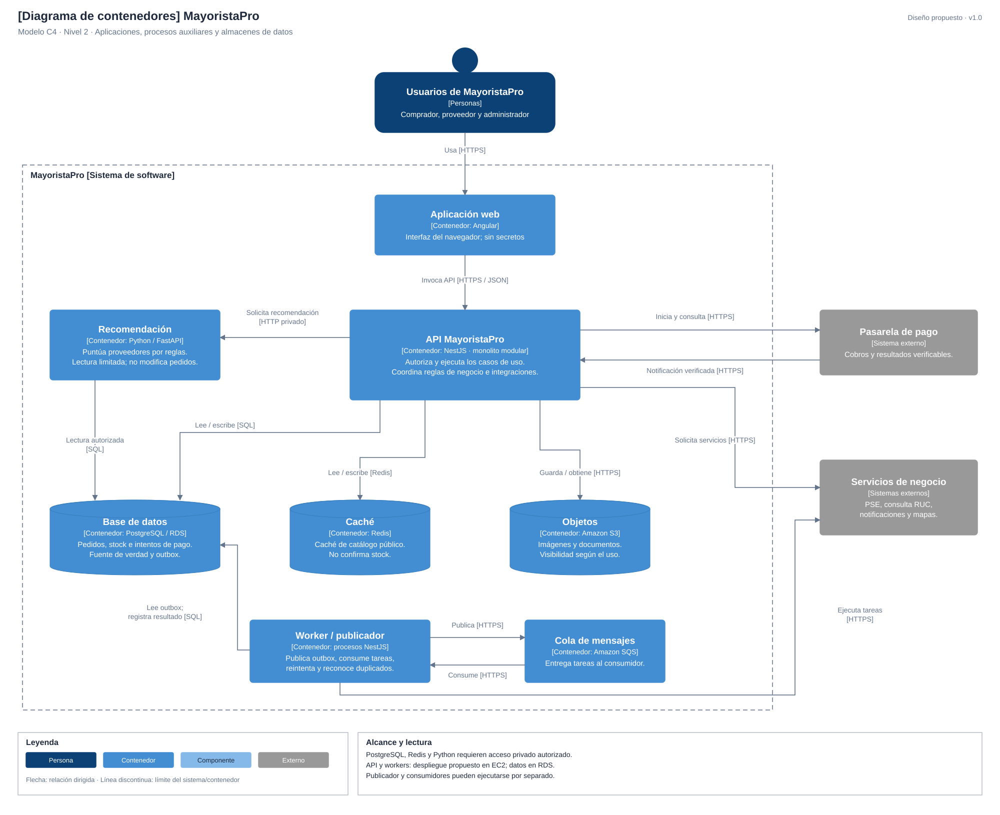

# Nivel 2: contenedores

**Pregunta:** ¿qué aplicaciones y almacenes forman MayoristaPro? En C4, contenedor significa una aplicación o almacén de datos; no equivale necesariamente a Docker.

**Fuente editable:** [nivel2-contenedores.svg](../../img/fuentes-svg/nivel2-contenedores.svg).

La imagen representa la visión de evolución. El [despliegue académico](../02-arquitectura-software/despliegue-academico.md) concreta la primera entrega. El worker representa procesos auxiliares del mismo código base; publicador y consumidores pueden ejecutarse por separado. SQS entrega mensajes; el consumidor debe reconocer duplicados.

| Contenedor | Responsabilidad y acceso |
|---|---|
| Angular | Interfaz del navegador, sin secretos de proveedores. |
| API NestJS | Autoriza operaciones y ejecuta casos de uso. |
| Python/FastAPI | Vista de evolución. El despliegue académico llama al modelo mediante un puerto de NestJS. Un proceso Python separado queda sujeto a justificación. |
| PostgreSQL | Fuente de verdad de pedidos y stock; incluye intentos de pago y eventos pendientes. |
| Redis | Caché compartida del catálogo público. La estrategia de sesiones se verifica aparte. |
| S3 | Imágenes y documentos con visibilidad pública o privada según uso. |
| SQS y workers | Tareas posteriores, reintentos y resultados persistidos. |

## Despliegue y seguridad

**Implementado en el Sprint 3:** todos los contenedores (Nginx con Angular, NestJS, worker, FastAPI, PostgreSQL y Redis) corren con Docker Compose en una instancia EC2. Cloudflare aporta DNS, HTTPS y CDN, y llega a Nginx mediante Cloudflare Tunnel. Solo Nginx escucha, y solo en `127.0.0.1:8080`. Ver [Sprint 3: integración y despliegue](../sprint-3-despliegue.md).

**Evolución:** PostgreSQL en RDS, ALB con varias réplicas de la API, S3, SQS y CloudWatch quedan para cuando la carga lo justifique.

PostgreSQL, Redis y Python no se exponen directamente a Internet. El acceso requiere red y credenciales autorizadas. Python usa datos comerciales permitidos y no modifica pedidos. El navegador consume la API, salvo el flujo de pago tokenizado/redirigido que se acuerde con el proveedor.

**Anterior:** [Contexto](Nivel1-Diagrama-de-Contexto.md). **Siguiente:** [Componentes](Nivel3-Diagrama-de-Componentes.md).
