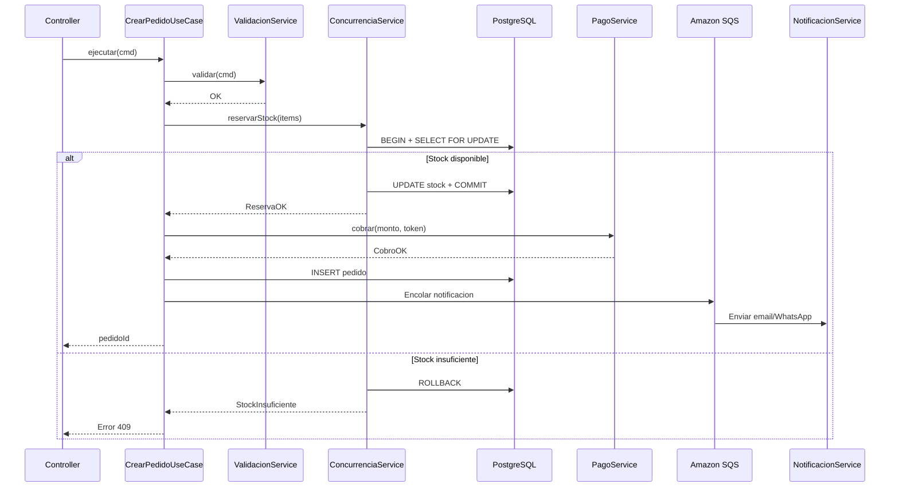
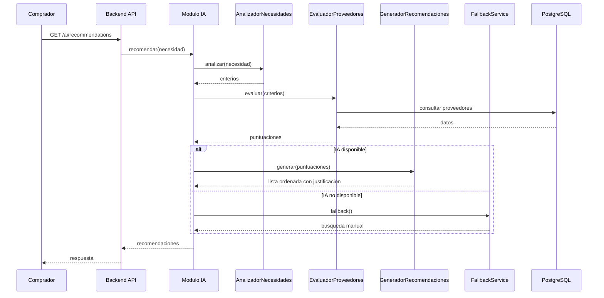
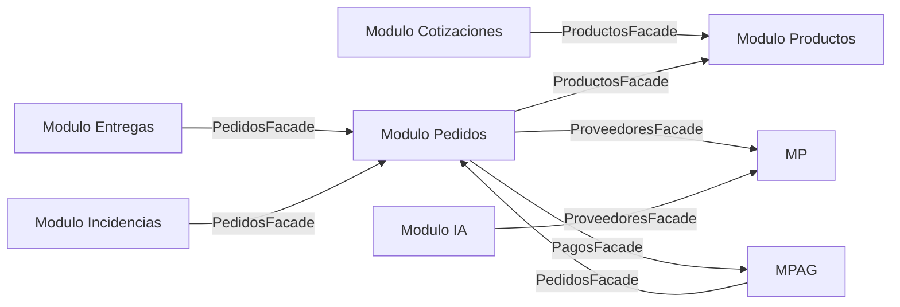

# Nivel 3 — Diagrama de Componentes

> **Proyecto:** MayoristaPro B2B
> **Nivel C4:** 3 — Componentes
> **Versión:** 1.0

---

## 1. Propósito

Este diagrama muestra **cómo se descompone cada contenedor en componentes** (módulos, servicios, clases) y cómo se comunican entre sí. Está dirigido a arquitectos y desarrolladores. En MayoristaPro, el contenedor principal es el **Backend API**, que se descompone en módulos siguiendo Clean Architecture.

---

## 2. Vista general del Backend API

```mermaid
graph TB
    subgraph Backend["Backend API (NestJS)"]
        subgraph Modulos["Modulos de negocio"]
            MU[Modulo Usuarios]
            MP[Modulo Proveedores]
            MPR[Modulo Productos]
            MC[Modulo Cotizaciones]
            MPED[Modulo Pedidos]
            MPAG[Modulo Pagos]
            ME[Modulo Entregas]
            MI[Modulo Incidencias]
            MR[Modulo Reportes]
            MIA[Modulo IA]
            MADM[Modulo Administracion]
        end

        subgraph Shared["Componentes compartidos"]
            AUTH[Servicio de autenticacion]
            LOG[Servicio de logs y auditoria]
            NOT[Servicio de notificaciones]
            VAL[Servicio de validacion]
        end

        subgraph Infra["Infraestructura compartida"]
            REPO[Repositorios]
            CACHE[Adaptador Redis]
            QUEUE[Adaptador SQS]
            EXT[Adaptadores externos]
        end
    end

    subgraph Datos["Persistencia y servicios"]
        PG[(PostgreSQL)]
        RD[(Redis)]
        SQS[Amazon SQS]
        S3[Amazon S3]
    end

    MU --> AUTH
    MP --> AUTH
    MPR --> AUTH
    MC --> AUTH
    MPED --> AUTH
    MPAG --> AUTH
    ME --> AUTH
    MI --> AUTH
    MR --> AUTH
    MIA --> AUTH
    MADM --> AUTH

    MU --> LOG
    MP --> LOG
    MPED --> LOG
    MPAG --> LOG
    MI --> LOG

    MC --> NOT
    MPED --> NOT
    MPAG --> NOT
    ME --> NOT

    MPR --> VAL
    MC --> VAL
    MPED --> VAL

    MU --> REPO
    MP --> REPO
    MPR --> REPO
    MC --> REPO
    MPED --> REPO
    MPAG --> REPO
    ME --> REPO
    MI --> REPO
    MR --> REPO
    MADM --> REPO

    REPO --> PG
    CACHE --> RD
    QUEUE --> SQS
    EXT --> S3

    MC --> CACHE
    MPR --> CACHE
    MPED --> QUEUE
    MPAG --> EXT
    MIA --> EXT
```



---

## 3. Módulos de negocio

### Módulo de Usuarios (MU)

| Componente | Responsabilidad |
|---|---|
| RegistroService | Registro de proveedores y compradores con validación de RUC. |
| AutenticacionService | Login con JWT, generación y validación de tokens. |
| RolesService | Asignación y verificación de permisos por rol. |
| UsuarioRepository | Persistencia de usuarios en PostgreSQL. |

### Módulo de Proveedores (MP)

| Componente | Responsabilidad |
|---|---|
| VerificacionService | Verificación de proveedores por parte del administrador. |
| PerfilComercialService | Gestión del perfil comercial del proveedor. |
| HistorialService | Consulta de historial de ventas, pedidos y evaluaciones. |
| ProveedorRepository | Persistencia de proveedores en PostgreSQL. |

### Módulo de Productos (MPR)

| Componente | Responsabilidad |
|---|---|
| PublicacionService | Publicación de productos con precios por volumen. |
| PreciosVolumenService | Configuración de precios diferenciados por cantidad. |
| CargaMasivaService | Importación masiva desde CSV/Excel. |
| BusquedaService | Búsqueda con filtros y tolerancia a errores. |
| ProductoRepository | Persistencia de productos en PostgreSQL. |

### Módulo de Cotizaciones (MC)

| Componente | Responsabilidad |
|---|---|
| SolicitudService | Solicitud de cotización a uno o varios proveedores. |
| RespuestaService | Respuesta del proveedor con precio, stock y condiciones. |
| ComparacionService | Comparación de cotizaciones recibidas. |
| CotizacionRepository | Persistencia de cotizaciones en PostgreSQL. |

### Módulo de Pedidos (MPED)

| Componente | Responsabilidad |
|---|---|
| ConfirmacionService | Confirmación de pedido con validación de stock y ACID. |
| SeguimientoService | Consulta de estado e historial de pedidos. |
| EstadoService | Gestión de transiciones de estado. |
| ConcurrenciaService | Control de concurrencia sobre stock. |
| PedidoRepository | Persistencia de pedidos en PostgreSQL. |

### Módulo de Pagos (MPAG)

| Componente | Responsabilidad |
|---|---|
| PagoService | Procesamiento de pagos con pasarela externa. |
| EstadoPagoService | Registro y consulta de estado de pagos. |
| ReembolsoService | Procesamiento de reembolsos cuando corresponde. |
| PagoRepository | Persistencia de transacciones en PostgreSQL. |

### Módulo de Entregas (ME)

| Componente | Responsabilidad |
|---|---|
| DespachoService | Registro de información de despacho. |
| ConfirmacionService | Confirmación de recepción por parte del comprador. |
| EntregaRepository | Persistencia de entregas en PostgreSQL. |

### Módulo de Incidencias (MI)

| Componente | Responsabilidad |
|---|---|
| RegistroService | Registro de incidencias por parte del comprador. |
| GestionService | Gestión de incidencias por parte del administrador. |
| IncidenciaRepository | Persistencia de incidencias en PostgreSQL. |

### Módulo de Reportes (MR)

| Componente | Responsabilidad |
|---|---|
| DashboardService | Generación de dashboards con indicadores clave. |
| ReporteService | Generación de reportes de ventas, productos y comportamiento. |
| ExportacionService | Exportación a PDF/Excel. |
| ReporteRepository | Consultas analíticas sobre PostgreSQL. |

### Módulo de IA (MIA)

| Componente | Responsabilidad |
|---|---|
| AnalizadorNecesidades | Procesamiento de la solicitud del comprador. |
| EvaluadorProveedores | Puntuación según precio, stock, ubicación e historial. |
| GeneradorRecomendaciones | Lista ordenada con justificación. |
| FallbackService | Búsqueda y comparación manual si la IA no está disponible. |

### Módulo de Administración (MADM)

| Componente | Responsabilidad |
|---|---|
| UsuariosAdminService | Gestión general de usuarios. |
| CategoriasService | Configuración de categorías y parámetros. |
| SupervisionService | Supervisión de operaciones de la plataforma. |
| ReportesAdminService | Reportes específicos del administrador. |

---

## 4. Componentes compartidos

| Componente | Responsabilidad | Usado por |
|---|---|---|
| Servicio de autenticación | Verificación de JWT y roles. | Todos los módulos |
| Servicio de logs y auditoría | Registro de operaciones relevantes. | Todos los módulos |
| Servicio de notificaciones | Envío de emails y WhatsApp. | Cotizaciones, Pedidos, Pagos, Entregas |
| Servicio de validación | Validación de RUC, montos, cantidades. | Usuarios, Productos, Cotizaciones, Pedidos |

---

## 5. Infraestructura compartida

| Componente | Tecnología | Responsabilidad |
|---|---|---|
| Repositorios | PostgreSQL | Persistencia transaccional con ACID. |
| Adaptador Redis | Redis | Caché de consultas frecuentes y sesiones. |
| Adaptador SQS | Amazon SQS | Procesamiento asíncrono de notificaciones, facturación y emails. |
| Adaptadores externos | Varios | PSE, pasarela, IA, notificaciones, mapas. |
| Adaptador S3 | Amazon S3 | Almacenamiento de imágenes y documentos. |

---

## 6. Flujo de componentes: crear pedido



---

## 7. Flujo de componentes: recomendar proveedores



---

## 8. Comunicación entre módulos

Los módulos se comunican mediante **fachadas** (Facade Pattern). No acceden directamente a las tablas de otros módulos.



**Reglas de comunicación:**
- Cada módulo expone solo su fachada pública (`index.ts`).
- No se accede a repositorios de otros módulos.
- Las transacciones que cruzan módulos se coordinan en un caso de uso de aplicación.

---

## 9. Estructura de carpetas del Backend

```text
src/
├── shared/
│   ├── errores/
│   ├── eventos/
│   └── utils/
├── modules/
│   ├── usuarios/
│   ├── proveedores/
│   ├── productos/
│   ├── cotizaciones/
│   ├── pedidos/
│   ├── pagos/
│   ├── entregas/
│   ├── incidencias/
│   ├── reportes/
│   ├── ia/
│   └── administracion/
└── infrastructure/
    ├── database/
    ├── cache/
    ├── queue/
    └── external/
```

---

## 10. Atributos de calidad cubiertos por los componentes

| Atributo | Componentes que lo cubren |
|---|---|
| Rendimiento | Caché Redis, búsqueda optimizada, paginación. |
| Escalabilidad | Módulos desacoplados, procesamiento asíncrono con SQS. |
| Concurrencia | ConcurrenciaService con transacciones ACID. |
| Seguridad | Servicio de autenticación, roles, validación. |
| Auditabilidad | Servicio de logs y auditoría. |
| Mantenibilidad | Fachadas, Clean Architecture, módulos independientes. |
| Interoperabilidad | Adaptadores externos para PSE, pagos, IA, notificaciones. |

---

## 11. Notas y consideraciones

- **Modularidad:** cada módulo tiene su propio dominio, aplicación, infraestructura y presentación.
- **Fachadas:** la comunicación entre módulos es explícita y desacoplada.
- **Escalabilidad futura:** cualquier módulo puede extraerse a un servicio independiente sin reescribir la lógica.
- **Testing:** cada componente se testea de forma aislada usando mocks de sus dependencias.

---

## 12. Leyenda de notación

| Elemento | Significado |
|---|---|
| Rectángulo con borde | Componente (módulo o servicio) |
| Subgraph | Agrupación lógica (módulo, capa) |
| Flecha con etiqueta | Dependencia o llamada entre componentes |
| Línea discontinua | Comunicación entre módulos mediante fachada |