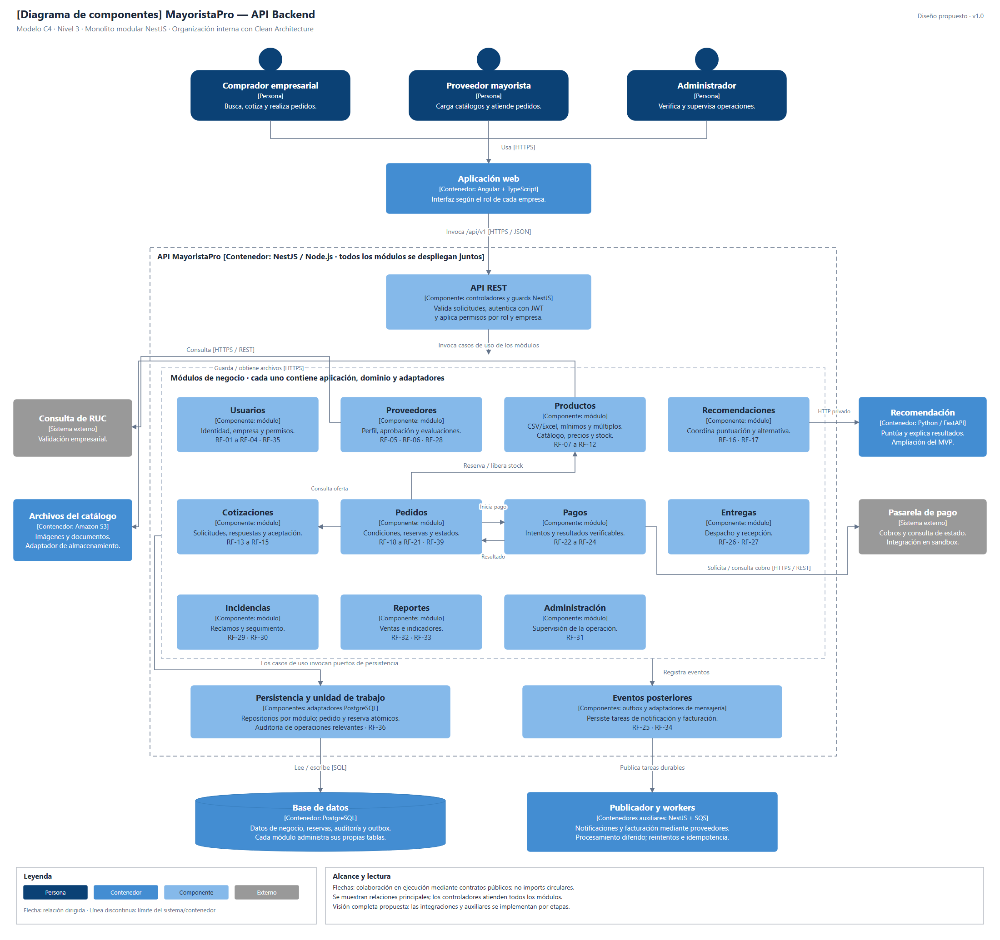

# Nivel 3: componentes de la API

**Pregunta:** ¿cómo se divide el backend por dentro? Esta vista abre la API NestJS del nivel 2; no representa servicios independientes.

**Fuente editable:** [nivel3-componentes.svg](../../img/fuentes-svg/nivel3-componentes.svg).

Las flechas representan colaboración en ejecución. El retorno de un resultado de pago no obliga a imports circulares: los contratos y su conexión se definen en la composición.

## Responsabilidades

| Componente | Responsabilidad y datos propios |
|---|---|
| Usuarios | Identidad, empresa y permisos. |
| Proveedores | Perfil, verificación y evaluaciones comerciales. |
| Productos | Carga masiva, catálogo público, presentaciones, mínimos, múltiplos, precios por volumen y reservas de stock. |
| Cotizaciones | Solicitudes, destinatarios y respuestas con precios propios. |
| Pedidos | Partes, condiciones históricas, ítems y estados. |
| Pagos | Intentos, referencias, eventos y reconciliación externa. |
| Entregas | Despacho y recepción del pedido. |
| Incidencias | Reclamos, estado y seguimiento. |
| Reportes | Proyecciones o consultas acordadas con módulos propietarios. |
| Administración | Supervisión mediante las APIs públicas de los módulos. |
| IA | Coordinar recomendaciones y alternativa por precio. |

## Puertos e infraestructura

| Colaboración | Regla |
|---|---|
| Módulo a módulo | API pública y contratos, sin leer tablas privadas ajenas. |
| Pedido y stock | Unidad de trabajo que proporciona la misma transacción a los adaptadores participantes. |
| Pagos a pasarela | Adaptador e intento persistido; el HTTP externo ocurre fuera de la transacción SQL. |
| Cambio de estado a tareas posteriores | Evento persistido en outbox; publicador a SQS; workers idempotentes. |
| Catálogo a caché | Lecturas temporales con invalidación; el stock se verifica en PostgreSQL al reservar. |
| Recomendación a datos | Vistas de lectura o contratos autorizados, sin acceso libre a registros privados. |

Cada componente utiliza Clean Architecture. La infraestructura implementa los puertos internos y la composición de NestJS conecta las implementaciones.

**Anterior:** [Contenedores](Nivel2-Diagrama-de-Contenedores.md). **Siguiente:** [Código de Pedidos](Nivel4-Diagrama-de-Codigo.md).
