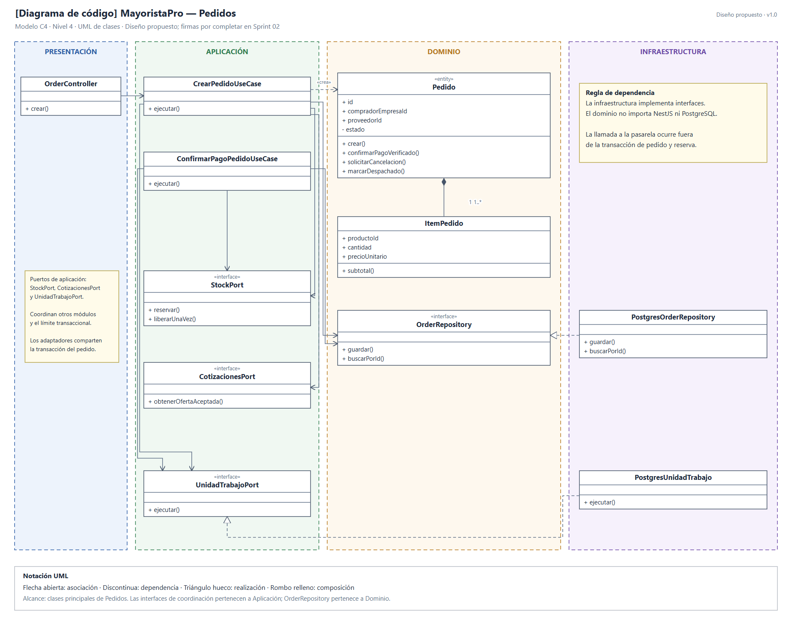
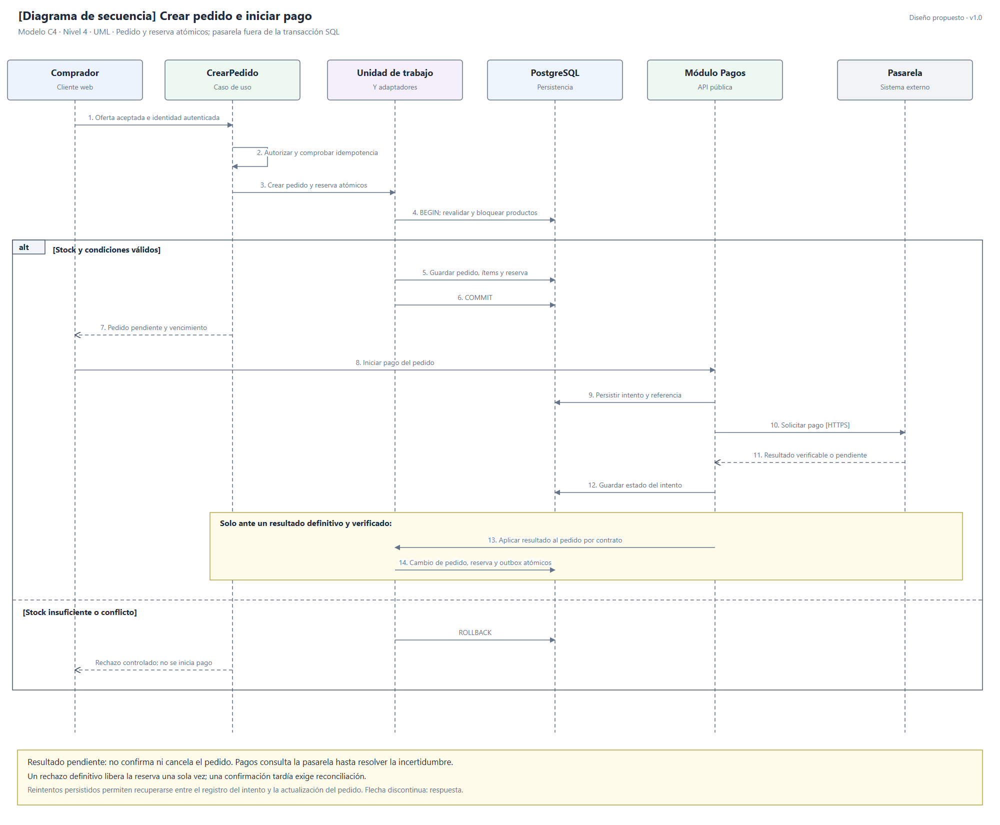

# Nivel 4: diseño de código de Pedidos

**Pregunta:** ¿qué clases e interfaces colaborarán para crear un pedido? Es un diseño propuesto, no código ya implementado. Se detalla el módulo crítico en lugar de dibujar todas las clases del sistema.

## Diagrama de clases

**Fuente editable:** [nivel4-clases.svg](../../img/fuentes-svg/nivel4-clases.svg).

Composición: un Pedido contiene sus ítems. Realización: el repositorio PostgreSQL implementa una interfaz. Las firmas se completarán en Sprint 02; no se presupone que ejecutar varias operaciones por separado forme una transacción.

## Secuencia principal

**Fuente editable:** [nivel4-secuencia.svg](../../img/fuentes-svg/nivel4-secuencia.svg).

El resultado pendiente no confirma ni cancela el pedido. Pagos consulta la pasarela hasta resolver la incertidumbre; solo un resultado definitivo autoriza la transición correspondiente. Los pasos de intento y pedido requieren una política de reintentos persistida para recuperarse si el proceso se interrumpe entre ellos.

## Reglas de negocio

| ID | Regla propuesta |
|---|---|
| RN-01 | Cada pedido tiene una empresa compradora, un usuario responsable y un proveedor. |
| RN-02 | El pedido contiene al menos un ítem del mismo proveedor. |
| RN-03 | Las cantidades usan la presentación ofertada, son positivas, alcanzan el mínimo y respetan el múltiplo; la transacción revalida esas condiciones. |
| RN-04 | El total se obtiene de cantidades y precios aceptados, con una política explícita de moneda y redondeo. |
| RN-05 | Solo se inicia un nuevo pago de un pedido pendiente y con reserva vigente; una confirmación tardía se reconcilia. |
| RN-06 | No se cancela directamente un pedido despachado o entregado. La cancelación de uno pagado requiere resolver el reembolso. |
| RN-07 | Pedido y reserva se persisten atómicamente antes de iniciar el pago externo. |
| RN-08 | Un rechazo definitivo permite liberar la reserva de forma idempotente; un timeout exige consultar el pago antes de liberarla. |
| RN-09 | Los precios son positivos y proceden del servidor, nunca del importe declarado por el cliente. |
| RN-10 | Solo un pedido en preparación puede pasar a despachado. |

## Capas y verificación

| Capa | Elementos del diseño | Comprobación |
|---|---|---|
| Dominio | Pedido, ItemPedido y OrderRepository. | Reglas probadas sin framework ni base de datos. |
| Aplicación | Casos de uso y puertos de coordinación. | Permisos, secuencia e idempotencia. |
| Infraestructura | Repositorio y unidad de trabajo PostgreSQL; adaptadores de otros módulos. | Rollback completo, concurrencia y recuperación. |
| Presentación y composición | OrderController y pedidos.module.ts. | HTTP correcto e inyección de implementaciones. |

**Anterior:** [Componentes](Nivel3-Diagrama-de-Componentes.md). **Detalle:** [Diseño interno](../03-diseno-de-software/diseno-interno/diseno-interno-de-modulos.md).
