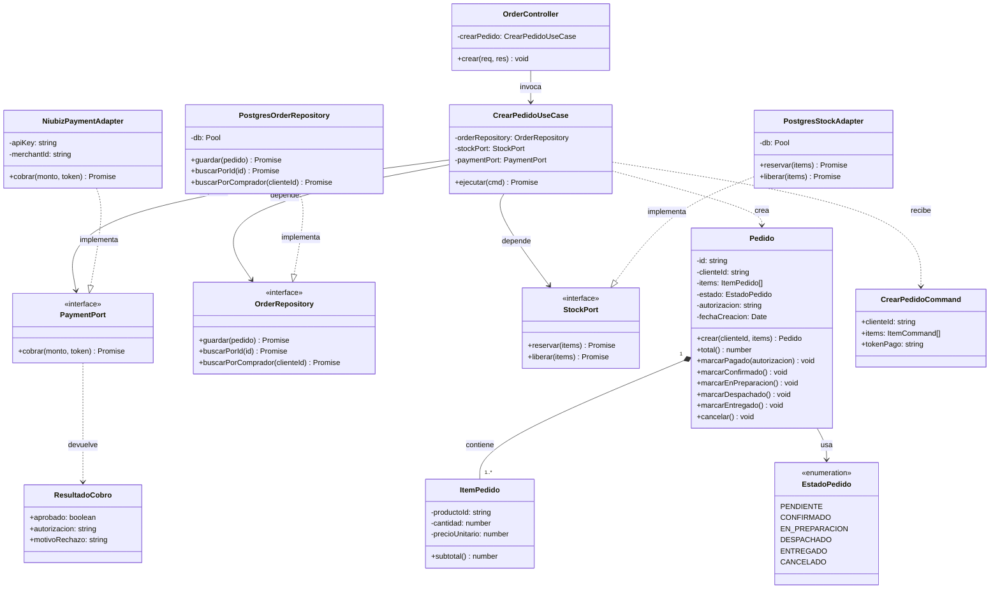

# Nivel 4 — Diagrama de Código

> **Proyecto:** MayoristaPro B2B
> **Nivel C4:** 4 — Código
> **Módulo de referencia:** Pedidos
> **Versión:** 1.0

---

## 1. Propósito

Este diagrama muestra **cómo se implementa un módulo a nivel de código**: clases, métodos, atributos y relaciones. Está dirigido a desarrolladores que necesitan entender o modificar el código. Se toma como referencia el **módulo de Pedidos**, por ser el más crítico (incluye control de concurrencia sobre stock).

---

## 2. Diagrama de clases del módulo Pedidos



---

## 3. Descripción de clases

### Capa de dominio

| Clase | Tipo | Responsabilidad |
|---|---|---|
| `Pedido` | Entidad | Representa un pedido con sus reglas de negocio. |
| `ItemPedido` | Value Object | Representa un ítem del pedido (producto, cantidad, precio). |
| `EstadoPedido` | Enumeración | Estados posibles del pedido. |
| `OrderRepository` | Interfaz | Contrato de persistencia de pedidos. |
| `StockPort` | Interfaz | Contrato para reservar y liberar stock. |
| `PaymentPort` | Interfaz | Contrato para procesar pagos. |
| `ResultadoCobro` | DTO | Resultado del cobro (aprobado, autorización, motivo). |

### Capa de aplicación

| Clase | Tipo | Responsabilidad |
|---|---|---|
| `CrearPedidoUseCase` | Caso de uso | Orquesta el flujo de creación de pedido. |
| `CrearPedidoCommand` | DTO | Datos de entrada del caso de uso. |

### Capa de infraestructura

| Clase | Tipo | Responsabilidad |
|---|---|---|
| `PostgresOrderRepository` | Repositorio | Persiste pedidos en PostgreSQL. |
| `PostgresStockAdapter` | Adaptador | Reserva y libera stock con transacciones ACID. |
| `NiubizPaymentAdapter` | Adaptador | Cobra a través de la API de Niubiz. |

### Capa de presentación

| Clase | Tipo | Responsabilidad |
|---|---|---|
| `OrderController` | Controlador | Traduce HTTP a llamadas del caso de uso. |

---

## 4. Detalle de métodos

### Pedido

| Método | Parámetros | Retorno | Descripción |
|---|---|---|---|
| `crear` | `clienteId`, `items` | `Pedido` | Crea un pedido válido en estado PENDIENTE. Valida RN-01 y RN-02. |
| `total` | — | `number` | Calcula el total sumando los subtotales de los ítems. |
| `marcarPagado` | `autorizacion` | `void` | Cambia el estado a CONFIRMADO. Valida RN-05. |
| `marcarConfirmado` | — | `void` | Transición a CONFIRMADO. |
| `marcarEnPreparacion` | — | `void` | Transición a EN_PREPARACION. |
| `marcarDespachado` | — | `void` | Transición a DESPACHADO. |
| `marcarEntregado` | — | `void` | Transición a ENTREGADO. |
| `cancelar` | — | `void` | Cambia a CANCELADO. Valida RN-06. |

### ItemPedido

| Método | Parámetros | Retorno | Descripción |
|---|---|---|---|
| `constructor` | `productoId`, `cantidad`, `precioUnitario` | `ItemPedido` | Valida RN-03 y RN-09. |
| `subtotal` | — | `number` | Calcula cantidad × precioUnitario. |

### CrearPedidoUseCase

| Método | Parámetros | Retorno | Descripción |
|---|---|---|---|
| `ejecutar` | `cmd: CrearPedidoCommand` | `Promise<string>` | Orquesta reserva de stock, cobro y persistencia. Aplica compensación si falla. |

### OrderRepository / StockPort / PaymentPort

| Interfaz | Método | Parámetros | Retorno |
|---|---|---|---|
| `OrderRepository` | `guardar` | `pedido: Pedido` | `Promise<void>` |
| `OrderRepository` | `buscarPorId` | `id: string` | `Promise<Pedido \| null>` |
| `OrderRepository` | `buscarPorComprador` | `clienteId: string` | `Promise<Pedido[]>` |
| `StockPort` | `reservar` | `items: ItemPedido[]` | `Promise<void>` |
| `StockPort` | `liberar` | `items: ItemPedido[]` | `Promise<void>` |
| `PaymentPort` | `cobrar` | `monto: number`, `token: string` | `Promise<ResultadoCobro>` |

---

## 5. Código de referencia

### Dominio · Entidad Pedido

```ts
// dominio/pedido.ts
import { ItemPedido } from './item-pedido';
import { EstadoPedido } from './estado-pedido';
import { ReglaNegocioError } from '../../../shared/errores';

export class Pedido {
  private constructor(
    readonly id: string,
    readonly clienteId: string,
    private readonly items: ItemPedido[],
    private estado: EstadoPedido,
    private autorizacion?: string,
    readonly fechaCreacion: Date = new Date(),
  ) {}

  static crear(clienteId: string, items: ItemPedido[]): Pedido {
    if (!clienteId) throw new ReglaNegocioError('RN-01: el pedido debe tener un cliente');
    if (items.length === 0) throw new ReglaNegocioError('RN-02: el pedido debe tener ítems');
    return new Pedido(crypto.randomUUID(), clienteId, items, EstadoPedido.PENDIENTE);
  }

  total(): number {
    return this.items.reduce((suma, item) => suma + item.subtotal(), 0);
  }

  marcarPagado(autorizacion: string): void {
    if (this.estado !== EstadoPedido.PENDIENTE) {
      throw new ReglaNegocioError('RN-05: solo un pedido pendiente puede pagarse');
    }
    this.estado = EstadoPedido.CONFIRMADO;
    this.autorizacion = autorizacion;
  }

  marcarDespachado(): void {
    if (this.estado !== EstadoPedido.EN_PREPARACION) {
      throw new ReglaNegocioError('RN-10: solo un pedido en preparación puede despacharse');
    }
    this.estado = EstadoPedido.DESPACHADO;
  }

  cancelar(): void {
    if (this.estado === EstadoPedido.DESPACHADO || this.estado === EstadoPedido.ENTREGADO) {
      throw new ReglaNegocioError('RN-06: el pedido ya fue despachado');
    }
    this.estado = EstadoPedido.CANCELADO;
  }
}
```

### Dominio · Interfaces (puertos)

```ts
// dominio/order-repository.ts
import { Pedido } from './pedido';

export interface OrderRepository {
  guardar(pedido: Pedido): Promise<void>;
  buscarPorId(id: string): Promise<Pedido | null>;
  buscarPorComprador(clienteId: string): Promise<Pedido[]>;
}
```

```ts
// dominio/stock-port.ts
import { ItemPedido } from './item-pedido';

export interface StockPort {
  reservar(items: ItemPedido[]): Promise<void>;
  liberar(items: ItemPedido[]): Promise<void>;
}
```

```ts
// dominio/payment-port.ts
import { ResultadoCobro } from './resultado-cobro';

export interface PaymentPort {
  cobrar(monto: number, token: string): Promise<ResultadoCobro>;
}
```

### Aplicación · Caso de uso

```ts
// aplicacion/crear-pedido.use-case.ts
export class CrearPedidoUseCase {
  constructor(
    private readonly orderRepository: OrderRepository,
    private readonly stockPort: StockPort,
    private readonly paymentPort: PaymentPort,
  ) {}

  async ejecutar(cmd: CrearPedidoCommand): Promise<string> {
    const items = cmd.items.map((i) => new ItemPedido(i.productoId, i.cantidad, i.precioUnitario));
    const pedido = Pedido.crear(cmd.clienteId, items);

    await this.stockPort.reservar(items);

    try {
      const cobro = await this.paymentPort.cobrar(pedido.total(), cmd.tokenPago);
      if (!cobro.aprobado) throw new PagoRechazadoError(cobro.motivoRechazo);

      pedido.marcarPagado(cobro.autorizacion);
      await this.orderRepository.guardar(pedido);
      return pedido.id;
    } catch (e) {
      await this.stockPort.liberar(items);
      throw e;
    }
  }
}
```

### Infraestructura · Adaptadores

```ts
// infraestructura/postgres-stock.adapter.ts
export class PostgresStockAdapter implements StockPort {
  constructor(private readonly db: Pool) {}

  async reservar(items: ItemPedido[]): Promise<void> {
    const client = await this.db.connect();
    try {
      await client.query('BEGIN');
      for (const item of items) {
        const { rows } = await client.query(
          'SELECT stock FROM productos WHERE id = $1 FOR UPDATE',
          [item.productoId],
        );
        if (!rows[0] || rows[0].stock < item.cantidad) {
          throw new StockInsuficienteError('Stock insuficiente');
        }
        await client.query(
          'UPDATE productos SET stock = stock - $1 WHERE id = $2',
          [item.cantidad, item.productoId],
        );
      }
      await client.query('COMMIT');
    } catch (e) {
      await client.query('ROLLBACK');
      throw e;
    } finally {
      client.release();
    }
  }

  async liberar(items: ItemPedido[]): Promise<void> {
    for (const item of items) {
      await this.db.query(
        'UPDATE productos SET stock = stock + $1 WHERE id = $2',
        [item.cantidad, item.productoId],
      );
    }
  }
}
```

---

## 6. Reglas de negocio implementadas

| ID | Regla | Clase / Método |
|---|---|---|
| RN-01 | El pedido debe tener un cliente asociado | `Pedido.crear()` |
| RN-02 | El pedido debe tener al menos un ítem | `Pedido.crear()` |
| RN-03 | La cantidad debe ser mayor a 0 | `ItemPedido` constructor |
| RN-04 | El total se calcula sumando subtotales | `Pedido.total()` |
| RN-05 | Solo un pedido pendiente puede pagarse | `Pedido.marcarPagado()` |
| RN-06 | No se cancela un pedido despachado/entregado | `Pedido.cancelar()` |
| RN-07 | El stock se reserva antes de cobrar | `CrearPedidoUseCase.ejecutar()` |
| RN-08 | Si el pago falla, se libera el stock | `CrearPedidoUseCase.ejecutar()` |
| RN-09 | El precio no puede ser negativo | `ItemPedido` constructor |
| RN-10 | Solo un pedido en preparación puede despacharse | `Pedido.marcarDespachado()` |

---

## 7. Relación con otros niveles C4

| Nivel | Relación con este documento |
|---|---|
| Nivel 1 — Contexto | El módulo Pedidos interactúa con Comprador y Proveedor. |
| Nivel 2 — Contenedores | El módulo Pedidos vive en el contenedor Backend API. |
| Nivel 3 — Componentes | El módulo Pedidos es uno de los módulos del backend. |
| Nivel 4 — Código | Este documento detalla sus clases y métodos. |

---

## 8. Notas y consideraciones

- **Constructor privado en `Pedido`:** obliga a usar `Pedido.crear()`, que aplica las validaciones.
- **Inversión de dependencias:** `CrearPedidoUseCase` depende de interfaces, no de implementaciones concretas.
- **Compensación:** si el pago falla, el stock reservado se libera automáticamente.
- **Transacción ACID:** `PostgresStockAdapter.reservar()` usa `BEGIN`, `SELECT FOR UPDATE`, `UPDATE`, `COMMIT` y `ROLLBACK`.
- **Testeabilidad:** el caso de uso se puede testear con `FakeStockPort`, `FakePaymentPort` y `FakeOrderRepository`.

---

## 9. Leyenda de notación UML

| Símbolo | Significado |
|---|---|
| `+` | Método o atributo público |
| `-` | Método o atributo privado |
| `<<interface>>` | Interfaz (contrato sin implementación) |
| `<<enumeration>>` | Enumeración de valores |
| Línea continua con flecha abierta | Asociación |
| Línea discontinua con flecha abierta | Dependencia |
| Línea discontinua con triángulo hueco | Realización de interfaz |
| Rombo relleno | Composición |