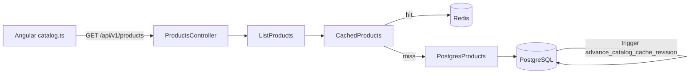

# Diseño — Catálogo público, filtros, precios por volumen y caché

## Resumen

Módulo `catalog` de NestJS con Clean Architecture: el caso de uso `ListProducts` (capa de aplicación) depende del puerto `ProductRepository`; la infraestructura ofrece `PostgresProducts` y el decorador `CachedProducts`, que envuelve al repositorio con Redis (patrón **Decorator** + **Cache-Aside**). Angular consume la API desde `catalog.ts`.

## Arquitectura

- **Presentación:** `apps/api/src/catalog/presentation/products.controller.ts` valida `page`, `limit`, `q`, `category`, `supplier`, `available` y `sort`.
- **Aplicación:** `apps/api/src/catalog/application/list-products.ts`.
- **Infraestructura:** `postgres-products.ts` (SQL parametrizado), `cached-products.ts` y `redis-catalog-cache.ts` (tiempo límite de 100 ms; si falla, se omite la caché).
- **Escalas de precio:** `trade.controller.ts` → `PUT trade/products/:id/price-tiers`, con dominio de precios en `apps/api/src/trade/domain`.

## Interfaces

| Método y ruta | Acceso | Respuesta |
|---|---|---|
| `GET /api/v1/products` | Pública | `{items[], page, limit}` |
| `GET /api/v1/products/options` | Pública | `{categories[], suppliers[]}` |
| `PUT /api/v1/trade/products/:id/price-tiers` | Proveedor dueño, `publish` | Escalas guardadas |

Contrato completo en [`apps/api/openapi.yaml`](../../../../apps/api/openapi.yaml) (Swagger en `/api-docs`).

## Modelo de datos

- `products` (001, 003): SKU por proveedor, precio `numeric(12,2)`, presentación, mínimo, múltiplo, stock, `published`, `retired_at` (011), `description` (010).
- `product_price_tiers` (008): `(product_id, min_quantity)` como clave, `unit_price`.
- `catalog_cache_revision` (007): fila única con `revision`; la función `advance_catalog_cache_revision()` se ejecuta como *constraint trigger* `DEFERRABLE INITIALLY DEFERRED` en `products`, `suppliers`, `companies`, `product_price_tiers` y `product_images`.

## Decisiones

- **Invalidación por revisión** en lugar de borrar claves: evita carreras entre lecturas y escrituras, porque una clave vieja simplemente deja de usarse.
- **TTL corto (30 s)** como red de seguridad adicional.
- **Fallo abierto:** si Redis cae, el catálogo sigue funcionando desde PostgreSQL (disponibilidad antes que rendimiento).

## Manejo de errores

| Caso | Respuesta |
|---|---|
| Paginación o filtros inválidos | 400 «Filtros de catálogo inválidos» |
| Escala inválida | 400 o 422 con el motivo |
| Proveedor ajeno o sin permiso | 403 |
| Redis caído o lento | 200 desde PostgreSQL (registro interno) |

## Estrategia de pruebas

| Requisito | Prueba |
|---|---|
| 1, 2 | [`tests/catalog.integration.cjs`](../../../../tests/catalog.integration.cjs), [`tests/catalog-filters.integration.cjs`](../../../../tests/catalog-filters.integration.cjs) |
| 3 | [`tests/price-tiers.integration.cjs`](../../../../tests/price-tiers.integration.cjs), [`tests/price-tiers.test.cjs`](../../../../tests/price-tiers.test.cjs) |
| 4 | [`tests/catalog-cache.integration.cjs`](../../../../tests/catalog-cache.integration.cjs) (RC01–RC07), [`tests/catalog-cache.test.cjs`](../../../../tests/catalog-cache.test.cjs) |
| Carga | [`tests/k6/catalogo.k6.js`](../../../../tests/k6/catalogo.k6.js): 2000 usuarios virtuales, ver [pruebas k6](../../pruebas-carga-k6.md) |
| Interfaz | [`tests/experiencia-catalogo.browser.cjs`](../../../../tests/experiencia-catalogo.browser.cjs), [`tests/cantidad-mayorista.browser.cjs`](../../../../tests/cantidad-mayorista.browser.cjs) |
