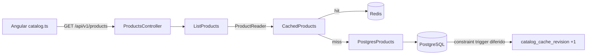

# Diseño Técnico — Catálogo público, filtros, precios por volumen y caché

| Campo        | Valor                                                        |
| ------------ | ------------------------------------------------------------ |
| Proyecto     | MayoristaPro B2B                                             |
| Módulo       | 01 · Catálogo público, filtros, precios por volumen y caché  |
| Metodología  | Spec-Driven Development (SDD)                                |
| Sprint       | Sprint 2                                                     |
| Estado       | Implementado ✓                                               |
| Curso        | IS-488 Arquitectura de Software · EPIS – UNSCH · 2026-II     |

---

## 1. Arquitectura del módulo

El módulo `catalog` de NestJS sigue **Clean Architecture**: el caso de uso no conoce PostgreSQL ni Redis, solo el puerto `ProductReader`. La caché se agrega envolviendo al repositorio con un **decorador**, sin tocar el caso de uso ni el controlador.

```
┌──────────────────────────────────────────────────────────────────┐
│                    FRONTEND (Angular 21, signals)                │
│                                                                  │
│  catalog.ts / catalog.html                                       │
│    ├── Carrusel de portada y «Qué puedes comprar» (15 fotos)     │
│    ├── Filtros: búsqueda, categoría, proveedor, disponible, orden│
│    ├── Tarjetas: foto, precio, escalas, «Ver detalle»            │
│    └── Ficha: galería, cantidad mayorista y precio por escala    │
│  catalog-search.service.ts  → arma la URL con los filtros        │
│  wholesale-quantity.ts      → respeta mínimo y múltiplo          │
└───────────────────────────────┬──────────────────────────────────┘
                                │ HTTPS · GET /api/v1/products
                                ▼
┌──────────────────────────────────────────────────────────────────┐
│                   BACKEND (NestJS · módulo catalog)              │
│                                                                  │
│  PRESENTACIÓN  products.controller.ts                            │
│    GET /products          → valida page, limit y filtros (400)   │
│    GET /products/options  → categorías y proveedores visibles    │
│                    │                                             │
│  APLICACIÓN    list-products.ts  (ListProducts)                  │
│    execute(page, limit, filtros) → offset = (page-1)·limit       │
│    puerto ProductReader  ◄── inyectado con PRODUCT_READER        │
│                    │                                             │
│  INFRAESTRUCTURA                                                 │
│    CachedProducts  (Decorator + Cache-Aside)                     │
│      ├── RedisCatalogCache   (timeout 100 ms, reconexión 1 s)    │
│      └── PostgresProducts    (SQL parametrizado + revision())    │
└───────────────┬───────────────────────────────┬──────────────────┘
                │ redis GET/SET EX 30           │ pg (pool)
                ▼                               ▼
┌──────────────────────────┐   ┌───────────────────────────────────┐
│ REDIS 7.4                │   │ POSTGRESQL 17                     │
│ clave:                   │   │ products, suppliers, companies    │
│ mayoristapro:catalog:v1: │   │ product_price_tiers               │
│  <hash esquema>:<rev>:   │   │ product_images                    │
│  <ruta>:<hash params>    │   │ catalog_cache_revision (singleton)│
└──────────────────────────┘   │ trigger advance_catalog_cache_... │
                               └───────────────────────────────────┘
```

Vista Mermaid equivalente:



---

## 2. Inyección de dependencias — `catalog.module.ts`

| Proveedor | Implementación | Nota |
| --------- | -------------- | ---- |
| `PostgresProducts` | `new PostgresProducts(pool)` | Usa el pool compartido `PG_POOL` |
| `RedisCatalogCache` | `new RedisCatalogCache()` | Lee `REDIS_URL` y `CATALOG_CACHE_TIMEOUT_MS` (100 ms por defecto) |
| `CachedProducts` | `new CachedProducts(reader, cache, namespace, ttl)` | TTL desde `CATALOG_CACHE_TTL_SECONDS` (30 s por defecto, 1 a 86400) |
| `PRODUCT_READER` | `useExisting: CachedProducts` | El caso de uso recibe la versión con caché |
| `ListProducts` | `new ListProducts(reader)` | Caso de uso sin dependencias de infraestructura |

Cambiar de Redis a otra caché, o quitarla, solo modifica este archivo: es el principio de **inversión de dependencias** (la D de SOLID).

---

## 3. Diseño del controlador — `products.controller.ts`

### `list(page, limit, q, category, supplier, available, sort)`

1. `ParseIntPipe` convierte `page` y `limit`; los valores por defecto son 1 y 20.
2. Rechaza con 400 «Página o límite inválidos.» si `page < 1`, `limit` fuera de 1–100 o el offset no es un entero seguro.
3. Rechaza con 400 «Filtros de catálogo inválidos.» si `q` > 120, `category` > 100, `supplier` no es UUID, `available` no es `true`/`false` o `sort` no es `price-asc`/`price-desc`.
4. Normaliza (`trim` en la búsqueda) y llama a `ListProducts.execute`.
5. Responde `{ items, page, limit }` con `Cache-Control: no-store`.

### `options()`

Llama a `ListProducts.options()` y responde `{ categories, suppliers }`.

---

## 4. Diseño del decorador de caché — `cached-products.ts`

### Clave

```
mayoristapro:catalog:v1:<sha256(host, puerto, base, usuario, options)>:<revisión>:<ruta>:<sha256(parámetros)>
```

- El primer hash (`catalogNamespace`) separa bases o esquemas distintos, por ejemplo la demo `demo_mayoristapro150` y la base de desarrollo.
- La **revisión** forma parte de la clave: cuando sube, las claves viejas simplemente dejan de usarse y Redis las borra por TTL.

### Algoritmo `read(ruta, parámetros, cargar)`

| Paso | Acción | Contador |
| ---- | ------ | -------- |
| 1 | Si Redis no está disponible → leer PostgreSQL | `bypasses` |
| 2 | Leer la revisión vigente y armar la clave | `revisionReads` |
| 3 | `GET` en Redis; si existe y la revisión no cambió → responder | `hits` |
| 4 | Si existe pero la revisión cambió → leer PostgreSQL | `bypasses` |
| 5 | Si no existe → leer PostgreSQL | `misses`, `sourceReads` |
| 6 | Volver a leer la revisión; si es igual → `SET EX ttl` | `fills` |
| 7 | Cualquier error de Redis → se ignora y se responde con lo leído | — |

Los contadores `stats` se usan en las pruebas para comprobar cada camino.

---

## 5. Diseño del repositorio — `postgres-products.ts`

### `listPublished(offset, limit, filtros)`

Consulta única con subconsultas JSON para escalas (`TIERS_JSON`) e imágenes (`IMAGES_JSON`):

| Condición SQL | Regla de negocio |
| ------------- | ---------------- |
| `p.published AND s.verified` | Solo productos publicados de proveedores verificados |
| `NOT EXISTS(… c.status='suspended')` | Excluye empresas suspendidas |
| `strpos(lower(nombre‖proveedor‖categoría), lower($3)) > 0` | Búsqueda literal, sin comodines |
| `$4 IS NULL OR p.category = $4` | Filtro por categoría |
| `$5 IS NULL OR s.id = $5` | Filtro por proveedor |
| `$6 IS NULL OR (p.stock >= p.minimum) = $6` | Filtro por disponibilidad |
| `ORDER BY CASE … price …, p.id` | Orden por precio con desempate estable |
| `LIMIT $1 OFFSET $2` | Paginación después de filtrar |

### `options()`

`SELECT DISTINCT p.category, s.id, s.name` con las mismas condiciones de visibilidad; en memoria se quitan duplicados con `Set` y `Map`.

### `revision()`

Lee `catalog_cache_revision` del **mismo esquema** que `products` (comparando `relnamespace`), para que la demo y el desarrollo no compartan revisión.

---

## 6. Diseño de las escalas — `trade/domain/price-tiers.ts`

### `priceTiers(body, producto)`

```
validar 0 ≤ escalas ≤ 5
ordenar por «desde»
anterior = (mínimo, precio base)
para cada escala:
   desde > cantidad anterior          → si no, INVALID_INPUT
   desde % múltiplo == 0              → si no, INVALID_INPUT
   precio < precio anterior           → si no, INVALID_INPUT
   anterior = escala
```

### `unitPriceFor(precioBase, escalas, cantidad)`

Devuelve el precio de la escala más alta alcanzada, sin superar nunca el precio base (aunque el proveedor suba el precio base después).

El endpoint `PUT /trade/products/:id/price-tiers` (`postgres-trade.ts → setPriceTiers`) valida la propiedad del producto, borra las escalas anteriores e inserta las nuevas en la misma transacción.

---

## 7. Modelo de datos utilizado

### Tabla `products` (001, 003, 010, 011)

| Columna | Tipo | Regla |
| ------- | ---- | ----- |
| `id` | `uuid` | PK |
| `supplier_id` | `uuid` | FK a `suppliers`; `(supplier_id, sku)` único |
| `sku`, `name`, `category` | `text` | Categoría por defecto «General» |
| `unit`, `units_per_pack` | `text`, `integer` | Presentación y equivalencia (> 0) |
| `minimum`, `multiple`, `stock` | `integer` | Mínimo > 0, múltiplo > 0, stock ≥ 0 |
| `price` | `numeric(12,2)` | > 0 |
| `currency`, `includes_tax` | `text`, `boolean` | Solo `PEN` |
| `published` | `boolean` | Visible en el catálogo |
| `revision` | `bigint` | Sube con cada cambio de metadatos (usado por la carga masiva) |
| `description` | `text` | ≤ 2000 caracteres |
| `retired_at`, `retired_reason` | `timestamptz`, `text` | Retiro del administrador; `CHECK (retired_at IS NULL OR NOT published)` |

### Tabla `product_price_tiers` (008)

| Columna | Tipo | Regla |
| ------- | ---- | ----- |
| `product_id` | `uuid` | FK a `products` |
| `min_quantity` | `integer` | > 1; PK compuesta con `product_id` |
| `unit_price` | `numeric(12,2)` | > 0 |

### Tabla `catalog_cache_revision` (007)

| Columna | Tipo | Regla |
| ------- | ---- | ----- |
| `singleton` | `boolean` | PK, siempre `true` (una sola fila) |
| `revision` | `bigint` | ≥ 0 |
| `last_txid` | `text` | Última transacción que la incrementó |

**Función `advance_catalog_cache_revision()`:** se ejecuta como `CONSTRAINT TRIGGER … DEFERRABLE INITIALLY DEFERRED` en `products`, `suppliers`, `companies`, `product_price_tiers` y `product_images`. Al ser diferida, corre justo antes del commit y compara `last_txid` con `pg_current_xact_id()`, así que una carga de 500 filas sube la revisión **una sola vez**; si hay rollback, no sube.

---

## 8. Decisiones de diseño

| Decisión | Justificación |
| -------- | ------------- |
| Invalidación por revisión en la clave, en lugar de borrar claves | Evita carreras entre lectura y escritura: una clave vieja simplemente deja de usarse |
| Trigger diferido en PostgreSQL | Cualquier camino (API, carga masiva, SQL directo, worker) invalida la caché; no depende de que el programador recuerde hacerlo |
| Doble lectura de la revisión (antes y después) | Evita guardar en caché un resultado leído mientras otra transacción confirmaba |
| TTL corto de 30 s | Red de seguridad adicional; además limita la memoria usada por Redis |
| Tiempo límite de 100 ms y fallo abierto | Se prioriza la disponibilidad: si Redis se cae, el catálogo responde igual desde PostgreSQL |
| `Cache-Control: no-store` en la API | La única caché es Redis, controlada por el servidor; los navegadores no guardan copias viejas |
| Patrón Decorator (`CachedProducts`) | Agrega la caché sin modificar el caso de uso ni el repositorio (principio abierto/cerrado) |
| `strpos` en lugar de `ILIKE` | La búsqueda es literal y no hay que escapar `%` ni `_` |

---

## 9. Manejo de errores

| Caso | HTTP | Mensaje |
| ---- | ---- | ------- |
| Página o límite inválidos | 400 | «Página o límite inválidos.» |
| Filtro inválido | 400 | «Filtros de catálogo inválidos.» |
| Escalas inválidas | 422 | Motivo específico, por ejemplo «Cada escala debe tener un precio menor al precio base y a la escala anterior.» |
| Escalas de un producto ajeno o sin permiso | 403 | «Requiere permiso de publicación.» o propiedad |
| Redis caído o lento | 200 | Respuesta desde PostgreSQL (sin error visible) |
| Falta la tabla de revisión | 500 | «Falta la revisión del catálogo. Aplica db:migrate.» (solo si no se migró) |

El filtro global `ApiExceptionFilter` convierte las excepciones en `{ statusCode, code, message }`.

---

## 10. Estrategia de pruebas

| Requisito | Prueba | Tipo |
| --------- | ------ | ---- |
| RF-CAT-01, 02 | [`tests/catalog.integration.cjs`](../../../../tests/catalog.integration.cjs), [`tests/catalog-filters.integration.cjs`](../../../../tests/catalog-filters.integration.cjs) | Integración (Jest) |
| RF-CAT-03 | `catalog-filters.integration.cjs` (opciones visibles) | Integración |
| RF-CAT-04 | [`tests/price-tiers.test.cjs`](../../../../tests/price-tiers.test.cjs), [`tests/price-tiers.integration.cjs`](../../../../tests/price-tiers.integration.cjs) | Unitaria e integración |
| RF-CAT-05 | [`tests/catalog-cache.test.cjs`](../../../../tests/catalog-cache.test.cjs), [`tests/catalog-cache.integration.cjs`](../../../../tests/catalog-cache.integration.cjs) (RC01–RC07), [`tests/catalog-revision.integration.cjs`](../../../../tests/catalog-revision.integration.cjs) | Unitaria e integración |
| RF-CAT-06 | [`tests/experiencia-catalogo.browser.cjs`](../../../../tests/experiencia-catalogo.browser.cjs), [`tests/cantidad-mayorista.browser.cjs`](../../../../tests/cantidad-mayorista.browser.cjs) | Navegador (Playwright) |
| RNF-CAT-01 | [`tests/k6/catalogo.k6.js`](../../../../tests/k6/catalogo.k6.js): smoke, load, stress (hasta 2000 VU) y spike | Carga (k6) |
| Contrato | [`tests/openapi.test.cjs`](../../../../tests/openapi.test.cjs) | Contrato |
| Postman | Carpeta «1. Catálogo» (6 peticiones) de `postman/MayoristaPro.postman_collection.json` | Funcional |

---

## 11. Trazabilidad SDD

| Requisito | Función implementada |
| --------- | -------------------- |
| RF-CAT-01 | `ProductsController.list()` → `ListProducts.execute()` → `PostgresProducts.listPublished()` |
| RF-CAT-02 | Validación en `list()` + condiciones SQL de `listPublished()` |
| RF-CAT-03 | `ProductsController.options()` → `PostgresProducts.options()` |
| RF-CAT-04 | `TradeController.setPriceTiers()` → `priceTiers()` y `unitPriceFor()` |
| RF-CAT-05 | `CachedProducts.read()`, `RedisCatalogCache`, `advance_catalog_cache_revision()` |
| RF-CAT-06 | `catalog.ts`, `catalog.html`, `catalog-product.ts`, `wholesale-quantity.ts` |
