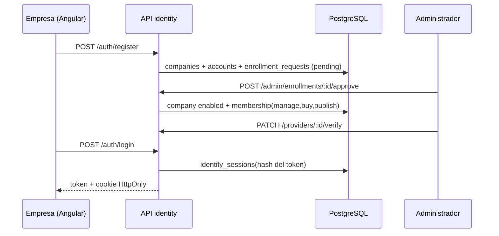

# Diseño — Identidad, empresas y permisos

## Resumen

Módulo `identity` de NestJS (`identity.controller.ts`, `identity.service.ts`, `browser-session.ts`). Cada operación protegida resuelve en el servidor la vinculación activa y sus permisos a partir del token: nunca confía en la empresa o los permisos que envíe el navegador. Angular implementa las pantallas en `apps/web/src/identity.ts` (Mi cuenta, Registrar mi empresa, Aceptar invitación y Panel de administración).

## Arquitectura

## Interfaces

| Ruta | Acceso | Resultado |
|---|---|---|
| `POST /auth/register` | Pública | 201 `{requestId, status:"pending"}` |
| `POST /auth/login` · `POST /auth/logout` | Pública · Sesión | Token y cookie · sesión cerrada |
| `GET /auth/restore` · `GET /auth/session` · `GET /auth/me` | Cookie o Bearer | Sesión, cuenta, empresa y permisos |
| `GET /admin/enrollments` · `POST /admin/enrollments/:id/approve` | Administrador | Solicitudes · aprobación |
| `PATCH /providers/:id/verify` | Administrador | Proveedor verificado |
| `POST /company/invitations` · `POST /auth/invitations/accept` | Responsable · Pública | Enlace · cuenta vinculada |
| `GET /company/members` · `POST /company/members/:id/revoke` | Responsable | Miembros · revocación |

## Modelo de datos (migración 002)

`companies` (RUC único de 11 dígitos, `status`, `supplier_id`), `accounts` (correo único en minúsculas, `password_hash`, `platform_admin`), `memberships` (permisos, `active`), `enrollment_requests`, `identity_sessions` (hash del token y vencimiento), `invitations` (hash, destinatario, vencimiento, `used_at`) e `identity_audit`.

## Seguridad

- scrypt con sal y comparación en tiempo constante (`timingSafeEqual`), incluso si el correo no existe.
- Token Bearer opaco; en la base solo se guarda su SHA-256.
- Cookie `HttpOnly`, `SameSite` y `Secure` en HTTPS; se comprueba el origen de la petición.
- La auditoría no guarda secretos.

## Manejo de errores

400 datos inválidos · 401 sin sesión o credenciales incorrectas · 403 sin permiso, vinculación o propiedad · 409 correo o RUC duplicado, o invitación ya usada.

## Estrategia de pruebas

| Requisito | Prueba |
|---|---|
| 1–4 | [`tests/identity.integration.cjs`](../../../../tests/identity.integration.cjs): alta, aprobación concurrente, RUC duplicado, verificación, invitación concurrente, revocación |
| 3.4 | [`tests/browser-session.integration.cjs`](../../../../tests/browser-session.integration.cjs): cookie, origen, vencimiento y restore |
| Interfaz por rol | [`tests/catalog.browser.cjs`](../../../../tests/catalog.browser.cjs), [`tests/continuidad-comprador.browser.cjs`](../../../../tests/continuidad-comprador.browser.cjs) |
