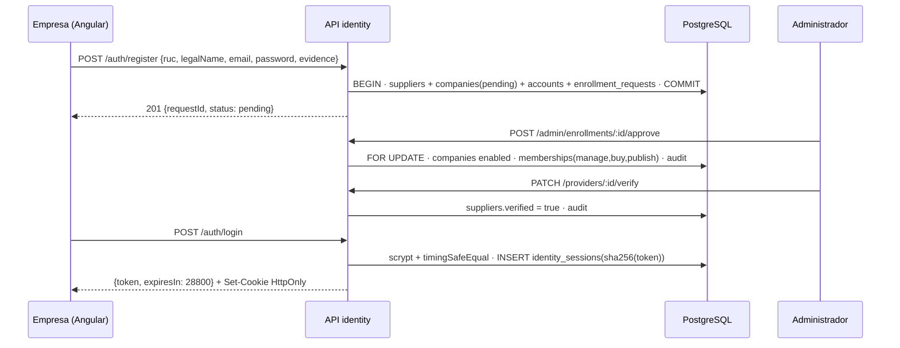

# Diseño Técnico — Identidad, empresas y permisos

| Campo        | Valor                                                        |
| ------------ | ------------------------------------------------------------ |
| Proyecto     | MayoristaPro B2B                                             |
| Módulo       | 02 · Identidad, empresas y permisos                          |
| Metodología  | Spec-Driven Development (SDD)                                |
| Sprint       | Sprint 2                                                     |
| Estado       | Implementado ✓                                               |
| Curso        | IS-488 Arquitectura de Software · EPIS – UNSCH · 2026-II     |

---

## 1. Arquitectura del módulo

```
┌──────────────────────────────────────────────────────────────────┐
│                    FRONTEND (Angular · identity.ts)              │
│                                                                  │
│  /cuenta  → paneles según permisos:                              │
│     ├── Empresa (dirección, datos)              [manage]         │
│     ├── Usuarios (invitar, revocar)             [manage]         │
│     ├── Mis productos                           [publish]        │
│     ├── Cotizaciones y Pedidos                  [buy/publish]    │
│     └── Panel de administración                 [platform_admin] │
│  Registrar mi empresa · Iniciar sesión · Aceptar invitación      │
│  session.service.ts → guarda el token en memoria y llama restore │
└───────────────────────────────┬──────────────────────────────────┘
                                │ HTTPS · Bearer + cookie HttpOnly
                                ▼
┌──────────────────────────────────────────────────────────────────┐
│                 BACKEND (NestJS · módulo identity)               │
│                                                                  │
│  identity.controller.ts                                          │
│    POST auth/register · auth/login · auth/logout                 │
│    GET  auth/restore · auth/session · auth/me                    │
│    GET/POST admin/enrollments(/:id/approve|reject)               │
│    PATCH providers/:id/verify                                    │
│    POST company/invitations · auth/invitations/accept            │
│    GET  company/members · POST company/members/:id/revoke        │
│    PUT  company/address                                          │
│           │                                                      │
│  browser-session.ts  → sessionCookie(), browserToken(),          │
│                        sameOrigin()                              │
│  identity.service.ts → tx(), authenticated(), actor(), audit()   │
│     usado también por catalog y trade: requireSupplier(),        │
│     tradeIdentity()                                              │
└───────────────────────────────┬──────────────────────────────────┘
                                │ pg (transacciones)
                                ▼
┌──────────────────────────────────────────────────────────────────┐
│                     POSTGRESQL (migración 002)                   │
│  companies · accounts · memberships · enrollment_requests        │
│  identity_sessions (hash) · invitations (hash) · identity_audit  │
└──────────────────────────────────────────────────────────────────┘
```

### Secuencia de alta, aprobación e inicio de sesión



---

## 2. Funciones internas del servicio — `identity.service.ts`

### `tx(acción)`

Abre una conexión del pool, ejecuta `BEGIN`, la acción y `COMMIT`; ante error hace `ROLLBACK`. Si PostgreSQL devuelve `23505` (violación de unicidad), lo traduce a 409 «Correo o RUC ya registrado. La coincidencia no concede acceso.».

### `authenticated(db, authorization)`

1. Extrae el token con `^Bearer ([a-f0-9]{64})$`; si no coincide → 401.
2. Busca `identity_sessions` por `sha256(token)` con `expires_at > now()`.
3. Bloquea la cuenta (`FOR UPDATE OF a`) para que una revocación simultánea no pase de largo.

### `actor(db, authorization, admin = false)`

- Con `admin = true`: exige `platform_admin` → si no, 403.
- Sin admin: busca la vinculación activa de una empresa `enabled` → si no existe, 403 «Vinculación no habilitada.».
- Devuelve `{ id, platform_admin, membership_id, company_id, permissions }`.

### `requireSupplier(db, auth)` y `tradeIdentity(db, auth)`

Funciones compartidas con los módulos `catalog` y `trade`: confirman permiso `publish` y proveedor verificado (`FOR SHARE`), o devuelven `{ companyId, supplierId, canBuy, canSell }`. Así ningún otro módulo repite la lógica de permisos.

### `audit(db, actor, acción, id)`

Inserta en `identity_audit` la acción (`approve-enrollment`, `verify-provider`, `invite`, `accept-invitation`, `revoke-membership`, `publish-product`, `unpublish-product`). Nunca guarda contraseñas ni tokens.

---

## 3. Diseño de cada operación

### `register(body)`

| Paso | Acción |
| ---- | ------ |
| 1 | Validar correo, RUC (11 dígitos), razón social, evidencia y contraseña |
| 2 | Calcular `passwordHash()` (scrypt, sal de 16 bytes) **antes** de abrir la transacción |
| 3 | `INSERT suppliers` con código aleatorio `company-<hex>` |
| 4 | `INSERT companies` (status `pending` por defecto) |
| 5 | `INSERT accounts` y `INSERT enrollment_requests` |
| 6 | Responder `{ requestId, status: 'pending' }` |

### `login(body)`

| Paso | Acción |
| ---- | ------ |
| 1 | Validar correo; contraseña de más de 128 caracteres → 401 |
| 2 | Leer `password_hash`; si no hay cuenta, usar un hash ficticio para gastar el mismo tiempo |
| 3 | `scrypt` + `timingSafeEqual`; si falla → 401 «Credenciales inválidas.» |
| 4 | Si la empresa está suspendida → 403 con el motivo |
| 5 | Generar 32 bytes aleatorios, guardar su SHA-256 y responder `{ token, expiresIn: 28800 }` |

El controlador valida el origen (`sameOrigin`) y emite la cookie con `sessionCookie()`.

### `approve(id)`

Bloquea la solicitud (`FOR UPDATE`). Si `approved_at` está vacío: habilita la empresa, inserta la vinculación con los tres permisos, marca `approved_at/approved_by` y audita. Si ya estaba aprobada, solo devuelve el resultado: **idempotente**.

### `reject(id, body)`

Valida el motivo con `reason()` (5–500), bloquea solicitud y empresa, y si no está aprobada borra sesiones, solicitud, cuenta, empresa y proveedor; luego registra `reject-enrollment` en `moderation_actions`.

### `invite(body)` y `accept(body)`

- `invite`: exige `manage`, valida permisos y vigencia (1/7/30 días), guarda `sha256(token)` con `expires_at = now() + make_interval(days => n)` y devuelve el enlace `/accept-invitation#token=…`.
- `accept`: busca la invitación por hash **y** correo, no usada, no vencida, y cuyo creador siga activo con `manage`, con `FOR UPDATE OF i, m`. Crea la cuenta, la vinculación y marca `used_at`. El bloqueo hace que dos aceptaciones simultáneas no creen dos cuentas.

### `revoke(id)`

`UPDATE memberships SET active=false WHERE id=$1 AND company_id=<mi empresa> AND NOT 'manage'=ANY(permissions)`. Si no afecta filas → 403. Luego borra las sesiones de esa cuenta: el corte es inmediato.

### `updateAddress(body)`

Valida cada campo con su longitud máxima y el teléfono con expresión regular; exige `manage` y actualiza las 7 columnas de dirección de la empresa.

---

## 4. Diseño de la sesión en el navegador — `browser-session.ts`

| Función | Comportamiento |
| ------- | -------------- |
| `sessionCookie(res, req, token?)` | `mayoristapro_session=<token>; Path=/api/v1/auth; HttpOnly; SameSite=Strict` y `Secure` si el sitio es HTTPS; sin token agrega `Max-Age=0` para borrarla |
| `browserToken(cookie)` | Acepta exactamente una cookie con 64 caracteres hexadecimales |
| `sameOrigin(req)` | Si llega `Origin`, debe coincidir con el host; si no → 403 «Origen de acceso no permitido.» |

La cookie solo viaja a `/api/v1/auth`: las operaciones de negocio siguen exigiendo `Authorization: Bearer`, lo que reduce el riesgo de CSRF.

---

## 5. Modelo de datos utilizado (migración 002, 011, 014)

### Tabla `companies`

| Columna | Tipo | Regla |
| ------- | ---- | ----- |
| `id` | `uuid` | PK |
| `ruc` | `text` | Único, `^[0-9]{11}$` |
| `legal_name` | `text` | 2 a 200 caracteres |
| `status` | `text` | `pending`, `enabled` o `suspended` |
| `review_label` | `text` | «revisado manualmente» al aprobar |
| `supplier_id` | `uuid` | FK única a `suppliers` (cada empresa puede vender) |
| `address`, `district`, `province`, `department`, `address_reference`, `contact_name`, `contact_phone` | `text` | Dirección (014) |

### Tabla `accounts`

| Columna | Tipo | Regla |
| ------- | ---- | ----- |
| `id` | `uuid` | PK |
| `email` | `text` | Único y en minúsculas |
| `password_hash` | `text` | `sal:hash` en hexadecimal |
| `platform_admin` | `boolean` | Solo lo crea `npm run identity:admin` |

### Tabla `memberships`

| Columna | Tipo | Regla |
| ------- | ---- | ----- |
| `id` | `uuid` | PK |
| `company_id` | `uuid` | FK a `companies` |
| `account_id` | `uuid` | FK única: una cuenta pertenece a una sola empresa |
| `permissions` | `text[]` | `manage`, `buy`, `publish` |
| `active` | `boolean` | `false` al revocar |

### Tablas de soporte

| Tabla | Columnas clave | Uso |
| ----- | -------------- | --- |
| `enrollment_requests` | `company_id`, `account_id`, `evidence`, `approved_by`, `approved_at` | Solicitud de alta |
| `identity_sessions` | `token_hash` (PK), `account_id`, `expires_at` (+8 h) | Sesiones activas |
| `invitations` | `email`, `permissions ⊆ {buy, publish}`, `token_hash` único, `created_by`, `expires_at`, `used_at` | Invitaciones de un solo uso |
| `identity_audit` | `actor_id`, `action`, `resource_id`, `created_at` | Auditoría |

---

## 6. Decisiones de diseño

| Decisión | Justificación |
| -------- | ------------- |
| Token opaco en lugar de JWT | Se puede revocar al instante borrando la fila (logout, revocación, suspensión); un JWT seguiría valiendo hasta vencer |
| Guardar solo el SHA-256 del token | Si alguien copia la base, no obtiene sesiones válidas |
| scrypt con comparación en tiempo constante | Resiste fuerza bruta y no revela por tiempo si el correo existe |
| Permisos en la vinculación, no en la cuenta | Refleja el negocio B2B: la persona actúa en nombre de la empresa |
| Verificación del proveedor separada del alta | Una empresa puede comprar en cuanto la aprueban, pero vender exige una revisión adicional |
| Aprobación idempotente con `FOR UPDATE` | Dos clics o dos administradores a la vez no duplican vinculaciones |
| Cookie limitada a `/api/v1/auth` | Solo sirve para restaurar la sesión; el resto exige Bearer y así se reduce el riesgo de CSRF |
| Servicio compartido (`requireSupplier`, `tradeIdentity`) | Un solo lugar decide los permisos para catálogo, carga masiva y comercio |

---

## 7. Manejo de errores

| Caso | HTTP | Mensaje |
| ---- | ---- | ------- |
| Datos inválidos | 400 | «Datos inválidos.», «Correo inválido.», «RUC de 11 dígitos y razón social requeridos.» |
| Contraseña corta o larga | 400 | «Contraseña de 12 a 128 caracteres.» |
| Sin token o token vencido | 401 | — |
| Credenciales incorrectas | 401 | «Credenciales inválidas.» |
| Empresa pendiente o vinculación revocada | 403 | «Vinculación no habilitada.» |
| Empresa suspendida al iniciar sesión | 403 | «Tu empresa está suspendida por el administrador. Motivo: …» |
| Origen ajeno | 403 | «Origen de acceso no permitido.» |
| Revocar a otro responsable o de otra empresa | 403 | «No se puede revocar esta vinculación.» |
| Correo o RUC duplicado | 409 | «Correo o RUC ya registrado. La coincidencia no concede acceso.» |
| Rechazar una solicitud aprobada | 409 | «La solicitud ya fue aprobada. Para bloquear la empresa, suspéndela.» |
| Invitación vencida o usada | 400 | «Invitación inválida, vencida o utilizada.» |

---

## 8. Estrategia de pruebas

| Requisito | Prueba (subprueba) |
| --------- | ------------------ |
| RF-IDE-01, 02 | `tests/identity.integration.cjs` · «alta pendiente, aprobación manual y sin privilegios públicos» |
| RF-IDE-02 (rechazo) | `identity.integration.cjs` · «rechazar una solicitud falsa borra la cuenta pendiente y libera el RUC» |
| RF-IDE-03 | `identity.integration.cjs` · «aislamiento, compra habilitada y publicación bloqueada hasta verificar proveedor» |
| RF-IDE-04 | `identity.integration.cjs` · «sesiones vencidas, logout y credenciales inválidas» |
| RF-IDE-04 (cookie) | `tests/browser-session.integration.cjs` · 4 subpruebas: restore, `Secure` en HTTPS, cerrar sesión, origen ajeno |
| RF-IDE-05 | `identity.integration.cjs` · «invitación vinculada al correo, permiso limitado y un solo consumo concurrente» |
| RF-IDE-06 | `identity.integration.cjs` · «invitación vencida y revocación inmediata con aislamiento» |
| RF-IDE-07 | `tests/entrega.integration.cjs` |
| RF-IDE-08 | `tests/catalog.browser.cjs`, `tests/continuidad-comprador.browser.cjs` |
| Postman | Carpeta «2. Identidad» (6 peticiones) |

---

## 9. Trazabilidad SDD

| Requisito | Función implementada |
| --------- | -------------------- |
| RF-IDE-01 | `register()` + `passwordHash()` |
| RF-IDE-02 | `requests()`, `approve()`, `reject()` |
| RF-IDE-03 | `verify()`, `requireSupplier()` |
| RF-IDE-04 | `login()`, `logout()`, `session()`, `me()`, `sessionCookie()`, `sameOrigin()` |
| RF-IDE-05 | `invite()`, `accept()` |
| RF-IDE-06 | `members()`, `revoke()` |
| RF-IDE-07 | `updateAddress()` |
| RF-IDE-08 | `identity.ts`, `session.service.ts` |
