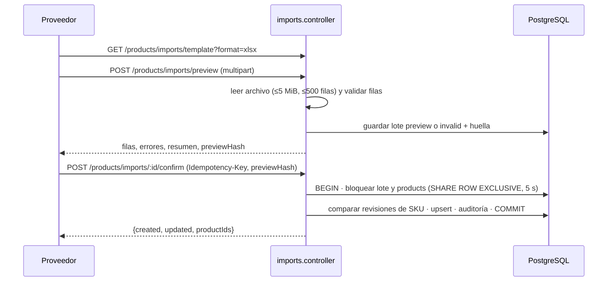

# Diseño — Carga masiva del catálogo

## Resumen

Casos de uso en `apps/api/src/catalog/application` (`import-file.ts` lee y valida CSV o XLSX; la vista previa y la confirmación se guardan en la tabla `catalog_imports`) expuestos por `imports.controller.ts`. La lógica de lotes y su SQL están en `application/catalog-imports.ts`. En Angular, el asistente de 4 pasos vive en `apps/web/src/catalog-import.ts`.

## Flujo

## Interfaces

| Ruta | Resultado |
|---|---|
| `GET /products/imports/template?format=csv\|xlsx` | Plantilla descargable |
| `POST /products/imports/preview` | 201 `{id, status, previewHash, expiresAt, rows, summary}` |
| `GET /products/imports/:id` | Estado y reporte del lote propio |
| `POST /products/imports/:id/confirm` | 201 con resultado aplicado |

## Modelo de datos (migración 003)

`products.category`, `products.revision` (un trigger la incrementa en cada cambio de metadatos), `catalog_imports` (filas normalizadas, errores, huella, responsable, vencimiento, clave de confirmación y resultado). Unicidad `(supplier_id, sku)`.

## Decisiones

- **Vista previa persistida:** la confirmación no vuelve a leer el archivo, solo aplica lo revisado.
- **Revisión por SKU:** detecta cambios concurrentes, incluso desde SQL directo.
- **Bloqueo acotado** de `products` solo durante la confirmación; las lecturas públicas continúan.
- **Seguridad de archivos:** XLSX limitado a 20 MiB descomprimido y 100 entradas ZIP; el reporte CSV escapa fórmulas.

## Manejo de errores

400 archivo ilegible o encabezados incorrectos (con detalle) · 401 sin sesión · 403 sin permiso o proveedor pendiente · 404 lote ajeno · 409 huella distinta, lote vencido o cambios concurrentes · 413 archivo grande · 422 lote con filas inválidas.

## Estrategia de pruebas

| Requisito | Prueba |
|---|---|
| 1–4 | [`tests/imports.integration.cjs`](../../../../tests/imports.integration.cjs): CSV, XLSX real, encabezados mal escritos, límites, 500 filas, concurrencia, rollback inyectado, vencimiento, revocación |
| Interfaz | [`tests/catalog.browser.cjs`](../../../../tests/catalog.browser.cjs): subir Excel inválido, corregir, confirmar y ver publicado |
| Recarga sin reponer stock | [`tests/demo-catalog.integration.cjs`](../../../../tests/demo-catalog.integration.cjs) |
