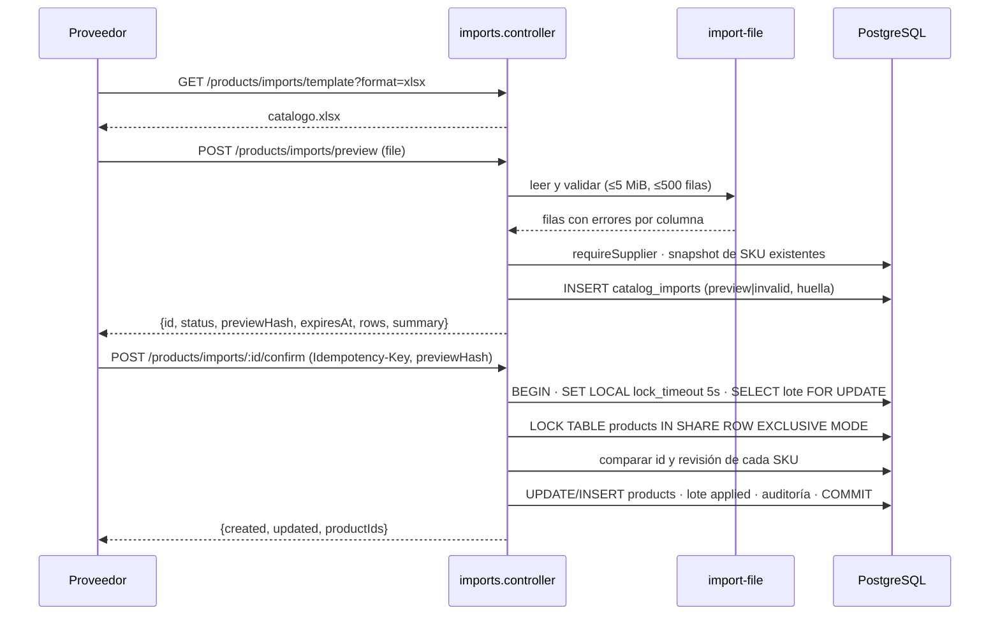

# Diseño Técnico — Carga masiva del catálogo (CSV y Excel)

| Campo        | Valor                                                        |
| ------------ | ------------------------------------------------------------ |
| Proyecto     | MayoristaPro B2B                                             |
| Módulo       | 03 · Carga masiva del catálogo (CSV y Excel)                 |
| Metodología  | Spec-Driven Development (SDD)                                |
| Sprint       | Sprint 2                                                     |
| Estado       | Implementado ✓                                               |
| Curso        | IS-488 Arquitectura de Software · EPIS – UNSCH · 2026-II     |

---

## 1. Arquitectura del módulo

```
┌──────────────────────────────────────────────────────────────────┐
│             FRONTEND (Angular · catalog-import.ts)               │
│                                                                  │
│  Asistente en 4 pasos (ol.import-steps):                         │
│    1. Descargar plantilla (CSV o Excel)                          │
│    2. Subir archivo                                              │
│    3. Revisar vista previa (errores por fila y columna)          │
│    4. Confirmar (Idempotency-Key + previewHash)                  │
│  «¿Cómo lleno la plantilla?» · reporte CSV descargable           │
└───────────────────────────────┬──────────────────────────────────┘
                                │ HTTPS · Bearer · multipart/form-data
                                ▼
┌──────────────────────────────────────────────────────────────────┐
│              BACKEND (NestJS · módulo catalog)                   │
│                                                                  │
│  imports.controller.ts                                           │
│    GET  products/imports/template   → ExcelJS / CSV con BOM      │
│    POST products/imports/preview    → FileInterceptor (5 MiB)    │
│    GET  products/imports/:id                                     │
│    POST products/imports/:id/confirm                             │
│                    │                                             │
│  import-file.ts     → readImportFile(): CSV/XLSX, límites, fórmulas  │
│  catalog-imports.ts → preview(), get(), confirm()                │
│                    │                                             │
│  identity.service.ts → requireSupplier() (permiso + verificado)  │
└───────────────────────────────┬──────────────────────────────────┘
                                │ pg · transacción + LOCK TABLE
                                ▼
┌──────────────────────────────────────────────────────────────────┐
│                   POSTGRESQL (migración 003)                     │
│  catalog_imports (filas, huella, estado, vencimiento, resultado) │
│  products (revision, trigger de metadatos)                       │
│  identity_audit (confirm-import)                                 │
└──────────────────────────────────────────────────────────────────┘
```

### Secuencia completa



---

## 2. Diseño de la lectura — `import-file.ts`

### Constantes

```ts
export const FILE_LIMIT = 5 * 1024 * 1024; // 5 MiB
export const ROW_LIMIT = 500;
export const COLUMNS = ['sku', 'nombre', 'categoria', 'presentacion', 'unidades_por_presentacion',
  'precio', 'moneda', 'incluye_igv', 'minimo', 'multiplo', 'stock', 'publicado'] as const;
```

### `readImportFile(file)` y `validateRows(rows)`

| Paso | Acción | Error |
| ---- | ------ | ----- |
| 1 | Verificar tamaño | 413 «Máximo 5 MB.» |
| 2 | Detectar formato: XLSX (firma ZIP) o CSV UTF-8 | 400 «Solo CSV UTF-8 con comas o XLSX.» |
| 3 | XLSX: revisar el ZIP antes de abrirlo (≤ 20 MiB descomprimido, ≤ 100 entradas, sin macros) | 400 «XLSX inválido, con macros o demasiado expandido…» |
| 4 | Contar filas (1 a 500) | 400 «Se requieren entre 1 y 500 filas.» |
| 5 | Comparar encabezados con `COLUMNS` y armar el mensaje con faltantes, sobrantes y repetidas | 400 con detalle |
| 6 | Por cada fila: ignorar si está vacía; error si la cantidad de columnas no coincide | Error de fila |
| 7 | Rechazar celdas que no sean valores literales (fórmulas, fechas, vínculos) | «Solo valores literales; no fórmulas, fechas ni vínculos.» |
| 8 | Validar cada columna (sección 3 de requisitos) y textos que empiezan con `= + - @` | Error por columna |
| 9 | Marcar SKU repetidos dentro del archivo | «SKU repetido dentro del archivo.» |

---

## 3. Diseño de la vista previa — `catalog-imports.ts → preview()`

1. `requireSupplier()` obtiene `{ accountId, supplierId }` de la sesión.
2. `readImportFile()` devuelve las filas validadas.
3. `products()` lee los productos existentes del proveedor por SKU y guarda un **snapshot** `{ id, revision, unit, units_per_pack, stock }`.
4. Cada fila recibe `action: 'create' | 'update'`; `stockErrors()` agrega errores si se intenta cambiar la equivalencia de un producto existente.
5. Se calcula la huella `previewHash` sobre las filas normalizadas.
6. Se inserta en `catalog_imports` con estado `invalid` si alguna fila tiene errores, o `preview` si no.
7. La respuesta incluye `summary` con el conteo de altas, actualizaciones y errores.

---

## 4. Diseño de la confirmación — `confirm()`

| Paso | Acción | Resultado si falla |
| ---- | ------ | ------------------ |
| 1 | Validar `Idempotency-Key` | 400 |
| 2 | `BEGIN` · `SET LOCAL lock_timeout='5s'` · `requireSupplier()` | 401/403 |
| 3 | `SELECT … FROM catalog_imports WHERE id AND supplier_id FOR UPDATE` | 404 «Lote no disponible.» |
| 4 | Comparar `previewHash` | 409 «La huella de la vista previa no coincide.» |
| 5 | Si ya está `applied` → devolver el mismo reporte | (idempotente) |
| 6 | Si es `invalid` o tiene errores | 422 «El lote tiene errores…» |
| 7 | Si es `stale` o venció → marcar `stale` | 409 «La vista previa venció…» |
| 8 | `LOCK TABLE products IN SHARE ROW EXCLUSIVE MODE` | — |
| 9 | Releer productos; si cambió el `id` o la `revision` de un SKU, o apareció uno nuevo → `stale` | 409 «El SKU … cambió después de la vista previa.» |
| 10 | `UPDATE` (sin tocar `stock`, con `published = (valor AND retired_at IS NULL)`) o `INSERT` (con stock inicial) | — |
| 11 | Marcar `applied`, guardar `confirmation_key` y `result`, auditar `confirm-import` | — |
| 12 | `COMMIT` | `ROLLBACK` total ante cualquier error |

El bloqueo de pasos 3 y 8 serializa las confirmaciones: si dos llegan a la vez, la segunda espera, ve el lote `applied` y devuelve el mismo reporte.

---

## 5. Modelo de datos utilizado (migración 003)

### Columnas agregadas a `products`

| Columna | Tipo | Uso |
| ------- | ---- | --- |
| `category` | `text` | Categoría (por defecto «General») |
| `revision` | `bigint` | Sube con un trigger cuando cambian SKU, nombre, categoría, presentación, equivalencia, mínimo, múltiplo, precio, moneda, IGV o publicación |

### Tabla `catalog_imports`

| Columna | Tipo | Regla |
| ------- | ---- | ----- |
| `id` | `uuid` | PK |
| `supplier_id` | `uuid` | FK a `suppliers`; solo el dueño lo ve |
| `actor_id` | `uuid` | Cuenta que subió el archivo |
| `status` | `text` | `preview`, `invalid`, `stale` o `applied` |
| `rows` | `jsonb` | Filas normalizadas, acción, snapshot y errores |
| `preview_hash` | `text` | Huella de la vista previa |
| `confirmation_key` | `text` | `Idempotency-Key` usada al aplicar |
| `result` | `jsonb` | `{ created, updated, productIds }` |
| `created_at`, `expires_at`, `applied_at` | `timestamptz` | Vence a los 30 minutos |

---

## 6. Decisiones de diseño

| Decisión | Justificación |
| -------- | ------------- |
| Vista previa persistida en la base | La confirmación no vuelve a leer el archivo: aplica exactamente lo que el proveedor revisó |
| Huella obligatoria al confirmar | Evita confirmar un lote distinto del que se mostró en pantalla |
| Revisión por SKU (`products.revision`) | Detecta cambios concurrentes aunque vengan de SQL directo o de otro lote |
| `LOCK TABLE … SHARE ROW EXCLUSIVE` acotado a 5 s | Protege también SKU que todavía no existen; las lecturas del catálogo siguen funcionando |
| La plantilla no repone stock de productos existentes | El inventario se mueve con pedidos y reservas; una carga no debe pisarlo |
| `published = valor AND retired_at IS NULL` | Respeta la moderación: una carga no puede republicar lo que retiró el administrador |
| Rechazar fórmulas y textos con `= + - @` | Evita inyección de fórmulas cuando el reporte se abre en Excel |
| ExcelJS con revisión previa del ZIP | Lee XLSX reales sin riesgo de bombas de descompresión |

---

## 7. Manejo de errores

| Caso | HTTP | Mensaje |
| ---- | ---- | ------- |
| Sin archivo | 400 | «Adjunta un archivo en el campo file.» |
| Formato no soportado o XLSX corrupto | 400 | «Solo CSV UTF-8 con comas o XLSX.» / «XLSX no válido.» |
| Encabezados incorrectos | 400 | Lista de columnas que faltan, sobran o se repiten |
| Filas fuera de rango | 400 | «Se requieren entre 1 y 500 filas.» |
| Archivo grande | 413 | «Máximo 5 MB.» |
| Sin `Idempotency-Key` | 400 | «Idempotency-Key requerido (1–128 letras, números, punto o guion).» |
| Sin sesión | 401 | — |
| Sin `publish` o proveedor no verificado | 403 | «Requiere permiso de publicación.» / «Requiere proveedor verificado.» |
| Lote ajeno o inexistente | 404 | «Lote no disponible.» |
| Huella distinta, lote vencido o SKU cambiado | 409 | Mensaje con el motivo y «Vuelve a cargar y revisar el archivo.» |
| Lote con errores | 422 | «El lote tiene errores: corrige el archivo y vuelve a cargarlo.» |

---

## 8. Estrategia de pruebas

| Requisito | Subprueba en `tests/imports.integration.cjs` |
| --------- | -------------------------------------------- |
| RF-IMP-01, 02 | «XLSX real y plantillas; fórmulas y contenido corrupto rechazados» |
| RF-IMP-02 | «Encabezados mal escritos: el mensaje dice cuál falta y cuál sobra» |
| RF-IMP-02 | «límites de archivo y filas; se admite un lote de 500 productos» |
| RF-IMP-03 | «errores por fila/columna impiden cualquier cambio parcial» |
| RF-IMP-04, 05 | «CSV: vista previa sin escrituras, confirmación y catálogo público» |
| RF-IMP-05.2 | «reintentos simultáneos aplican el lote una vez, huella y clave requeridas» |
| RF-IMP-05.4 | «cambio de SKU o metadatos invalida vista previa, incluso al restaurar el valor» |
| RF-IMP-05.4 | «dos lotes para un SKU ausente: solo uno se aplica y el otro exige revisar» |
| RF-IMP-05.5 | «un fallo SQL durante la aplicación revierte altas, lote y auditoría juntos» |
| RF-IMP-05.6 | «actualización conserva stock incluso con movimiento posterior a la vista previa» |
| RNF-IMP-01 | «mismo SKU de otro proveedor crea una oferta independiente; ajenos y pendientes bloqueados» |
| RNF-IMP-01 | «vencimiento, pérdida de verificación y revocación se revalidan al confirmar» |
| Interfaz | `tests/catalog.browser.cjs`: subir Excel inválido, corregir, confirmar y ver publicado |

---

## 9. Trazabilidad SDD

| Requisito | Función implementada |
| --------- | -------------------- |
| RF-IMP-01 | `ImportsController.template()` |
| RF-IMP-02 | `ImportsController.preview()` → `CatalogImports.preview()` → `readImportFile()` |
| RF-IMP-03 | Validaciones de `import-file.ts` + `stockErrors()` |
| RF-IMP-04 | `CatalogImports.get()` |
| RF-IMP-05 | `CatalogImports.confirm()` |
