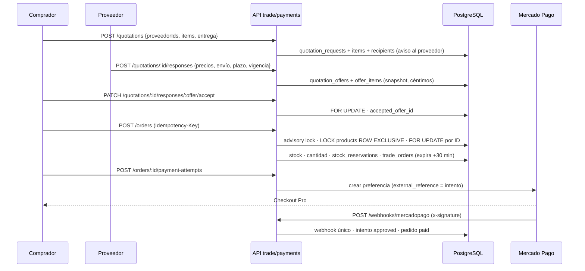

# Diseño Técnico — Cotizaciones, pedidos, pago y despacho

| Campo        | Valor                                                        |
| ------------ | ------------------------------------------------------------ |
| Proyecto     | MayoristaPro B2B                                             |
| Módulo       | 04 · Cotizaciones, pedidos, pago y despacho                  |
| Metodología  | Spec-Driven Development (SDD)                                |
| Sprint       | Sprint 2                                                     |
| Estado       | Implementado ✓                                               |
| Curso        | IS-488 Arquitectura de Software · EPIS – UNSCH · 2026-II     |

---

## 1. Arquitectura del módulo

Tres módulos NestJS colaboran, cada uno con sus capas de Clean Architecture:

```
┌──────────────────────────────────────────────────────────────────┐
│                     FRONTEND (Angular)                           │
│  order-list.ts       Lista de pedido agrupada por proveedor      │
│  trade.ts            Cotizaciones, ofertas, pedidos y despacho   │
│  pago-prueba.ts      Tarjeta · Yape · PagoEfectivo (CIP)         │
│  pago-mercadopago.ts Regreso de Mercado Pago y «Ya pagué…»       │
│  orden-compra.ts     Orden de compra imprimible con IGV          │
└───────────────────────────────┬──────────────────────────────────┘
                                │ HTTPS · Bearer · Idempotency-Key
                                ▼
┌──────────────────────────────────────────────────────────────────┐
│                      BACKEND (NestJS)                            │
│                                                                  │
│  trade/                                                          │
│    presentation  trade.controller.ts                             │
│    application   trade.ts (Trade) ── puerto TradeStore           │
│    domain        trade.ts (dinero, reglas, ofertas, reservas)    │
│                  fulfillment.ts (transiciones de despacho)       │
│                  price-tiers.ts                                  │
│    infrastructure postgres-trade.ts (unidad de trabajo, locks)   │
│                                                                  │
│  payments/                                                       │
│    presentation  payments.controller.ts (webhook + firma)        │
│    application   payments.ts ── puertos PaymentStore y Gateway   │
│    domain        payment.ts (estados y transiciones del pago)    │
│    infrastructure mercadopago-gateway.ts (Adapter, modo prueba)  │
│                   postgres-payments.ts                           │
│                                                                  │
│  ai/             ai.service.ts → FastAPI /api/v1/score-offers    │
│  workers/        expire-orders.cjs · recover-webhooks.cjs        │
└──────┬───────────────────────────┬──────────────────────┬────────┘
       │ pg                        │ HTTPS                │ HTTP
       ▼                           ▼                      ▼
┌──────────────┐         ┌───────────────────┐   ┌──────────────────┐
│ PostgreSQL   │         │ Mercado Pago      │   │ FastAPI (IA)     │
│ 004·005·006· │         │ Checkout Pro      │   │ puntaje 50/30/20 │
│ 009·014      │         │ (sandbox)         │   │                  │
└──────────────┘         └───────────────────┘   └──────────────────┘
```

### Secuencia: de la cotización al pago



---

## 2. Dominio — `trade/domain/trade.ts`

| Función | Responsabilidad |
| ------- | --------------- |
| `rule(cond, código, mensaje)` | Lanza `TradeRule` (un `DomainError`) con código estable |
| `money(valor)` / `amount(céntimos)` | Convierte cadenas decimales a céntimos `bigint` y de vuelta; rechaza más de 2 decimales |
| `priceTotal(líneas, envío)` | Suma exacta de subtotales y envío |
| `requestDraft(body)` | Valida proveedores, ítems, presentaciones y entrega |
| `deliveryDraft(body)` | Valida modalidad `envio`, `recojo` o `agencia` y sus campos |
| `offerDraft(body)` | Valida PEN con IGV, envío, plazo, vigencia con zona horaria e ítems únicos |
| `conditions(producto)` / `compatible(…)` | Snapshot de condiciones y verificación de que no cambiaron |
| `assertCoversRequest(…)` / `offerLines(…)` | La oferta cubre todos los ítems con productos propios y stock |
| `assertAcceptable(oferta)` | Proveedor verificado y oferta vigente |
| `reservationQuantities(…)` | Unidades a reservar por producto; detecta cambios y falta de stock |

El dominio **no conoce HTTP**: `ApiExceptionFilter` traduce el código a estado con `statusForCode()`.

| Código | HTTP |
| ------ | ---- |
| `FORBIDDEN` | 403 |
| `*_NOT_FOUND` | 404 |
| `INVALID_*` | 422 |
| `INVALID_SIGNATURE` | 401 |
| Cualquier otro (`ALREADY_ACCEPTED`, `OFFER_EXPIRED`, `INSUFFICIENT_STOCK`, `CONDITIONS_CHANGED`, `IDEMPOTENCY_CONFLICT`, `ORDER_STATE_CONFLICT`, `CONCURRENT_CHANGE`) | 409 |

---

## 3. Infraestructura — `postgres-trade.ts`

### `tx(trabajo)` — unidad de trabajo

```
for intento in 0..1:
   BEGIN; SET LOCAL lock_timeout = '5s'
   resultado = trabajo(db); COMMIT
   si error 40P01 (interbloqueo) o 40001 (serialización) y es el primer intento → reintentar
   22007/22008 → INVALID_INPUT «Fecha de vigencia inválida.»
   23505/55P03/40P01/40001 → CONCURRENT_CHANGE «Conflicto concurrente. Actualiza y reintenta.»
```

### `accept(id, oferta)`

1. `tradeIdentity()` y permiso `buy`.
2. Bloquea la solicitud (`request(…, lock = true)`); solo el comprador continúa (404 para otros).
3. Si ya hay otra oferta aceptada → `ALREADY_ACCEPTED`; si es la misma → devuelve el detalle (idempotente).
4. `assertAcceptable()` y `UPDATE quotation_requests SET accepted_offer_id`. Auditoría `accept-offer`.

### `order(oferta, clave)`

| Paso | Acción |
| ---- | ------ |
| 1 | `pg_advisory_xact_lock(empresa:create-order:clave)` serializa la misma clave |
| 2 | Si la clave existe en `order_keys`: misma oferta → mismo pedido; otra oferta → `IDEMPOTENCY_CONFLICT` |
| 3 | La oferta debe ser la aceptada (`NOT_ACCEPTED`); si ya hay pedido para ella, se asocia la clave y se devuelve |
| 4 | Proveedor verificado y empresa habilitada (`FOR SHARE`) → si no, `CONDITIONS_CHANGED` |
| 5 | `LOCK TABLE products IN ROW EXCLUSIVE MODE` (compatible con otros pedidos, incompatible con la carga masiva) |
| 6 | `SELECT … FROM products WHERE id = ANY(…) ORDER BY id FOR UPDATE` (orden fijo = sin interbloqueos) |
| 7 | Vigencia con `clock_timestamp()` → si no, `OFFER_EXPIRED` |
| 8 | `reservationQuantities()` y `INSERT trade_orders` con importes copiados de la oferta |
| 9 | `UPDATE products SET stock = stock - n WHERE stock >= n` → si no afecta fila, `INSUFFICIENT_STOCK` |
| 10 | `stock_reservations`, `trade_order_items`, `order_keys` y auditoría `create-order` |

### `fulfill(id, borrador)`

Usa `assertFulfillment(estadoActual, destino, roles)` de `fulfillment.ts`: comprueba el rol, devuelve `false` si ya está en ese estado (no hace nada) y lanza `ORDER_STATE_CONFLICT` si la transición no corresponde. Inserta en `trade_order_events`.

---

## 4. Pagos — `payments/`

### Estados del intento de pago (`payment.ts`)

```
created ──► pending ──► approved        (a tiempo)
   │           ├──────► approved_late   (después del vencimiento)
   │           ├──────► rejected
   │           └──────► cancelled
   └──► rejected / cancelled
approved, approved_late ──► refunded
```

`canCreateAttempt()`: pedido `pendiente`, no vencido, menos de 3 intentos y ninguno activo (`created` o `pending`). Además, un índice único parcial en la base impide dos intentos activos simultáneos.

### `MercadoPagoGateway` (patrón Adapter)

| Modo | Condición | Comportamiento |
| ---- | --------- | -------------- |
| Real (sandbox) | Hay `MP_ACCESS_TOKEN` | `POST /checkout/preferences` con `external_reference` = ID del intento y `back_urls` hacia `/pago-mercadopago` |
| Simulado | Sin token | `init_point = /pago-de-prueba/<intento>`; pantalla con Tarjeta, Yape y PagoEfectivo |

### Webhook — `payments.controller.ts → handleWebhook()`

1. Acepta el formato actual (`?data.id=…&type=payment`) y el IPN antiguo (`?id=…&topic=payment`).
2. Verifica `x-signature` (`ts=…,v1=…`) con HMAC-SHA256 usando `MP_WEBHOOK_SECRET`. Sin secreto configurado (desarrollo y pruebas), se acepta.
3. Guarda el evento en `payment_webhook_events` (único por `notification_id`) y lo procesa.
4. Ante un error transitorio responde 200; el worker `recover-webhooks.cjs` lo reprocesa (`retryPendingWebhooks()`, de 50 en 50).

### `mapMercadoPagoStatus()`

| Estado en Mercado Pago | Estado del intento |
| ---------------------- | ------------------ |
| `approved` | `approved` o `approved_late` según el vencimiento |
| `pending`, `in_process`, `in_mediation` | `pending` |
| `rejected`, `cancelled` | `rejected` |
| `refunded`, `charged_back` | `refunded` |

### Worker de vencimiento — `expire-orders.cjs`

Busca pedidos `pendiente` o `expired_pending_payment` con `expires_at < now()` (`FOR UPDATE`). Sin pagos activos → `expired`, devuelve el stock y libera la reserva. Con pago activo → `expired_pending_payment` sin liberar stock. Es idempotente: no devuelve stock dos veces.

---

## 5. Modelo de datos utilizado

### Comercio (004, 014)

| Tabla | Columnas clave | Restricciones |
| ----- | -------------- | ------------- |
| `quotation_requests` | `buyer_company_id`, `actor_id`, `accepted_offer_id`, `delivery` (jsonb) | FK compuesta: la oferta aceptada pertenece a esta solicitud |
| `quotation_items` | `description`, `unit`, `units_per_pack`, `quantity` | Cantidades > 0 |
| `quotation_recipients` | `(request_id, supplier_id)` | PK compuesta |
| `quotation_offers` | `shipping`, `subtotal`, `total`, `delivery_days`, `expires_at` | `total = subtotal + shipping`, solo PEN con IGV |
| `quotation_offer_items` | `product_id`, `quantity`, `unit_price`, `subtotal`, `snapshot` | `subtotal = unit_price × quantity`; producto del mismo proveedor |
| `trade_orders` | `request_id` y `offer_id` únicos, `state`, importes, `expires_at` | Un pedido por solicitud y por oferta |
| `trade_order_items` | Copia de líneas y snapshot | Importes históricos |
| `stock_reservations` | `(order_id, product_id)`, `quantity`, `state` | `activa`, `consumed`, `expired`, `released` |
| `order_keys` | `(buyer_company_id, key)`, `request_hash`, `order_id` | Idempotencia de «Crear pedido» |

### Pagos (005, 006) y despacho (009)

| Tabla | Columnas clave |
| ----- | -------------- |
| `payment_attempts` | `order_id`, `state`, `preference_id`, `payment_id`, `amount`, `currency`, respuestas de MP |
| `payment_webhook_events` | `notification_id` único, `data_id`, `type`, `payload`, `signature_verified`, `processed` |
| `payment_reconciliations` | `order_id`, `payment_attempt_id`, `reason`, `resolved` |
| `trade_order_events` | `order_id`, `state`, `actor_id`, `note` (1–300), `created_at` |

---

## 6. Decisiones de diseño

| Decisión | Justificación |
| -------- | ------------- |
| Cotización previa al pedido (RFQ) | Es como compra el mayorista: el precio final depende del volumen, el envío y el plazo |
| Oferta inmutable con snapshot | El pedido copia lo que el comprador aceptó; si el producto cambia, se detecta con `CONDITIONS_CHANGED` |
| Dinero en céntimos `bigint` | Evita errores de punto flotante (0.1 + 0.2) en totales e IGV |
| Reserva al crear el pedido, con vencimiento de 30 min | El stock queda apartado mientras se paga, pero no se bloquea para siempre |
| Bloqueo ordenado por ID + un reintento | Evita interbloqueos entre pedidos simultáneos y con la carga masiva |
| Bloqueo asesor por clave + `order_keys` | Repetir el clic «Crear pedido» no duplica pedidos |
| Adapter de Mercado Pago con modo simulado | La demo funciona sin credenciales; con credenciales usa el sandbox real |
| Webhook + confirmación al regreso + worker | Tres caminos para no perder un pago aunque el webhook no llegue (por ejemplo, en `localhost`) |
| IA desacoplada por HTTP con degradación | Si FastAPI no responde, el comprador compara igual sin puntaje |

---

## 7. Manejo de errores

| Caso | HTTP | Código / mensaje |
| ---- | ---- | ---------------- |
| Datos inválidos | 422 | `INVALID_INPUT` con el motivo («Docena requiere 12 unidades.», «Vigencia ISO con zona horaria requerida.») |
| Sin sesión | 401 | — |
| Sin permiso comercial | 403 | «Permiso comercial insuficiente o proveedor no verificado.» |
| Solicitud u oferta ajena | 404 | — |
| Otra oferta ya aceptada | 409 | `ALREADY_ACCEPTED` |
| Oferta vencida | 409 | `OFFER_EXPIRED` «La oferta venció. Inicia una nueva solicitud.» |
| Stock insuficiente | 409 | `INSUFFICIENT_STOCK` |
| Clave reutilizada con otra oferta | 409 | `IDEMPOTENCY_CONFLICT` |
| Transición de despacho inválida | 409 | `ORDER_STATE_CONFLICT` «El pedido aún no está pagado.» |
| Cuarto intento de pago o intento activo | 409 | `CANNOT_CREATE_ATTEMPT` |
| Firma de webhook inválida | 401 | `INVALID_SIGNATURE` |

---

## 8. Estrategia de pruebas

| Requisito | Prueba |
| --------- | ------ |
| RF-COT-01, 02 | `tests/orders.integration.cjs` · T4-AC01/02 (permisos, destinatarios, productos propios, privacidad) |
| RF-COT-03 | `tests/ai.integration.cjs`, `apps/ai-service/test_scoring.py` |
| RF-COT-04 | T4-AC03 (aceptación concurrente con cuentas distintas) |
| RF-COT-05 | T4-AC04/09 (idempotencia), AC05 (vencida), AC06 (cambios), AC07 (dos compradores, stock 5), AC08 (rollback), AC11 (reimportación) |
| RF-COT-06 | `tests/payments.integration.cjs` (T5-P01…P08), `payments-security` (S01…S05), `payments-recovery` (R01…R06), `payments-migration` (M01…M17), `tests/mercadopago-retorno.test.cjs` |
| RF-COT-07 | `tests/fulfillment.integration.cjs`, `tests/fulfillment.test.cjs` |
| Dominio | `tests/pricing.test.cjs`, `tests/trade-rules.test.cjs`, `tests/quotation-summary.integration.cjs`, `tests/entrega.integration.cjs` |
| Interfaz | `tests/quotations.browser.cjs`, `cotizacion-simple.browser.cjs`, `lista-pedido.browser.cjs`, `pago-prueba.browser.cjs` |
| Postman | Carpetas «3. Cotizaciones» (11) y «4. Pedidos» (6) |

---

## 9. Trazabilidad SDD

| Requisito | Función implementada |
| --------- | -------------------- |
| RF-COT-01 | `Trade.create()` → `requestDraft()` → `PostgresTrade.createRequest()` |
| RF-COT-02 | `Trade.respond()` → `offerDraft()`, `assertCoversRequest()`, `offerLines()` |
| RF-COT-03 | `AiController` → `AiService.scoreQuotation()` |
| RF-COT-04 | `PostgresTrade.accept()` + `assertAcceptable()` |
| RF-COT-05 | `Trade.order()` → `PostgresTrade.order()` + `reservationQuantities()` |
| RF-COT-06 | `Payments.createPaymentAttempt()`, `processWebhookNotification()`, `confirmReturn()`, `simulatePayment()`, `expire-orders.cjs` |
| RF-COT-07 | `Trade.fulfill()` → `fulfillmentDraft()`, `assertFulfillment()` |
| RF-COT-08 | `orders()`, `orderDetail()`, `orden-compra.ts` |
