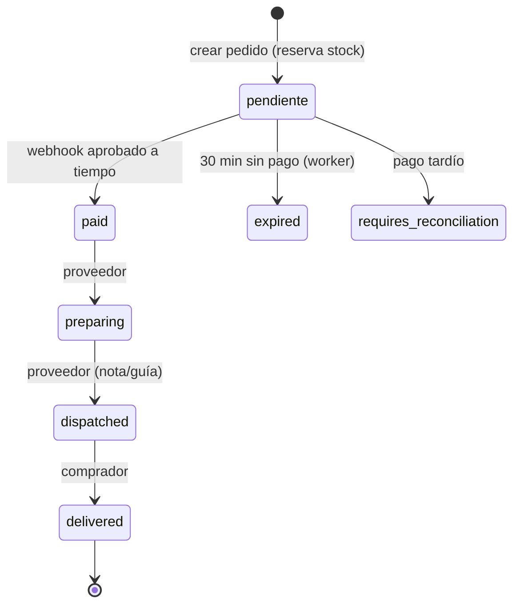

# Diseño — Cotizaciones, pedidos, pago y despacho

## Resumen

Dos módulos NestJS con Clean Architecture:

- `trade`: dominio puro (`domain/trade.ts` para dinero y reglas, `fulfillment.ts` para transiciones de despacho y `price-tiers.ts`), caso de uso `application/trade.ts` contra el puerto `TradeStore`, y adaptador `infrastructure/postgres-trade.ts` con unidad de trabajo.
- `payments`: dominio `payment.ts`, aplicación `payments.ts`, gateway `mercadopago-gateway.ts` (patrón **Adapter** con modo de prueba) y `postgres-payments.ts`.

Los procesos periódicos (`workers/expire-orders.cjs` y `recover-webhooks.cjs`) corren en el contenedor `worker`. El puntaje de ofertas lo calcula el servicio FastAPI (`POST quotations/:id/score-offers`).

## Flujo

## Interfaces

| Ruta | Actor |
|---|---|
| `GET /trade/providers` · `GET /trade/products` | Comprador · proveedor |
| `POST/GET /quotations` · `GET /quotations/:id` | Comprador y destinatarios |
| `POST /quotations/:id/responses` | Proveedor destinatario |
| `PATCH /quotations/:id/responses/:offer/accept` | Comprador |
| `POST /quotations/:id/score-offers` | Comprador (IA) |
| `POST/GET /orders` · `GET /orders/:id` | Participantes |
| `POST/GET /orders/:id/payment-attempts` | Comprador |
| `POST /webhooks/mercadopago` | Mercado Pago (firma verificada) |
| `PATCH /orders/:id/fulfillment` | Proveedor o comprador según el estado |

## Modelo de datos

- **004:** `quotation_requests`, `quotation_items`, `quotation_recipients`, `quotation_offers`, `quotation_offer_items`, `trade_orders`, `trade_order_items`, `stock_reservations`, `order_keys`. Una FK compuesta obliga a que la oferta aceptada pertenezca a su solicitud.
- **005 y 006:** `trade_orders.expires_at` (30 min), `payment_attempts`, `payment_webhook_events`, `payment_reconciliations`.
- **009:** estados de despacho y `trade_order_events` (historial).

## Concurrencia y dinero

- Bloqueo de productos por ID ordenado, para evitar interbloqueos con la carga masiva; un reintento como máximo ante conflicto de serialización.
- Bloqueo asesor transaccional para la clave de idempotencia.
- Dinero como cadenas decimales convertidas a céntimos `bigint`; `numeric(12,2)` y `numeric(24,2)` en PostgreSQL. Los precios de la demo incluyen IGV.

## Manejo de errores

401/403/404 según acceso · 409 `ALREADY_ACCEPTED`, `IDEMPOTENCY_CONFLICT` o transición inválida · 422 cantidades o precios inválidos · códigos de negocio `OFFER_EXPIRED`, `INSUFFICIENT_STOCK`, `CONDITIONS_CHANGED`.

## Estrategia de pruebas

| Requisito | Prueba |
|---|---|
| 1–3 | [`tests/orders.integration.cjs`](../../../../tests/orders.integration.cjs) (T4-AC01 a AC11, con barreras de concurrencia), [`tests/pricing.test.cjs`](../../../../tests/pricing.test.cjs), [`tests/trade-rules.test.cjs`](../../../../tests/trade-rules.test.cjs), [`tests/quotation-summary.integration.cjs`](../../../../tests/quotation-summary.integration.cjs) |
| 2.4 | [`tests/ai.integration.cjs`](../../../../tests/ai.integration.cjs) |
| 4 | [`tests/payments.integration.cjs`](../../../../tests/payments.integration.cjs) (T5-P01 a P08), [`tests/payments-security.integration.cjs`](../../../../tests/payments-security.integration.cjs), [`tests/payments-recovery.integration.cjs`](../../../../tests/payments-recovery.integration.cjs) |
| 5 | [`tests/fulfillment.integration.cjs`](../../../../tests/fulfillment.integration.cjs), [`tests/fulfillment.test.cjs`](../../../../tests/fulfillment.test.cjs) |
| Interfaz | [`tests/quotations.browser.cjs`](../../../../tests/quotations.browser.cjs), [`tests/cotizacion-simple.browser.cjs`](../../../../tests/cotizacion-simple.browser.cjs), [`tests/lista-pedido.browser.cjs`](../../../../tests/lista-pedido.browser.cjs) |
