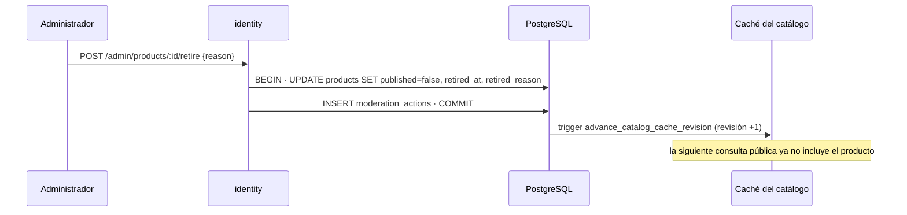

# Diseño — Moderación del administrador

## Resumen

Se extiende el módulo `identity` (`identity.service.ts` y `identity.controller.ts`), porque la autorización de administrador ya vive ahí. Cada acción usa una transacción que cambia el recurso e inserta en `moderation_actions` mediante el método privado `moderation()`; el motivo se valida con `reason()`. En Angular, el detalle del producto muestra «Retirar producto» solo al administrador, y el Panel de administración (`identity.ts`) agrega las secciones «Empresas registradas», «Productos retirados» y «Bitácora de moderación».

## Flujo de retiro

## Interfaces

| Ruta | Resultado |
|---|---|
| `POST /admin/products/:id/retire` · `POST /admin/products/:id/restore` | `{reason}` → 201 |
| `GET /admin/products/retired` | Productos retirados con su motivo |
| `GET /admin/companies?q=` | Hasta 100 empresas con su estado |
| `POST /admin/companies/:id/suspend` · `POST /admin/companies/:id/reactivate` | `{reason}` → 201 |
| `GET /admin/moderation` | Bitácora reciente |

Todas exigen sesión de administrador de plataforma (403 en otro caso).

## Modelo de datos (migración 011)

- `products.retired_at`, `products.retired_reason` y la restricción `products_retired_unpublished` (un producto retirado no puede estar publicado).
- `companies.status` admite `pending`, `enabled` y `suspended`; se agrega `companies.suspended_reason`.
- `moderation_actions(id, actor_id, action, resource_id, resource_name, reason, created_at)`, con `action` limitada a los 4 tipos y `reason` entre 5 y 500 caracteres.

## Decisiones

- La restricción en PostgreSQL garantiza la regla aunque alguien escriba SQL directo.
- El catálogo excluye empresas suspendidas en la consulta (`postgres-products.ts`), y la caché se invalida por los triggers ya existentes.
- La carga masiva calcula `published = (valor del archivo AND retired_at IS NULL)`, así que no puede republicar un retiro.
- Suspender borra las sesiones de la empresa: el corte es inmediato y no espera a que venzan los tokens.

## Manejo de errores

400 motivo inválido o estado no permitido (por ejemplo, suspender una empresa pendiente) · 403 no administrador, o publicar un producto retirado · 404 recurso inexistente.

## Estrategia de pruebas

| Requisito | Prueba |
|---|---|
| 1, 2, 3 | [`tests/identity.integration.cjs`](../../../../tests/identity.integration.cjs), subprueba «moderación: retirar producto y suspender empresa con bitácora» |
| Interfaz | Revisión visual con `npm run revisar:front` ([guía](../../../guias/revision-frontend.md)) |
| Contrato | [`tests/openapi.test.cjs`](../../../../tests/openapi.test.cjs): las 7 rutas están documentadas |
