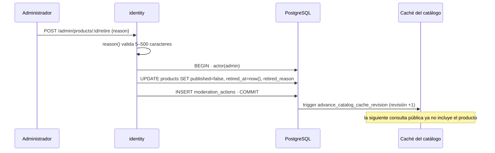
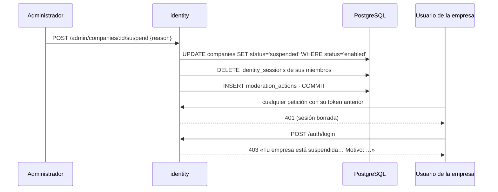

# Diseño Técnico — Moderación del administrador

| Campo        | Valor                                                        |
| ------------ | ------------------------------------------------------------ |
| Proyecto     | MayoristaPro B2B                                             |
| Módulo       | 05 · Moderación del administrador                            |
| Metodología  | Spec-Driven Development (SDD)                                |
| Sprint       | Sprint 2                                                     |
| Estado       | Implementado ✓                                               |
| Curso        | IS-488 Arquitectura de Software · EPIS – UNSCH · 2026-II     |

---

## 1. Arquitectura del módulo

La moderación **extiende el módulo `identity`**, porque ahí ya vive la autorización del administrador (`actor(db, auth, true)`). No se creó un módulo nuevo para no duplicar esa lógica.

```
┌──────────────────────────────────────────────────────────────────┐
│                    FRONTEND (Angular)                            │
│                                                                  │
│  catalog.ts (ficha)   → «Retirar producto» solo para admin       │
│  identity.ts → Panel de administración                           │
│     ├── Solicitudes pendientes (aprobar · rechazar · verificar)  │
│     ├── Empresas registradas (buscar · suspender · reactivar)    │
│     ├── Productos retirados (restaurar)                          │
│     └── Bitácora de moderación                                   │
│  Cada acción abre un cuadro para escribir el motivo              │
└───────────────────────────────┬──────────────────────────────────┘
                                │ HTTPS · Bearer (admin)
                                ▼
┌──────────────────────────────────────────────────────────────────┐
│                BACKEND (NestJS · módulo identity)                │
│                                                                  │
│  identity.controller.ts                                          │
│    GET  admin/companies?q=                                       │
│    POST admin/companies/:id/suspend | reactivate                 │
│    GET  admin/products/retired                                   │
│    POST admin/products/:id/retire | restore                      │
│    GET  admin/moderation                                         │
│    POST admin/enrollments/:id/reject                             │
│                    │                                             │
│  identity.service.ts                                             │
│    reason()      → valida el motivo (5–500)                      │
│    moderation()  → INSERT moderation_actions                     │
│    suspendCompany(), reactivateCompany(), companies()            │
│    retireProduct(), restoreProduct(), retiredProducts()          │
│    moderationLog(), reject()                                     │
│    publish()     → rechaza productos retirados                   │
│    login()       → rechaza empresas suspendidas                  │
└───────────────────────────────┬──────────────────────────────────┘
                                │ pg (transacción por acción)
                                ▼
┌──────────────────────────────────────────────────────────────────┐
│                POSTGRESQL (migraciones 011 y 013)                │
│  products.retired_at · retired_reason                            │
│  CHECK products_retired_unpublished                              │
│  companies.status ∈ {pending, enabled, suspended}                │
│  companies.suspended_reason                                      │
│  moderation_actions                                              │
│  triggers de revisión del catálogo → caché invalidada            │
└──────────────────────────────────────────────────────────────────┘
```

### Secuencia: retirar un producto



### Secuencia: suspender una empresa



---

## 2. Diseño de las funciones — `identity.service.ts`

### `reason(valor)`

```ts
const result = typeof value === 'string' ? value.trim() : '';
if (result.length < 5 || result.length > 500)
  throw new BadRequestException('Escribe un motivo de 5 a 500 caracteres.');
```

### `moderation(db, actor, acción, id, nombre, motivo)`

`INSERT INTO moderation_actions(actor_id, action, resource_id, resource_name, reason)`. Guarda el **nombre** del recurso además del ID, para que la bitácora se entienda aunque el recurso cambie o se borre.

### `retireProduct(id, body)`

```sql
UPDATE products SET published=false, retired_at=now(), retired_reason=$2
WHERE id=$1 AND retired_at IS NULL RETURNING name
```

Si no devuelve fila → 400. Luego `moderation('retire-product')`.

### `restoreProduct(id, body)`

```sql
UPDATE products SET retired_at=NULL, retired_reason=NULL, published=(stock>=minimum)
WHERE id=$1 AND retired_at IS NOT NULL RETURNING name
```

Publica solo si hay stock para el pedido mínimo.

### `suspendCompany(id, body)` y `reactivateCompany(id, body)`

| Función | SQL principal | Efecto adicional |
| ------- | ------------- | ---------------- |
| `suspendCompany` | `UPDATE companies SET status='suspended', suspended_reason=$2 WHERE id=$1 AND status='enabled'` | `DELETE FROM identity_sessions WHERE account_id IN (miembros)` |
| `reactivateCompany` | `UPDATE companies SET status='enabled', suspended_reason=NULL WHERE id=$1 AND status='suspended'` | — |

### `companies(auth, búsqueda)`

`strpos(lower(legal_name || ' ' || ruc), lower($1)) > 0`, `ORDER BY status='suspended' DESC, legal_name LIMIT 100`, con el conteo de productos publicados por empresa.

### Puntos de control en otros flujos

| Flujo | Control |
| ----- | ------- |
| `publish()` | Si `retired_at` no es nulo → 403 con el motivo |
| `login()` | Si la vinculación activa es de una empresa `suspended` → 403 con el motivo |
| `actor()` | Solo considera empresas `enabled`: un usuario suspendido recibe 403 aunque tenga token |
| `PostgresProducts` | `NOT EXISTS (… c.status='suspended')` en el listado y en las opciones |
| `CatalogImports.confirm()` | `published = (valor AND retired_at IS NULL)` |

---

## 3. Modelo de datos utilizado (migración 011)

### Cambios en `products`

| Columna o restricción | Detalle |
| --------------------- | ------- |
| `retired_at` | `timestamptz`, fecha del retiro |
| `retired_reason` | `text`, hasta 500 caracteres |
| `products_retired_unpublished` | `CHECK (retired_at IS NULL OR NOT published)` |

### Cambios en `companies`

| Columna o restricción | Detalle |
| --------------------- | ------- |
| `companies_status_check` | `status IN ('pending', 'enabled', 'suspended')` |
| `suspended_reason` | `text`, hasta 500 caracteres |

### Tabla `moderation_actions`

| Columna | Tipo | Regla |
| ------- | ---- | ----- |
| `id` | `bigint` | Identidad, PK |
| `actor_id` | `uuid` | FK a `accounts` (administrador) |
| `action` | `text` | `retire-product`, `restore-product`, `suspend-company`, `reactivate-company` (+ `reject-enrollment` en 013) |
| `resource_id` | `uuid` | Producto, empresa o solicitud |
| `resource_name` | `text` | Nombre legible en el momento de la acción |
| `reason` | `text` | 5 a 500 caracteres |
| `created_at` | `timestamptz` | `now()` |

---

## 4. Decisiones de diseño

| Decisión | Justificación |
| -------- | ------------- |
| Extender `identity` en lugar de un módulo nuevo | La autorización de administrador ya vive ahí; evita duplicar `actor()` |
| Restricción `CHECK` en PostgreSQL | La regla «retirado nunca publicado» se cumple aunque alguien escriba SQL directo o haya un error en el código |
| Motivo obligatorio | El afectado necesita saber por qué, y el administrador rinde cuentas |
| Borrar sesiones al suspender | El corte es inmediato; con tokens opacos no hay que esperar a que venzan |
| Guardar `resource_name` en la bitácora | La bitácora se lee sola, sin consultar otras tablas |
| Reusar los triggers de revisión del catálogo | La caché se invalida sola al retirar o suspender, sin código adicional |
| Restaurar publica solo con stock suficiente | No se muestra como disponible un producto que no se puede comprar |
| Rechazar solicitudes en la misma bitácora | Todo lo que hace el administrador queda en un solo lugar |

---

## 5. Manejo de errores

| Caso | HTTP | Mensaje |
| ---- | ---- | ------- |
| Motivo vacío, corto o largo | 400 | «Escribe un motivo de 5 a 500 caracteres.» |
| Identificador inválido | 400 | «Identificador inválido.» |
| Producto inexistente o ya retirado | 400 | «El producto no existe o ya fue retirado.» |
| Restaurar un producto no retirado | 400 | «El producto no está retirado.» |
| Suspender una empresa no habilitada | 400 | «Solo se puede suspender una empresa habilitada.» |
| Reactivar una empresa no suspendida | 400 | «La empresa no está suspendida.» |
| No es administrador | 403 | — |
| Publicar un producto retirado | 403 | «El administrador retiró este producto. Motivo: …» |
| Iniciar sesión en empresa suspendida | 403 | «Tu empresa está suspendida por el administrador. Motivo: …» |

---

## 6. Estrategia de pruebas

| Requisito | Prueba |
| --------- | ------ |
| RF-MOD-01 a 08 | `tests/identity.integration.cjs` · «moderación: retirar producto y suspender empresa con bitácora» |
| Rechazo de altas | `identity.integration.cjs` · «rechazar una solicitud falsa borra la cuenta pendiente y libera el RUC» |
| RF-MOD-02 (carga masiva) | `tests/imports.integration.cjs` (publicación con `retired_at IS NULL`) |
| RF-MOD-05.4 | `tests/catalog-filters.integration.cjs` (opciones solo de empresas visibles) |
| Contrato | `tests/openapi.test.cjs`: las rutas de administración están documentadas |
| Interfaz | Revisión visual de 320 a 1440 px |

---

## 7. Trazabilidad SDD

| Requisito | Función implementada |
| --------- | -------------------- |
| RF-MOD-01 | `retireProduct()` + `reason()` + `moderation()` |
| RF-MOD-02 | `publish()`, `CatalogImports.confirm()`, `CHECK products_retired_unpublished` |
| RF-MOD-03 | `restoreProduct()` |
| RF-MOD-04 | `retiredProducts()` |
| RF-MOD-05 | `suspendCompany()`, `login()`, `actor()`, `PostgresProducts` |
| RF-MOD-06 | `reactivateCompany()` |
| RF-MOD-07 | `companies()` |
| RF-MOD-08 | `moderationLog()` |
| RF-MOD-09 | `identity.ts` (Panel de administración), `catalog.ts` (ficha) |
