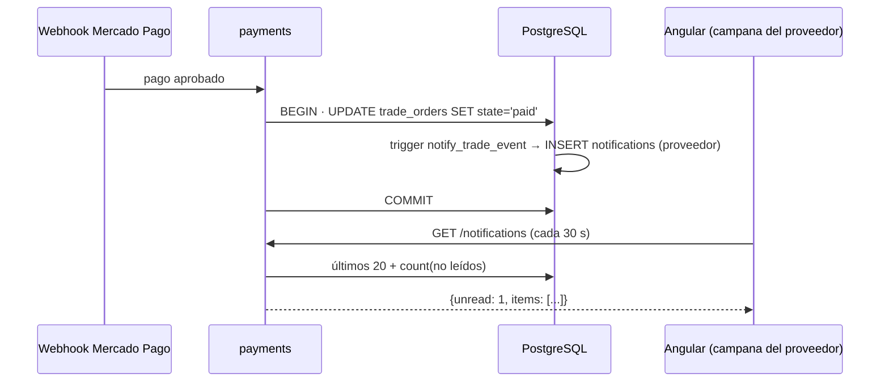

# Diseño Técnico — Avisos y «Volver a pedir»

| Campo        | Valor                                                        |
| ------------ | ------------------------------------------------------------ |
| Proyecto     | MayoristaPro B2B                                             |
| Módulo       | 06 · Avisos y «Volver a pedir»                               |
| Metodología  | Spec-Driven Development (SDD)                                |
| Sprint       | Sprint 2                                                     |
| Estado       | Implementado ✓                                               |
| Curso        | IS-488 Arquitectura de Software · EPIS – UNSCH · 2026-II     |

---

## 1. Arquitectura del módulo

Los avisos se generan **en la base de datos** con triggers. Es el patrón **Observer**: las tablas del flujo comercial son el sujeto y la función `notify_trade_event()` es el observador que reacciona a cada cambio.

```
┌──────────────────────────────────────────────────────────────────┐
│                    FRONTEND (Angular)                            │
│                                                                  │
│  notifications.ts (en el encabezado)                             │
│    ├── 🔔 con contador rojo de no leídos                          │
│    ├── Panel con los últimos 20 avisos y enlaces                 │
│    ├── «Marcar como leídos»                                      │
│    └── setInterval 30 s (solo con la pestaña visible)            │
│  trade.ts (detalle del pedido entregado)                         │
│    └── «↻ Volver a pedir»                                        │
└───────────────────────────────┬──────────────────────────────────┘
                                │ HTTPS · Bearer
                                ▼
┌──────────────────────────────────────────────────────────────────┐
│                BACKEND (NestJS · módulo trade)                   │
│  trade.controller.ts                                             │
│    GET  notifications          → postgres-trade.notifications()  │
│    POST notifications/read     → readNotifications()             │
│    POST orders/:id/reorder     → reorder() → createRequest()     │
└───────────────────────────────┬──────────────────────────────────┘
                                │ pg
                                ▼
┌──────────────────────────────────────────────────────────────────┐
│                 POSTGRESQL (migración 012)                       │
│                                                                  │
│  quotation_recipients ─┐                                         │
│  quotation_offers ─────┤  AFTER INSERT/UPDATE                    │
│  quotation_requests ───┼──► notify_trade_event() ──► notifications│
│  trade_orders ─────────┘                                         │
│                                                                  │
│  Quien escriba en esas tablas (API, webhook, worker) dispara     │
│  el aviso dentro de su propia transacción.                       │
└──────────────────────────────────────────────────────────────────┘
```

### Secuencia: aviso de pago aprobado



---

## 2. Diseño de la función `notify_trade_event()`

| Tabla (operación) | Condición | Destino | Tipo |
| ----------------- | --------- | ------- | ---- |
| `quotation_recipients` (INSERT) | La empresa del proveedor existe | Proveedor | `quote-request` |
| `quotation_offers` (INSERT) | — | Comprador | `offer` |
| `quotation_requests` (UPDATE) | `accepted_offer_id` cambió y no es nulo | Proveedor ganador | `offer-accepted` |
| `trade_orders` (INSERT) | — | Proveedor | `order` |
| `trade_orders` (UPDATE) | `state` cambió a `paid` | Proveedor | `order-paid` |
| `trade_orders` (UPDATE) | `state` cambió a `preparing` | Comprador | `order-preparing` |
| `trade_orders` (UPDATE) | `state` cambió a `dispatched` | Comprador | `order-dispatched` |
| `trade_orders` (UPDATE) | `state` cambió a `delivered` | Proveedor | `order-delivered` |

Los títulos usan la razón social del comprador o el nombre del proveedor, leídos dentro del trigger. Los enlaces son `/cuenta/cotizaciones/<id>` o `/cuenta/pedidos/<id>`.

---

## 3. Diseño de las operaciones — `postgres-trade.ts`

### `notifications(auth)`

```sql
SELECT id::text, kind, title, link, created_at AS "createdAt", read_at IS NOT NULL AS read
FROM notifications WHERE company_id = $1 ORDER BY id DESC LIMIT 20;

SELECT count(*)::int FROM notifications WHERE company_id = $1 AND read_at IS NULL;
```

La empresa sale de `tradeIdentity()`, nunca del navegador.

### `readNotifications(auth)`

```sql
UPDATE notifications SET read_at = now() WHERE company_id = $1 AND read_at IS NULL;
```

### `reorder(id, auth)`

| Paso | Acción |
| ---- | ------ |
| 1 | `tradeIdentity()`; si el pedido no existe, no es de su empresa o no tiene `buy` → 404 |
| 2 | Si `state ≠ 'delivered'` → `INVALID_INPUT` «Solo puedes volver a pedir un pedido entregado.» |
| 3 | Leer descripción, presentación, equivalencia y cantidad de cada línea (`trade_order_items` + `quotation_items`) |
| 4 | Llamar a `createRequest()` con `proveedorIds = [proveedor del pedido]` (misma validación que una solicitud nueva) |
| 5 | Auditar `reorder` y devolver la nueva solicitud |

Como la nueva solicitud se inserta en `quotation_recipients`, el trigger avisa al proveedor automáticamente.

---

## 4. Diseño del componente — `notifications.ts`

| Elemento | Comportamiento |
| -------- | -------------- |
| `canReceive` (computed) | Hay token, no es administrador y tiene al menos un permiso |
| `effect` | Al iniciar sesión carga los avisos; al cerrarla los vacía |
| `setInterval(30000)` | Recarga solo si `document.visibilityState === 'visible'` |
| `@HostListener('document:click')` | Cierra el panel al hacer clic fuera |
| `@HostListener('document:keydown.escape')` | Cierra el panel con Escape |
| Señales `unread`, `items`, `open` | Estado reactivo del contador y el panel |

---

## 5. Modelo de datos utilizado (migración 012)

### Tabla `notifications`

| Columna | Tipo | Regla |
| ------- | ---- | ----- |
| `id` | `bigint` | Identidad, PK (orden cronológico) |
| `company_id` | `uuid` | FK a `companies` |
| `kind` | `text` | Uno de los 8 tipos |
| `title` | `text` | Hasta 300 caracteres |
| `link` | `text` | `CHECK (link LIKE '/%')`: solo rutas internas |
| `created_at` | `timestamptz` | `now()` |
| `read_at` | `timestamptz` | Nulo si no se leyó |

### Índices

| Índice | Definición | Uso |
| ------ | ---------- | --- |
| `notifications_company_idx` | `(company_id, id DESC)` | Últimos 20 de la empresa |
| `notifications_unread_idx` | `(company_id) WHERE read_at IS NULL` | Contador de no leídos |

---

## 6. Decisiones de diseño

| Decisión | Justificación |
| -------- | ------------- |
| Triggers en lugar de llamadas desde el código | El webhook y los workers no pasan por el servicio web; con triggers el aviso es parte de la misma transacción y no puede perderse ni duplicarse |
| Patrón Observer en la base | Las tablas del flujo no conocen a quién avisar; la función centraliza esa decisión |
| Consulta periódica de 30 s en lugar de WebSockets | Suficiente para la demo y no agrega infraestructura ni conexiones abiertas |
| Solo con la pestaña visible | Ahorra peticiones cuando el usuario no está mirando |
| Avisos por empresa, no por persona | En B2B cualquier miembro con permiso puede atender la tarea |
| «Volver a pedir» crea una solicitud, no un pedido | Los precios y el stock pueden haber cambiado; se vuelve a cotizar |
| Reusar `createRequest()` | Una sola validación para solicitudes nuevas y repetidas (principio DRY) |

---

## 7. Manejo de errores

| Caso | HTTP | Mensaje |
| ---- | ---- | ------- |
| Sin sesión | 401 | — |
| Empresa no habilitada | 403 | «Empresa no habilitada.» |
| Pedido ajeno, inexistente o sin permiso `buy` | 404 | — |
| Pedido no entregado | 422 | «Solo puedes volver a pedir un pedido entregado.» |
| Falla la carga de avisos en el navegador | — | La campana conserva el último estado y reintenta en 30 s |

---

## 8. Estrategia de pruebas

| Requisito | Prueba |
| --------- | ------ |
| RF-AVI-01 a 03, 05 | `tests/fulfillment.integration.cjs` · «Avisos de cada paso y "Volver a pedir" tras la entrega» |
| RF-AVI-04 | `tests/catalog.browser.cjs`: el administrador no consulta avisos |
| Contrato | `tests/openapi.test.cjs`, etiqueta «Avisos» |

---

## 9. Trazabilidad SDD

| Requisito | Función implementada |
| --------- | -------------------- |
| RF-AVI-01 | `notify_trade_event()` + 4 triggers |
| RF-AVI-02 | `PostgresTrade.notifications()` |
| RF-AVI-03 | `PostgresTrade.readNotifications()` |
| RF-AVI-04 | `notifications.ts` |
| RF-AVI-05 | `PostgresTrade.reorder()` → `createRequest()` |
