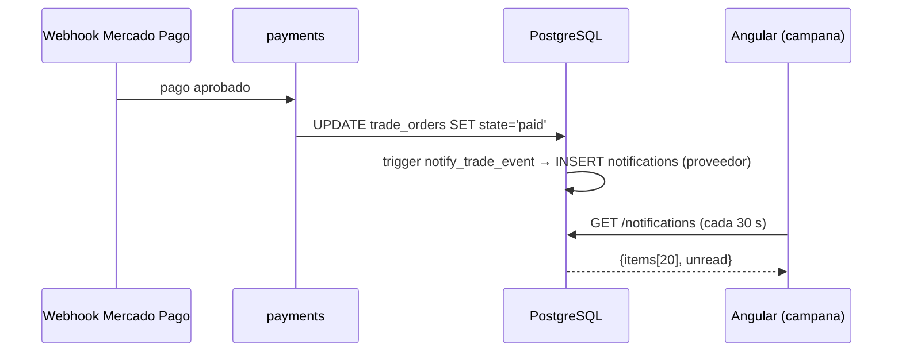

# Diseño — Avisos y «Volver a pedir»

## Resumen

- **Avisos:** se generan **en la base de datos** con triggers (`notify_trade_event()`) sobre `quotation_recipients`, `quotation_offers`, `quotation_requests` y `trade_orders`. Así ningún camino (API, webhook de Mercado Pago o worker) se olvida de avisar. Es el patrón **Observer** implementado con triggers.
- **Lectura:** `trade.controller.ts` expone `GET /notifications` y `POST /notifications/read`, implementados en `postgres-trade.ts`.
- **Volver a pedir:** `POST /orders/:id/reorder` reutiliza el método privado `createRequest()`, el mismo de una solicitud nueva, así que valida igual.
- **Angular:** componente `apps/web/src/notifications.ts` (campana, contador rojo, panel desplegable y consulta cada 30 s) y botón «↻ Volver a pedir» en el detalle del pedido entregado.

## Flujo

## Interfaces

| Ruta | Resultado |
|---|---|
| `GET /notifications` | `{items: [{id, kind, title, link, createdAt, read}], unread}` |
| `POST /notifications/read` | `{unread: 0}` |
| `POST /orders/:id/reorder` | Nueva solicitud de cotización |

## Modelo de datos (migración 012)

`notifications(id, company_id, kind, title ≤ 300, link que empieza con '/', created_at, read_at)` con índices por empresa y un índice parcial de no leídos. Tipos: `quote-request`, `offer`, `offer-accepted`, `order`, `order-paid`, `order-preparing`, `order-dispatched`, `order-delivered`.

## Decisiones

- **Triggers frente a llamadas en el código:** el webhook y los workers no pasan por el servicio web; con triggers el aviso es parte de la misma transacción que el cambio y no puede perderse ni duplicarse.
- **Consulta periódica (polling) de 30 s** en lugar de WebSockets: es suficiente para la demo y no agrega infraestructura.
- **Volver a pedir crea una solicitud, no un pedido:** los precios y el stock pueden haber cambiado, así que se vuelve a cotizar.

## Manejo de errores

401 sin sesión · 404 pedido ajeno o inexistente · 422 pedido no entregado.

## Estrategia de pruebas

| Requisito | Prueba |
|---|---|
| 1, 2, 3 | [`tests/fulfillment.integration.cjs`](../../../../tests/fulfillment.integration.cjs), subprueba «Avisos de cada paso y "Volver a pedir" tras la entrega» |
| 2.4 | Pruebas de navegador por rol: el administrador no consulta avisos ([`tests/catalog.browser.cjs`](../../../../tests/catalog.browser.cjs)) |
| Contrato | [`tests/openapi.test.cjs`](../../../../tests/openapi.test.cjs), etiqueta «Avisos» |
