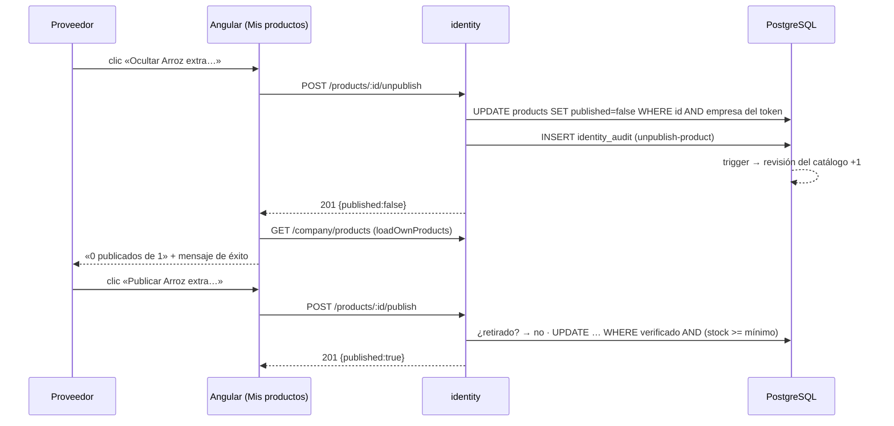

# Diseño Técnico — Mis productos y asistente de carga en 4 pasos

| Campo        | Valor                                                        |
| ------------ | ------------------------------------------------------------ |
| Proyecto     | MayoristaPro B2B                                             |
| Módulo       | 08 · Mis productos y asistente de carga en 4 pasos           |
| Metodología  | Spec-Driven Development (SDD)                                |
| Sprint       | Sprint 2                                                     |
| Estado       | Implementado ✓                                               |
| Curso        | IS-488 Arquitectura de Software · EPIS – UNSCH · 2026-II     |

---

## 1. Arquitectura del módulo

```
┌──────────────────────────────────────────────────────────────────┐
│             FRONTEND (Angular · /cuenta/productos)               │
│                                                                  │
│  identity.ts → sección «Mis productos» (solo con publish)        │
│    ├── Contador «N publicados de M» (publishedCount computed)    │
│    ├── Buscador por nombre o SKU (si hay más de 6)               │
│    ├── Fila: foto · nombre · SKU · precio · stock · estado       │
│    │     botón «Ocultar <nombre>» / «Publicar <nombre>»          │
│    │     o «Retirado: <motivo>»                                  │
│    └── <app-catalog-import (applied)="loadOwnProducts()">        │
│                                                                  │
│  catalog-import.ts → asistente                                   │
│    ol.import-steps (1 plantilla · 2 subir · 3 revisar · 4 conf.) │
│    <details> «¿Cómo lleno la plantilla?»                         │
│    <p role="status" aria-live="polite"> + señal failed()         │
│    tarjetas de resumen · «Descargar reporte CSV»                 │
└───────────────────────────────┬──────────────────────────────────┘
                                │ HTTPS · Bearer
                                ▼
┌──────────────────────────────────────────────────────────────────┐
│                  BACKEND (NestJS)                                │
│  identity  GET  company/products        → ownProducts()          │
│            POST products/:id/publish    → publish()              │
│            POST products/:id/unpublish  → unpublish()            │
│  catalog   rutas products/imports/...   → módulo 03              │
└───────────────────────────────┬──────────────────────────────────┘
                                │ pg
                                ▼
┌──────────────────────────────────────────────────────────────────┐
│ POSTGRESQL: products · product_images · companies · suppliers    │
│             identity_audit · trigger de revisión del catálogo    │
└──────────────────────────────────────────────────────────────────┘
```

### Secuencia: ocultar y volver a publicar



---

## 2. Diseño del backend — `identity.service.ts`

### `ownProducts(auth)`

```sql
SELECT p.id, p.sku, p.name, p.category, p.unit, p.stock, p.minimum, p.price::text, p.published,
       p.retired_reason AS "retiredReason",
       (SELECT i.url FROM product_images i WHERE i.product_id = p.id ORDER BY i.position LIMIT 1) AS photo
FROM products p JOIN companies c ON c.supplier_id = p.supplier_id
WHERE c.id = $1 ORDER BY p.name LIMIT 1000
```

Requiere `publish`; la empresa sale del token (`actor()`).

### `publish(id, auth)`

| Paso | Acción | Error |
| ---- | ------ | ----- |
| 1 | `uuid(id)` | 400 «Identificador inválido.» |
| 2 | `actor()` con permiso `publish` | 403 |
| 3 | ¿`retired_at` no nulo? | 403 «El administrador retiró este producto. Motivo: …» |
| 4 | `UPDATE products p SET published=true FROM suppliers s, companies c WHERE p.id=$1 AND p.supplier_id=s.id AND c.supplier_id=s.id AND c.id=$2 AND s.verified AND (p.published OR p.stock>=p.minimum)` | 403 «Requiere propiedad y proveedor verificado.» si no afecta filas |
| 5 | Auditar `publish-product` | — |

### `unpublish(id, auth)`

```sql
UPDATE products p SET published=false FROM companies c
WHERE p.id=$1 AND c.supplier_id=p.supplier_id AND c.id=$2 RETURNING p.id
```

Sin filas → 403 «Solo puedes ocultar tus propios productos.». Auditoría `unpublish-product`.

La regla de propiedad está **dentro del `WHERE`**: no hay una consulta previa que se pueda saltar ni una ventana entre comprobar y actualizar.

---

## 3. Diseño del frontend

### Panel «Mis productos» (`identity.ts`)

| Elemento | Implementación |
| -------- | -------------- |
| Visibilidad | Solo si la sesión tiene `publish` y el proveedor está verificado |
| Datos | Señal `ownProducts`; `publishedCount` es un `computed` |
| Búsqueda | Filtro local por nombre o SKU, visible con más de 6 productos |
| Botones | `[attr.aria-label]="'Ocultar ' + product.name"` / `'Publicar ' + product.name` |
| Recarga | `loadOwnProducts()` tras publicar u ocultar, tras confirmar una carga (`(applied)`) y al restaurar la sesión; conserva el mensaje de éxito |

### Asistente (`catalog-import.ts`)

| Elemento | Implementación |
| -------- | -------------- |
| Pasos | `<ol class="import-steps" aria-label="Pasos de la carga masiva">` |
| Ayuda | `<details><summary>¿Cómo lleno la plantilla?</summary>` con las reglas de cada columna |
| Validación previa | Extensión `.csv`/`.xlsx` y tamaño ≤ 5 MB antes de subir |
| Errores | Señal `failed()` cambia el estilo del mensaje; tabla con fila, columna y motivo |
| Confirmación | `Idempotency-Key` aleatoria y `previewHash` de la vista previa |
| Resultado | Tarjetas «creados» y «actualizados», reporte CSV con BOM y fórmulas escapadas, evento `applied` |

---

## 4. Modelo de datos utilizado

No agrega tablas. Usa:

| Tabla | Columnas usadas |
| ----- | --------------- |
| `products` | `id`, `sku`, `name`, `category`, `unit`, `stock`, `minimum`, `price`, `published`, `retired_reason`, `supplier_id` |
| `product_images` | `url` de la posición más baja (foto principal) |
| `companies`, `suppliers` | Empresa del token y `verified` |
| `identity_audit` | `publish-product`, `unpublish-product` |

---

## 5. Decisiones de diseño

| Decisión | Justificación |
| -------- | ------------- |
| Lista de productos en lugar de «ID del producto propio» | El proveedor no debería conocer UUID internos |
| El panel vive en «Mi cuenta» y solo aparece con `publish` | Evita botones que luego fallarían con 403 |
| Propiedad validada en el `WHERE` de la actualización | Una sola sentencia atómica; no se puede publicar un producto ajeno ni por carrera |
| Publicar exige `stock >= minimum` (salvo si ya estaba publicado) | No se ofrece en el catálogo algo que no se puede comprar |
| Asistente por pasos | Reduce errores de primera vez; los textos que usan las pruebas se conservaron |
| Reporte CSV con fórmulas escapadas | Abrir el reporte en Excel no ejecuta contenido malicioso |
| `minmax(0, 1fr)` y archivo al 100 % | Evitan el desborde horizontal en celular |

---

## 6. Manejo de errores

| Caso | HTTP | Mensaje |
| ---- | ---- | ------- |
| Sin sesión | 401 | — |
| Sin permiso `publish` | 403 | — |
| Ocultar un producto ajeno | 403 | «Solo puedes ocultar tus propios productos.» |
| Publicar sin propiedad, sin verificación o sin stock | 403 | «Requiere propiedad y proveedor verificado.» |
| Publicar un producto retirado | 403 | «El administrador retiró este producto. Motivo: …» |
| Archivo con extensión o tamaño inválido | — | Aviso en el paso 2, sin subir |
| Errores de importación | 400/409/413/422 | Se muestran dentro del paso correspondiente (ver módulo 03) |

---

## 7. Estrategia de pruebas

| Requisito | Prueba |
| --------- | ------ |
| RF-MIS-01 a 03 | `tests/identity.integration.cjs` · «mis productos: listar, ocultar y volver a publicar solo lo propio» |
| RF-MIS-01.5, 04, 05 | `tests/catalog.browser.cjs`: visibilidad por rol, recorrido Excel y Ocultar/Publicar |
| RF-MIS-05.4 | `tests/imports.integration.cjs` · «Encabezados mal escritos: el mensaje dice cuál falta y cuál sobra» |
| Recorrido completo | `tests/demo.browser.cjs` |
| RF-MIS-06 | Revisión visual de 320 a 1440 px |

---

## 8. Trazabilidad SDD

| Requisito | Función implementada |
| --------- | -------------------- |
| RF-MIS-01 | `ownProducts()` + sección `my-products` de `identity.ts` |
| RF-MIS-02 | `unpublish()` |
| RF-MIS-03 | `publish()` |
| RF-MIS-04 | `aria-label` de los botones, `loadOwnProducts()` |
| RF-MIS-05 | `catalog-import.ts` |
| RF-MIS-06 | `styles.css` (reglas responsive del asistente y el panel) |
