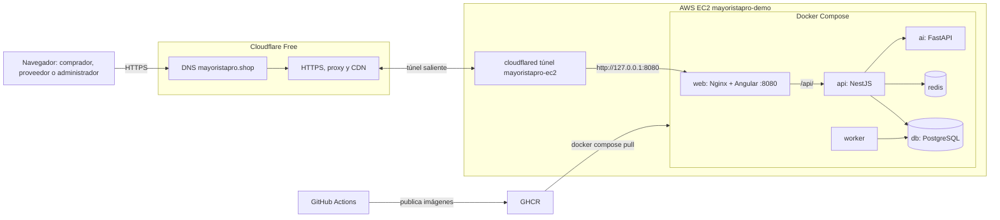

# Sprint 3: integración y despliegue

MayoristaPro B2B está publicado en **https://mayoristapro.shop**. Este documento responde a los cuatro entregables del Sprint 3: proyecto desplegado, plataforma, documentación técnica y repositorio reproducible.

## 1. Proyecto desplegado

| Dato | Valor |
|---|---|
| URL pública | https://mayoristapro.shop |
| Comprobación de la API | https://mayoristapro.shop/api/v1/products?limit=1 (responde JSON) |
| Versión desplegada | Imágenes del commit `7e81960` de `main`, publicadas por el workflow **Preparar imágenes para AWS** |
| Datos | Demo de 15 empresas y 450 productos (esquema `demo_mayoristapro150`) |

## 2. Plataforma y componentes

| Capa | Proveedor y servicio | Función |
|---|---|---|
| Dominio | Hostinger (registro de `mayoristapro.shop`) | Compra del dominio. Los nameservers se delegaron a Cloudflare. |
| DNS, HTTPS y CDN | Cloudflare Free | DNS del dominio, certificado HTTPS en el borde, proxy y caché de activos estáticos. |
| Ingreso | Cloudflare Tunnel `mayoristapro-ec2` (`cloudflared` en la instancia) | Conexión saliente desde EC2 hacia Cloudflare. El registro raíz `@` es un CNAME *proxied* al túnel. La instancia no abre puertos web a Internet. |
| Cómputo | AWS EC2, instancia `mayoristapro-demo` | Ejecuta todos los contenedores con Docker Compose, pagado con el crédito promocional de AWS. |
| Registro de imágenes | GitHub Container Registry (GHCR) | Imágenes `api`, `web` y `ai` etiquetadas con el SHA del commit. |
| Integración continua | GitHub Actions | `ci.yml` compila y prueba cada cambio; `aws-images.yml` construye, prueba y publica las imágenes. |

Cuentas de administración (los correos, contraseñas e identificadores de cuenta no se publican en el repositorio):

| Servicio | Cuenta | Acceso a la consola |
|---|---|---|
| AWS | Cuenta raíz creada con el correo institucional del autor, región `us-east-1` (Norte de Virginia), plan con crédito promocional | Navegador. A la instancia se entra con **EC2 Instance Connect** desde la consola; el grupo de seguridad solo permite SSH desde ese servicio de AWS y desde la IP del equipo usado al crearla. |
| Cloudflare | Correo personal del autor, plan Free | Navegador (`dash.cloudflare.com`). |
| Hostinger | Cuenta del autor | Solo registro del dominio y nameservers. |
| GitHub | `Yeltsin-MC` | Repositorio, Actions y GHCR. |

Contenedores dentro de la instancia (Docker Compose: `compose.yaml` + `compose.demo.yaml` + `compose.aws.yaml`, perfil `cache`):

| Contenedor | Tecnología | Exposición |
|---|---|---|
| `web` | Nginx 1.28 con Angular compilado | Solo `127.0.0.1:8080`; el túnel lo publica. Enruta `/api/` a NestJS. |
| `api` | NestJS 11 sobre Node.js 24 | Red interna. |
| `worker` | Mismo código de la API | Red interna. Expira reservas y reintenta webhooks cada 120 s. |
| `ai` | FastAPI (Python 3.11) | Red interna `backend`. Comparador de ofertas. |
| `db` | PostgreSQL | Red interna `backend`, volumen persistente. |
| `redis` | Redis 7.4 | Red interna `backend`. Caché del catálogo público. |
| `migrate` | Mismo código de la API | Se ejecuta al arrancar y termina. Aplica migraciones. |

La base de datos corre como contenedor dentro de la misma EC2, no en RDS. Así el crédito de US$ 100 cubre una sola instancia.



## 3. Integración entre componentes

Un pedido de la demo recorre todos los componentes:

1. El navegador carga Angular desde Cloudflare, que lo trae por el túnel desde Nginx.
2. Angular llama a `/api/v1/...` en el mismo dominio. Nginx lo reenvía a NestJS.
3. NestJS lee el catálogo de Redis o, si no está en caché, de PostgreSQL.
4. Para comparar ofertas, NestJS consulta al servicio FastAPI.
5. Las cotizaciones y pedidos se guardan en PostgreSQL. El worker procesa expiraciones en segundo plano.

## 4. Procedimiento de despliegue

El procedimiento completo, con los comandos, está en [aws-demo.md](aws-demo.md). En resumen:

1. **Construir imágenes.** En GitHub, *Actions → Preparar imágenes para AWS → Run workflow* sobre `main`. El workflow construye las tres imágenes, arranca la pila, comprueba los 450 productos y publica en GHCR con el SHA del commit.
2. **Preparar la instancia** (una sola vez). EC2 con Docker y Docker Compose 2.24.4 o superior, una copia del repositorio y un archivo privado `.env.demo` con `GHCR_IMAGE_PREFIX`, `RELEASE_SHA`, `PUBLIC_BASE_URL=https://mayoristapro.shop` y la contraseña de PostgreSQL.
3. **Cargar la base** (una sola vez): `migrate node deployment/start.cjs load-demo`.
4. **Arrancar**: `docker compose ... pull` y `up -d --wait`. Comprobar con `curl http://127.0.0.1:8080/api/v1/products?limit=1`.
5. **Publicar**: en Cloudflare Zero Trust, el túnel `mayoristapro-ec2` enruta `mayoristapro.shop` a `http://127.0.0.1:8080`. En DNS, el registro raíz es un CNAME *proxied* a `<id-del-túnel>.cfargotunnel.com`; reemplazó el registro A de estacionamiento de Hostinger.
6. **Actualizar**: el workflow manual **Desplegar en EC2** (`deploy-ec2.yml`) entra por SSH, cambia `RELEASE_SHA`, descarga las imágenes, reinicia la pila y ejecuta la prueba de humo contra la URL pública. Ver la sección siguiente.

### Despliegue continuo (CD)

`deploy-ec2.yml` se ejecuta a mano desde *Actions* y no corre hasta configurar en *Settings → Secrets and variables → Actions*:

| Nombre | Tipo | Valor |
|---|---|---|
| `EC2_HOST` | secret | IP pública o DNS de la instancia |
| `EC2_USER` | secret | Usuario SSH (por ejemplo `ubuntu` o `ec2-user`) |
| `EC2_SSH_KEY` | secret | Contenido de la llave privada `.pem` |
| `EC2_APP_DIR` | variable | Carpeta del repositorio en la instancia |

El grupo de seguridad debe permitir SSH (puerto 22) desde GitHub Actions. Si solo se permite desde tu IP, despliega a mano con [aws-demo.md](aws-demo.md).

## 5. Verificación

```bash
DEMO_URL=https://mayoristapro.shop node tests/deployment.smoke.cjs
```

La prueba comprueba la portada de Angular, el bundle JavaScript, el fallback SPA, el catálogo JSON con `no-store` y los errores JSON de la API.

Verificación manual para la presentación:

- [ ] La portada y el catálogo cargan desde un celular con datos móviles.
- [ ] Iniciar sesión como comprador demo.
- [ ] Enviar una cotización y verla como proveedor.
- [ ] La instancia `mayoristapro-demo` está *En ejecución* en la consola de AWS.

## 6. Guion de la demo (5 minutos)

| Tiempo | Qué mostrar |
|---|---|
| 0:00 – 1:00 | **Proyecto en funcionamiento.** Abrir https://mayoristapro.shop, recorrer la portada y buscar en el catálogo. |
| 1:00 – 2:00 | **Despliegue.** Consola de AWS con la instancia EC2 y panel de Cloudflare con el DNS y el túnel. Explicar el diagrama de la sección 2. |
| 2:00 – 3:30 | **Integración.** Iniciar sesión como comprador, agregar productos con precio por volumen y enviar la cotización. Mostrar en DevTools → Network la llamada a `/api/v1/...`. |
| 3:30 – 4:30 | **Evidencias.** Repositorio en GitHub: estructura, `docs/`, ejecuciones verdes de GitHub Actions e imágenes en *Packages*. |
| 4:30 – 5:00 | Cierre: tecnologías principales y siguientes pasos. |

## 7. Repositorio

El repositorio contiene el código, los Dockerfiles (`deployment/`), los archivos Compose, los workflows (`.github/workflows/`) y esta documentación. Si es privado, compartirlo con la docente (Lizbeth.jaico@unsch.edu.pe) en *Settings → Collaborators*.
